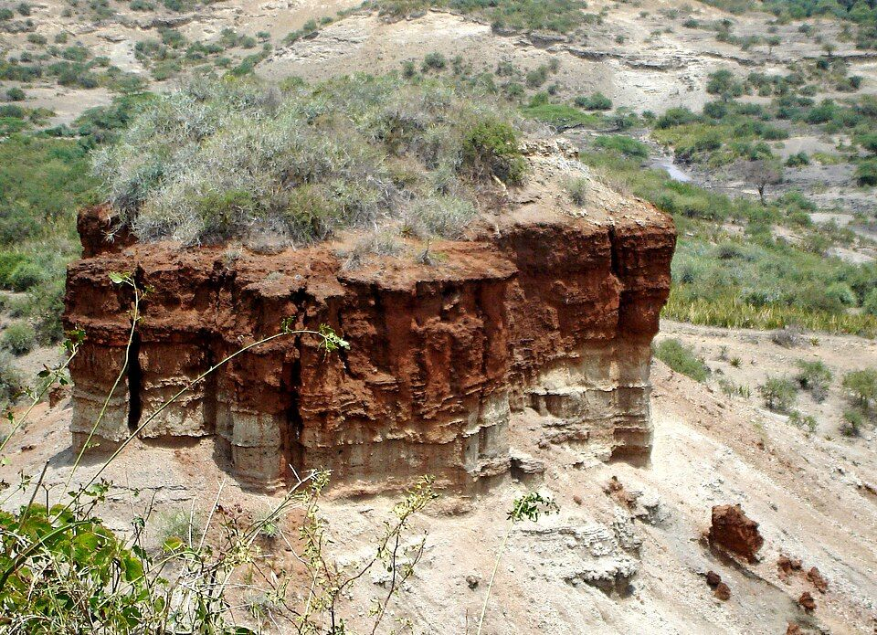
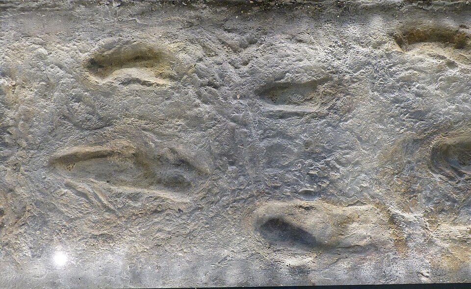
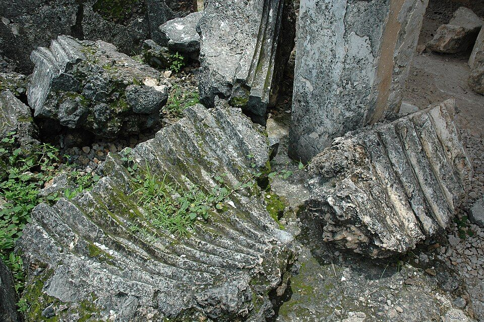
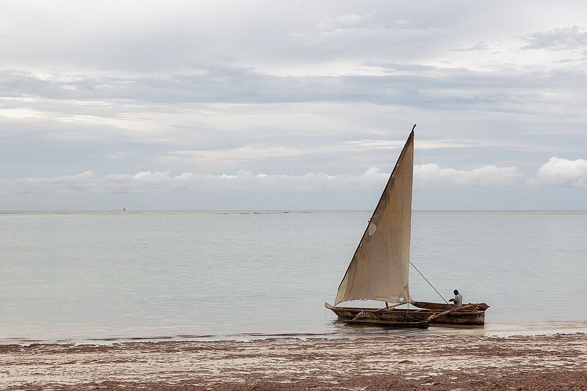
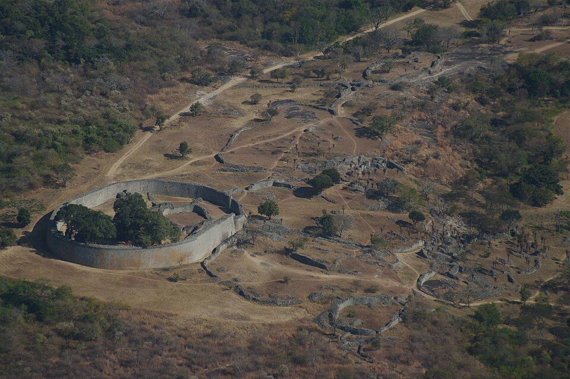
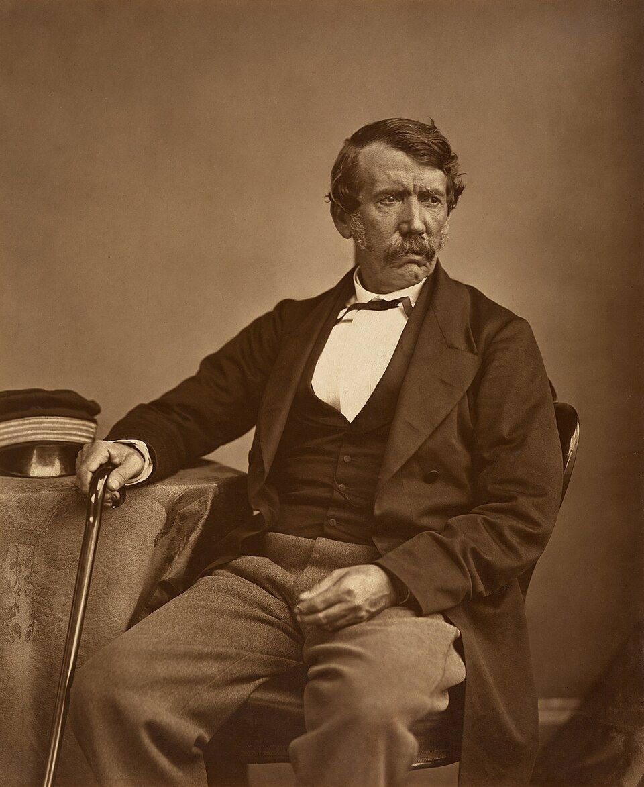
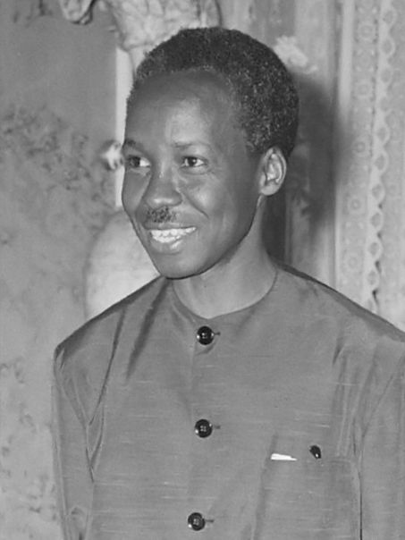
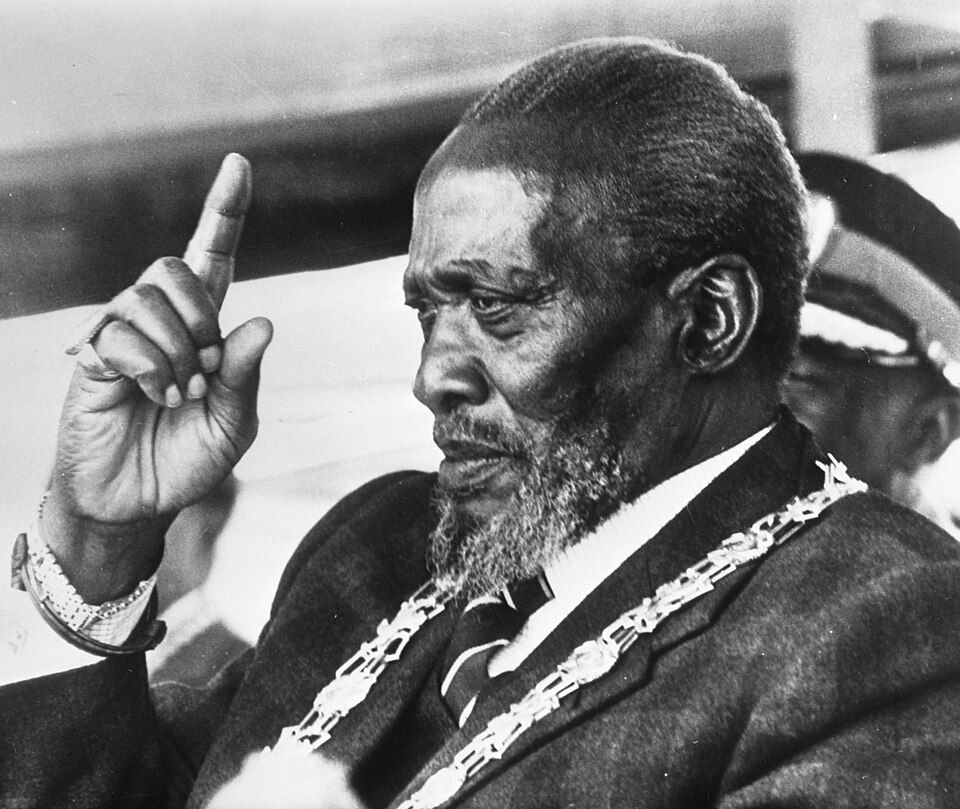
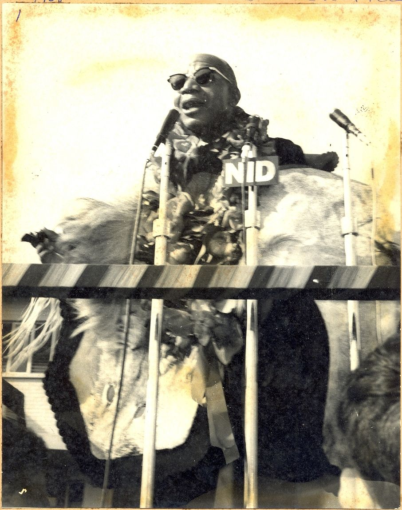

# 2. 歴史

## この章でわかること

- 人類が生まれた大陸としてのアフリカ
- 植民地になる前の王国と、交易
- 奴隷貿易と、ヨーロッパによる分割
- 独立と、そのあと
- タンザニア・ケニア・マラウイの歩み

## 年表

| いつ | できごと |
| --- | --- |
| 約700万年前〜 | 人類の祖先がアフリカで生まれる |
| 約30万年前 | いまの人類（ホモ・サピエンス）が現れる。約6万年前からほかの大陸へ広がる |
| 前3000年ごろ | 古代エジプトの王国 |
| 1〜7世紀 | アクスム王国（エチオピア）。4世紀にキリスト教が入る |
| 8〜16世紀 | 西アフリカのガーナ・マリ・ソンガイ王国。サハラを越えて金と塩を取引 |
| 10〜15世紀 | 東海岸のスワヒリの町（キルワ・モンバサ・ザンジバル）がインド洋の交易で栄える |
| 11〜15世紀 | グレート・ジンバブエ（石造りの都） |
| 1498年 | ポルトガルのバスコ・ダ・ガマが東海岸に来る |
| 16〜19世紀 | 大西洋の奴隷貿易。約1,250万人がアメリカ大陸へ運ばれた |
| 19世紀 | ザンジバルが東アフリカの奴隷・象牙・クローブの交易の中心になる |
| 1884〜85年 | ベルリン会議。ヨーロッパの国々がアフリカを分ける決まりを作る |
| 1914年ごろ | 独立を保っていたのはエチオピアとリベリアだけになる |
| 1957年 | ガーナが、サハラより南で最初に独立 |
| 1960年 | 「アフリカの年」。17か国が独立 |
| 1961〜64年 | タンガニーカ・ケニア・マラウイが独立。タンザニアが生まれる |
| 1963年 | アフリカ統一機構（OAU）ができる。2002年にアフリカ連合（AU）になる |
| 1994年 | 南アフリカでアパルトヘイト（人種隔離）が終わり、マンデラが大統領に。ルワンダで虐殺 |
| 2007年 | ケニアで携帯電話のお金 M-Pesa が始まる |
| 2021年 | アフリカ大陸自由貿易圏（AfCFTA）の取引が始まる |

## 人類のふるさと

- 人類の祖先の化石は、大地溝帯の周りで多く見つかっています
- タンザニアの**オルドバイ渓谷**では、リーキー夫妻が初期の人類の化石と石器を見つけました。近くのラエトリには、約366万年前の、2本足で歩いた足あとが残っています
- エチオピアでは、約320万年前の「ルーシー」の骨が見つかっています
- 世界中の人の祖先をたどると、アフリカに行き着きます

## 植民地になる前の王国と交易

- アフリカには、ヨーロッパ人が来るずっと前から、大きな王国と町がありました
- **西アフリカ**: マリ王国のマンサ・ムーサ王は、1324年のメッカ巡礼で大量の金を配り、エジプトの金の値段が下がったと伝えられます。トンブクトゥは学問の町でした
- **東アフリカの海岸**: アラビア・ペルシャ・インド・中国と、季節風に乗って船で取引しました。この交易の中で、バントゥー系の言葉にアラビア語の単語が入って、**スワヒリ語**が生まれました。「スワヒリ」はアラビア語で「海岸の人」という意味です
- 15世紀はじめには、中国の明の鄭和の船団がケニアのマリンディまで来ています

## 奴隷貿易

- 16〜19世紀の大西洋の奴隷貿易で、約1,250万人がアメリカ大陸へ運ばれました。運ばれる途中で多くの人が亡くなりました
- 東アフリカでも、内陸の人々がザンジバルに連れて来られ、アラビアやインド洋の島々に売られました。ザンジバルの奴隷市場は1873年に閉じられ、いまはその場所に教会が建っています
- 働き手が大量に連れ去られたことは、その地域の人口と経済に長く傷を残しました

## ヨーロッパによる分割と植民地

- 19世紀に、リビングストン（マラウイ湖を訪れたイギリスの宣教師）などの探検家が内陸に入りました
- 1884〜85年のベルリン会議で、ヨーロッパの国々はアフリカを分ける決まりを作りました。民族や言葉を考えずに引いた国境が、いまの国境のもとになっています
- 植民地では、ヨーロッパに送るための作物（茶・コーヒー・綿・たばこ・サイザル麻）と鉱物の生産が進められ、道路や鉄道も港へ運ぶために作られました

## 独立とそのあと

- 1950〜60年代に、ほとんどの国が独立しました
- 独立のあと、多くの国で、1つの政党だけが政治をする体制や、軍のクーデターが続きました。冷戦の中で、アメリカとソ連がそれぞれの側の政権を助けました
- 1980年代には借金が返せなくなる国が増え、国際通貨基金（IMF）・世界銀行の指導で、補助金を減らし国の会社を民営化する「構造調整」が行われました
- 1990年代からは、複数の政党で選挙をする国が増えました
- 2000年代からは、資源の値上がりと携帯電話の広がりで、経済が大きく伸びた国が多くあります

## 3か国の歩み

### タンザニア

- 19世紀末からドイツ領東アフリカ。1905〜07年に、ドイツの支配と綿の強制栽培に反対した「マジマジの反乱」が起きた
- 第一次世界大戦のあと、イギリスが治めるタンガニーカになる
- 1961年にタンガニーカが独立（初代大統領ニエレレ）。1964年に、革命の起きたザンジバルと一つになり、**タンザニア**になった
- ニエレレは「**ウジャマー**」（スワヒリ語で「家族のきずな」）という、村に集まって共同で農業をするアフリカ式の社会主義を進めたが、経済はうまくいかなかった。一方で、**スワヒリ語を国じゅうで使う**ようにして、120以上の民族がまとまる国を作った
- 1992年に複数の政党を認めた。独立のときから同じ政党（いまは CCM、革命党）が政権を続けている

### ケニア

- 1895年からイギリスの保護領、1920年から植民地
- イギリスはモンバサからビクトリア湖までの鉄道を作り（1901年に完成）、そのためにインドから多くの人を連れてきた。ナイロビは、この鉄道の基地として生まれた町。インド系の人たちは、いまもケニアの商売で大きな役割をもっている
- 涼しい高原（「ホワイト・ハイランド」）はヨーロッパ人の農場になり、アフリカ人は土地を失った
- 1952〜60年に、土地と自由を求める「**マウマウの闘い**」が起き、イギリスは非常事態を出して厳しく取りしまった
- 1963年に独立（初代大統領ジョモ・ケニヤッタ）
- 2007〜08年の選挙のあと、民族どうしの争いで1,000人以上が亡くなった。2010年に新しい憲法を作り、国を47の郡（カウンティ）に分けて、農業などの仕事を郡に任せた

### マラウイ

- 1859年にリビングストンがマラウイ湖を訪れた。南部の町ブランタイヤの名前は、リビングストンの生まれたスコットランドの町から
- 1891年からイギリスの保護領（1907年から「ニヤサランド」とよばれた）。1953〜63年はローデシア（いまのザンビア・ジンバブエ）と一つの連邦にされた
- 1964年に独立（バンダ大統領）。バンダは1つの政党だけの体制で、「終身大統領」として30年近く国を治めた
- 1994年に複数の政党での選挙が始まった
- 2019年の大統領選挙は、不正があったとして裁判所が無効にし、2020年のやり直し選挙で野党のチャクウェラが勝った。アフリカでは珍しい例として注目された

