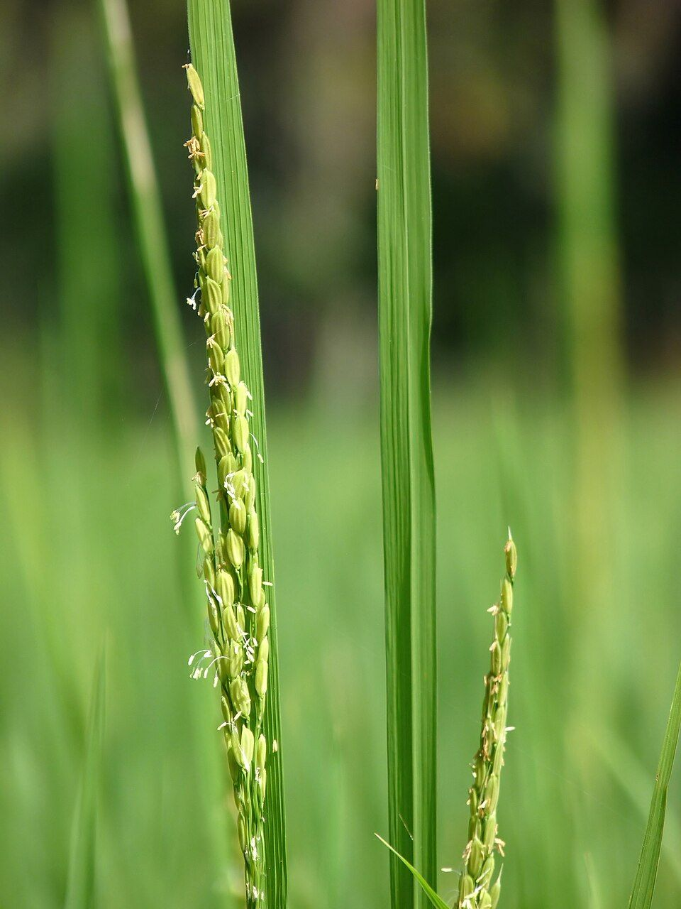
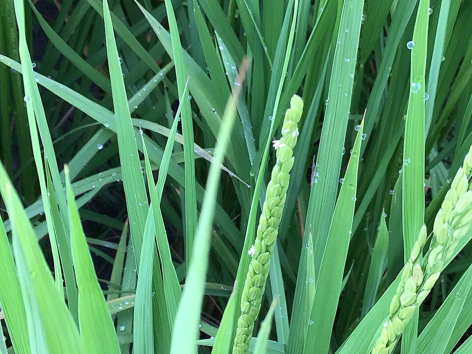

# 2. 稲の育ち方

## この章でわかること

- 稲のからだ（根・茎・葉・穂）
- 葉の数で育ち具合をはかる（葉齢）
- 分げつ・幼穂形成・出穂・登熟
- 収量はどう決まるか（収量構成要素）
- 冷害と高温障害

## 稲のからだ

- 稲は**イネ科**の草です。麦・とうもろこし・ヒエなども同じ仲間
- **根**: ひげ根。田んぼの水の中でも息ができるように、茎や根の中に空気の通り道（通気組織）があります
- **茎**（稈、かん）: 節があり、中は空洞。いちばん最初の茎を**主稈**（しゅかん）といいます
- **葉**: 葉身（細長い部分）と、茎を包む葉鞘（ようしょう）。主稈には、品種によって13〜17枚ほどの葉が順に出ます。最後の葉を**止葉**（とめば）といい、穂を太らせる大事な葉です
- **穂**: 茎の先に出る。1つの穂に、籾が80〜120粒ほど付きます

## 育ち方の段階

稲の一生は、大きく2つに分かれます。

| 段階 | 時期（本州中部・5月田植えの例） | 何が起きるか |
| --- | --- | --- |
| **栄養成長期** | 田植え〜7月上旬 | 葉と茎（分げつ）を増やし、からだを大きくする |
| **生殖成長期** | 7月上旬〜出穂 | 茎の中で穂を作る（幼穂形成）。穂が茎の中を上がってくる |
| **登熟期** | 出穂〜9月 | 葉で作ったでんぷんを籾に送り、米を太らせる |

### 葉齢（ようれい）

- 主稈に何枚目の葉が出ているかを**葉齢**といいます。「4.5葉」なら、4枚目が開ききって、5枚目が半分出ている状態
- 稲は、葉の数で育ち具合がそろっているので、「何月何日」より葉齢で作業を決めるほうが確かです（例: 苗は2.0〜2.5葉で植える。中干しは止葉の数枚前から）
- 1枚の葉が出るのに、暖かい時期で5日ほどかかります

### 分げつ（ぶんげつ）

- 茎の根もとの節から、新しい茎が枝分かれして出ることを**分げつ**といいます。田植えのとき1株3〜5本の苗が、1株20本以上に増えることもあります
- 分げつした茎のすべてに穂が出るわけではありません。遅く出た細い茎は、穂を出さずに終わります（**無効分げつ**）
- 穂を出す茎（**有効茎**）がちょうどよい数になったら、それ以上増やさないように水を抜きます（**中干し**、4章）。茎が多すぎると、1本1本の穂が小さくなり、倒れやすく、病気も出やすくなるからです

### 幼穂形成期（ようすいけいせいき）

- 出穂の**約25日前**、茎の根もとで小さな穂（**幼穂**）ができ始めます。最初は1〜2 mm
- このころに追加でやる肥料を**穂肥**（ほごえ）といいます。籾の数を増やし、実りを良くします（4章）
- 出穂の **10〜12日前**は、花粉ができる**減数分裂期**です。このとき気温が低い（17 ℃より下）と、花粉がうまくできず、実が入らない籾（**不稔**）になります。これが**冷害**です

### 出穂と開花

- 穂が止葉の葉鞘から出てくることを**出穂**（しゅっすい）といいます。田んぼの半分の茎から穂が出た日を「出穂期」と呼びます
- 出穂した日に、穂の先から順に花が咲きます。稲の花は、籾がぱかっと開いて、おしべが出るだけの地味な花です
- 稲は、ほとんど**自分の花粉で受粉**します（自家受粉）。そのため、品種の性質が親から子へそのまま伝わります
- 開花のとき、気温が35 ℃をこえると、受粉がうまくいかないことがあります

### 登熟（とうじゅく）

- 受粉した籾に、葉で作ったでんぷんが運ばれ、米が太っていきます
  - 乳熟期（中が白い液）→ 糊熟期（のり状）→ 黄熟期（固くなり、籾が黄色くなる）→ 完熟期
- 出穂から収穫まで、毎日の平均気温を足した値（**積算気温**）が 1,000 ℃前後になったころが刈りどきの目安です（夏の平均が25 ℃なら40日ほど）
- 穂が重くなって、首をたれます。「実るほど頭を垂れる稲穂かな」

## 収量はどう決まるか

米の収量は、4つの数をかけ算して決まります（**収量構成要素**）。

> 収量 ＝ 1 m² の穂の数 × 1 穂の籾の数 × 登熟歩合（実が入った籾の割合）× 千粒重（玄米1,000粒の重さ）

計算の例（コシヒカリくらい）:

| 要素 | 値 |
| --- | --- |
| 1 m² の穂の数 | 400本 |
| 1 穂の籾の数 | 80粒 → 1 m² に 32,000粒 |
| 登熟歩合 | 85% → 27,200粒 |
| 千粒重 | 21 g → 27,200 ÷ 1,000 × 21 ＝ 571 g |

- 1 m² で約 570 g なので、10a（1,000 m²）で約 570 kg（約9.5俵）
- それぞれの数は、決まる時期がちがいます
  - 穂の数: 分げつの時期（田植え〜中干し）
  - 籾の数: 幼穂形成期（穂肥）
  - 登熟歩合と千粒重: 出穂のあと（天気・葉の元気さ・水）
- 4つは**取り合いの関係**です。穂の数を増やしすぎると、1穂の籾が減り、実の入りも悪くなります。ちょうどよいバランスをねらいます

## 冷害と高温障害

| 障害 | いつ・何で起きるか | 何が起きるか | 対策 |
| --- | --- | --- | --- |
| **障害型冷害** | 減数分裂期（出穂の10〜12日前）に 17 ℃より低い | 花粉ができず、実が入らない（不稔）。1993年の大冷害は作況74 | 深水（水を15〜20 cm に深くして、幼穂を水で守る） |
| **遅延型冷害** | 夏全体が涼しい | 出穂がおくれ、秋の寒さで実りきらない | 早く育つ品種、早めの田植え |
| **高温障害** | 出穂後20日間の平均気温が 26〜27 ℃より高い | 米が白くにごる（**白未熟粒**）、ひびが入る（胴割れ）。等級が下がる | 田植えを遅らせる、暑さに強い品種、かけ流しで水温を下げる、肥料を切らさない |

- 最近は、冷害より**高温障害**が大きな問題です。2023年の猛暑では、新潟のコシヒカリの1等米の割合が大きく下がりました
- そのため、暑さに強い品種（にじのきらめき・つや姫・新之助・きぬむすめなど）への切りかえや、作る時期をずらす工夫が進んでいます
