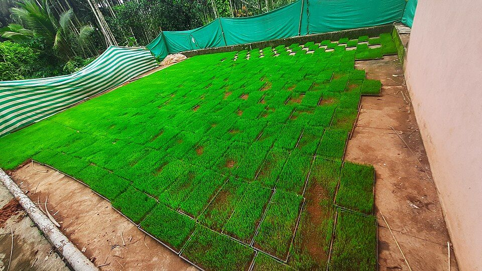
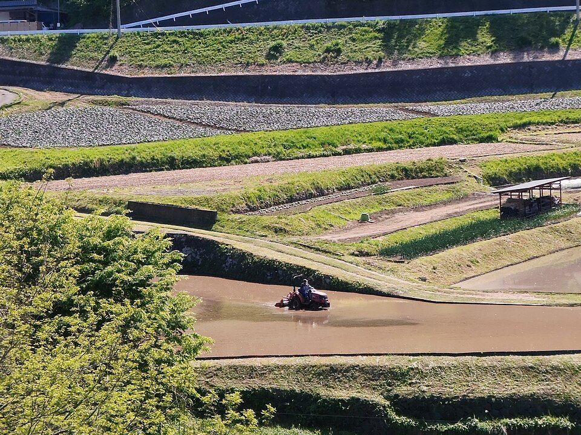
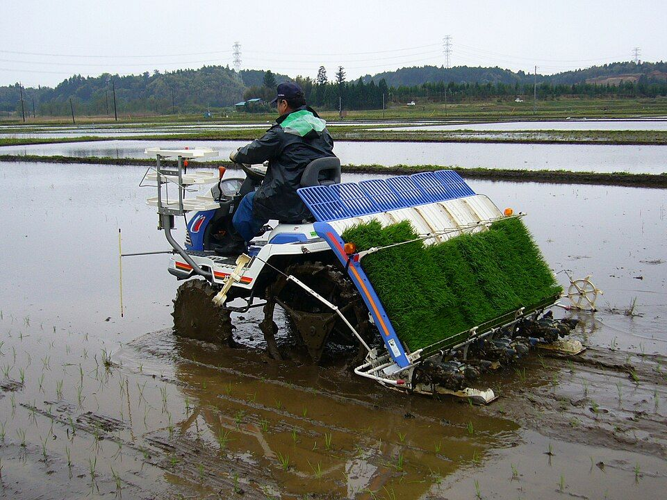
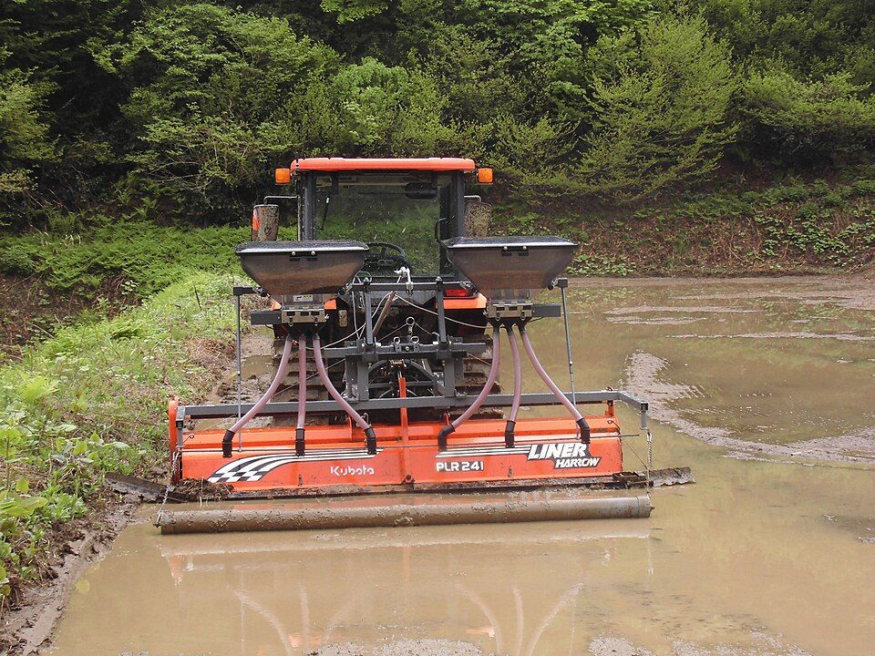

# 3. 種もみから田植えまで

## この章でわかること

- 種もみの準備（塩水選・消毒・浸種・催芽）
- 苗の育て方（箱育苗、稚苗と中苗、密苗）
- 田起こしと代かき
- 田植えのやり方
- 直播（じかまき）

「苗半作」（なえはんさく）という言葉があります。良い苗を作れば、それだけで半分は成功、という意味です。

## 種もみの準備

| 作業 | やり方 | 目的 |
| --- | --- | --- |
| **塩水選** | 塩水（比重1.13。うるち米の場合、水10 L に塩約2 kg）に種もみを入れ、浮いたものを捨てる | 中身が詰まった重い種だけを選ぶ |
| **種子消毒** | 60 ℃のお湯に10分つける（**温湯消毒**）か、薬（殺菌剤）につける | 種につく病気（ばか苗病・いもち病など）を防ぐ |
| **浸種** | 水（10〜15 ℃）に7〜10日つける。水の温度 × 日数 ＝ 約100 ℃ が目安（例: 12 ℃ なら約8日） | 種に水を吸わせ、芽が出る準備をさせる |
| **催芽** | 30〜32 ℃ の水に1日ほどつける | 芽をそろえて少しだけ出す（**ハト胸**。白い芽が1 mm ほど） |

- 種もみは、毎年 病気のない**採種ほ**（種を作るための専用の田んぼ）で作られたものを買って使うのがふつうです。自分の田んぼの米を種にすると、病気や他の品種の混ざりが増えます
- 温湯消毒は農薬を使わないので、有機の米づくりや、減農薬の米でよく使われます。温度と時間が少しずれると、芽が出なくなったり、消毒できなかったりします

## 苗を育てる（育苗）

- いまの田植えは、ほとんどが**箱育苗**です。プラスチックの**育苗箱**（約60 × 30 cm）に土を入れ、種もみをまき、ハウスや畑で育てます
- 手順
  1. 箱に床土（とこつち、肥料入りの土）を入れ、水をかける
  2. 催芽した種もみをまき、覆土（ふくど）をかける
  3. 30〜32 ℃で2〜3日、芽を出させる（**出芽**）
  4. 弱い光で1〜2日、緑にする（**緑化**）
  5. 外の温度に少しずつ慣らして、丈夫にする（**硬化**）。昼は25 ℃をこえないよう、ハウスの換気に気をつける

| 苗の種類 | 1箱にまく種もみ（乾いた重さ） | 育てる日数 | 植えるときの葉齢 | 10a に使う箱の数 |
| --- | --- | --- | --- | --- |
| 稚苗（ちびょう） | 150〜180 g | 20〜25日 | 2.0〜2.5葉 | 15〜20箱 |
| 中苗（ちゅうびょう） | 80〜100 g | 30〜35日 | 3.0〜4.0葉 | 20〜25箱 |
| **密苗**（みつびょう） | 250〜300 g | 15〜20日 | 2.0葉ほど | 6〜8箱 |

- 稚苗が全国でいちばん多い。寒い地方（北海道など）は、寒さに強い中苗や、ポットに1本ずつ育てる**ポット苗**も使います
- **密苗**は、種を多くまいて、箱の数を3分の1ほどに減らす方法です。苗を運ぶ手間と、ハウスや資材の費用が大きく減るので、大きな農家で広がっています（専用の田植え機が必要）
- 苗の病気: 苗立枯病（カビ）、ばか苗病（ひょろ長くなる）、むれ苗（高温と急な冷え）

## 田起こしと代かき

- **田起こし**（耕起）: 春、乾いた田んぼをトラクターで耕し、去年のわらや切り株を土に混ぜる。15 cm ほどの深さ
- **代かき**（しろかき）: 田植えの数日前に水を入れ、土を細かくかきまぜて、どろどろで平らにする
  - 田んぼの水もちを良くする（すき間をふさぐ）
  - 表面を平らにして、水の深さをそろえる（深い所と浅い所があると、苗の育ちと雑草の生え方がばらばらになる）
  - 雑草を土に埋め、苗が植えやすいやわらかい土にする
- 田んぼの高さの差は、±2〜3 cm 以内が目安です。最近は、レーザーや GNSS で高さを測って平らにする機械（レベラー）もあります
- 代かきの濁った水を川に流さないように、水を入れすぎない、すぐに排水しない、という注意が要ります

## 田植え

- 乗用の**田植え機**で、6〜8条（列）を同時に植えるのがふつうです。1台で1日に数 ha 植えられます
- 植え方の目安

| 項目 | 目安 |
| --- | --- |
| 条間（列のあいだ） | 30 cm |
| 株間（同じ列の株のあいだ） | 15〜20 cm（1 m² に 16〜22株） |
| 1株の苗の本数 | 3〜5本 |
| 植える深さ | 2〜3 cm |
| 水の深さ | 1〜3 cm（浅いほうが植えやすい） |

- 浅すぎると苗が浮き、深すぎると分げつが遅れます
- 株間を広くして株の数を減らす**疎植**（そしょく）にすると、苗の箱が減り、作業が楽になります。そのかわり穂の数が足りなくならないよう注意します
- 田植えの時期は、北海道・東北が5月中〜下旬、関東・北陸が4月下旬〜5月、西日本は6月が多い。高温障害を避けるため、最近は時期を少し遅らせる地域もあります

## 直播（じかまき）

- 苗を作らず、田んぼに種もみを直接まく方法です。苗づくりと田植えの手間がなくなり、春の仕事が大きく減ります
- やり方は2つ

| やり方 | 中身 |
| --- | --- |
| **湛水直播**（たんすい） | 代かきした水のある田んぼにまく。鉄の粉をまぶした種（鉄コーティング）で、鳥に食べられにくく、浮きにくくする |
| **乾田直播**（かんでん） | 水を入れる前の乾いた田んぼに、麦や大豆のように種まき機でまく。芽が出てから水を入れる。畑の機械が使えるので、大きな農家に向く |

- 難しい点: 芽がそろいにくい、雑草が多い、倒れやすい、鳥やジャンボタニシの害。収量が田植えより少し低いことが多い
- 全国の田んぼの数%ですが、人手が減る中で、少しずつ増えています。ドローンで種をまく方法もあります（12章）
