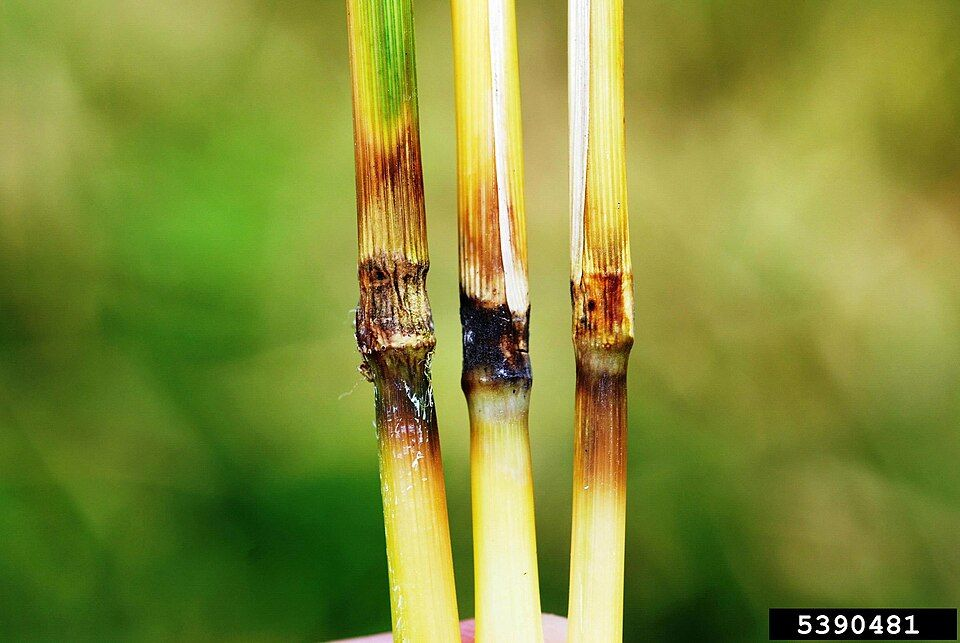
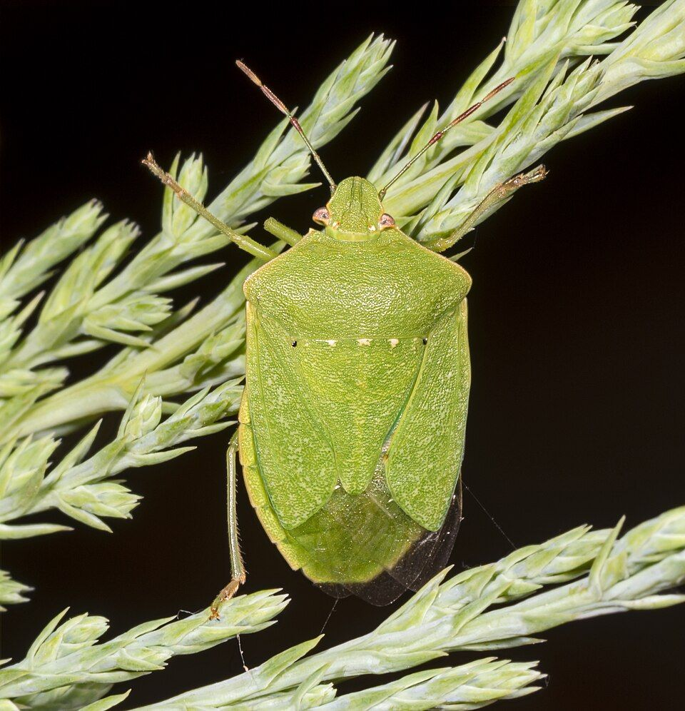
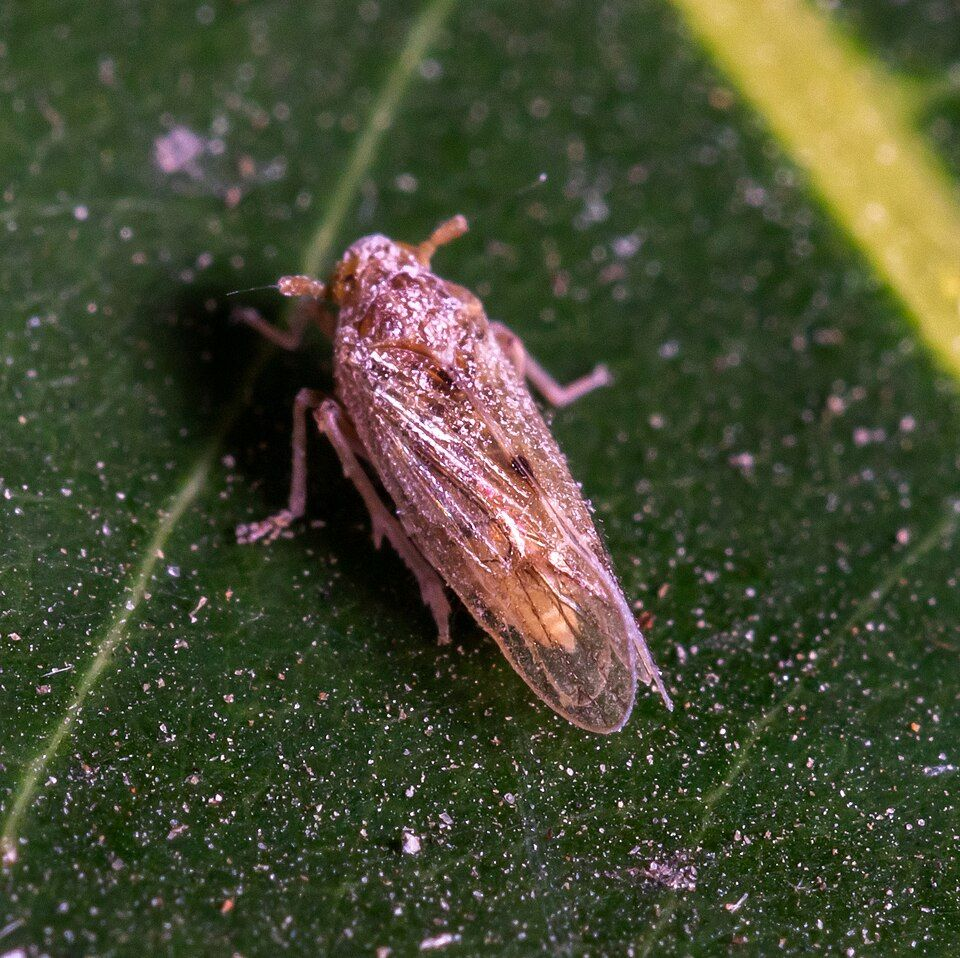
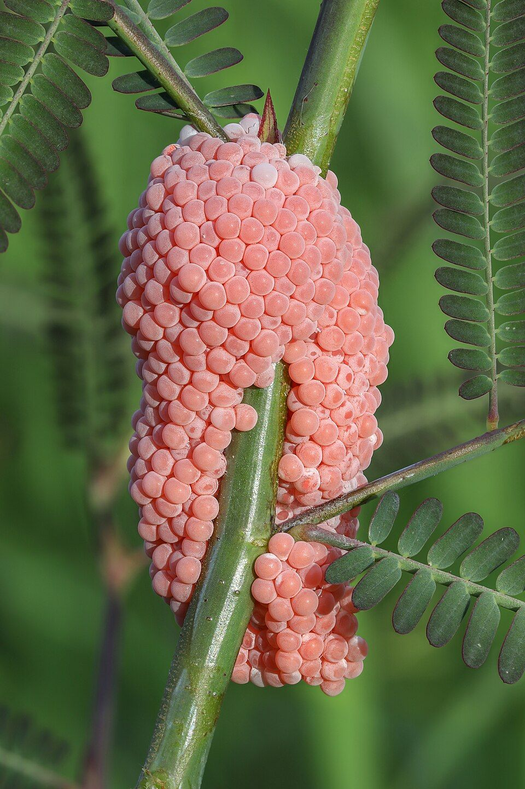
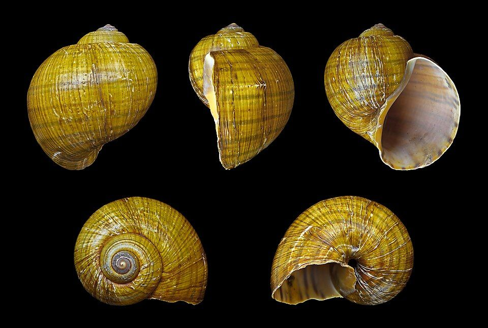
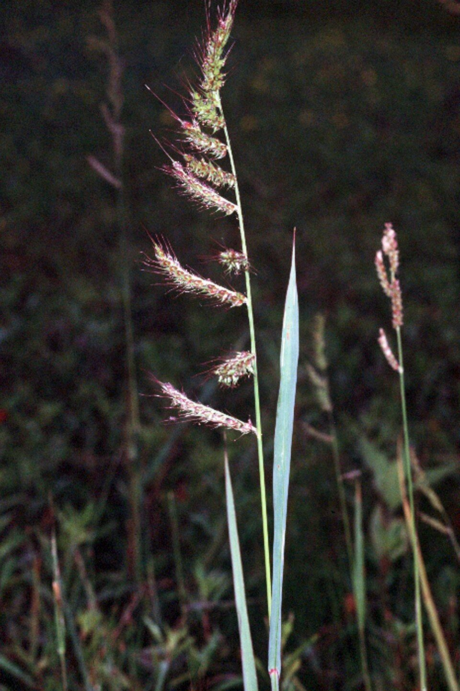
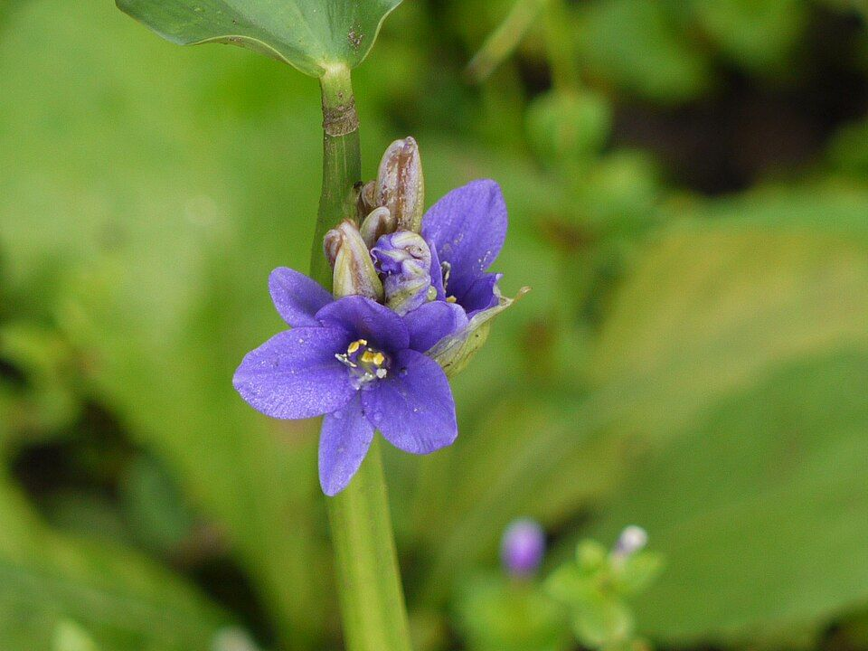

# 5. 病気・害虫・雑草

## この章でわかること

- いちばん怖い病気「いもち病」と、ほかのおもな病気
- 米の等級を下げるカメムシ、海を渡ってくるウンカ
- ジャンボタニシ
- 田んぼの雑草と除草剤

農薬をまく回数や量は、地域の**防除暦**（ぼうじょれき。県やJAが出す、いつ何をまくかの表）と、**発生予察**（県の病害虫防除所が出す、病気と虫の出かたの予報）を見て決めます。農薬は、ラベルに書かれた作物・量・回数・時期を必ず守ります（農薬取締法）。

## 病気

### いもち病

- 稲でいちばん被害の大きい病気です。カビ（糸状菌）がうつります
- 出る場所で呼び方が変わります
  - **葉いもち**: 葉に、紡錘形（両端のとがった形）の褐色の斑点。ひどいと株が育たなくなる（ずりこみ）
  - **穂いもち**: 穂の首や枝が黒くなり、その先の籾が実らない（白穂）。収量に直接ひびく
- 出やすい条件: **低い気温と長雨**（梅雨・冷夏）、**窒素の多すぎ**、葉が濡れている時間が長い
- 対策
  - 強い品種、病気のない種もみと温湯消毒
  - 窒素をやりすぎない
  - 箱に入れる薬（**箱施用剤**。田植えの前に苗箱にまく）で、葉いもちを長く防ぐ
  - 穂いもちは、出穂の前後に殺菌剤をまく
  - 補植用に田んぼの隅に置いた余り苗は、病気のもとになるので早く片付ける

### ほかの病気

| 病気 | うつすもの | 症状 | 対策 |
| --- | --- | --- | --- |
| 紋枯病（もんがれ） | カビ | 株もとの葉鞘に、雲形の模様。夏の高温・多湿、茎が多すぎると出る | 殺菌剤、茎を増やしすぎない |
| ばか苗病 | カビ（種につく） | 苗がひょろ長く伸び、のちに枯れる | 種子消毒 |
| 縞葉枯病（しまはがれ） | ウイルス（ヒメトビウンカが運ぶ） | 葉に黄色い縞、穂が出ない | 強い品種、ウンカの防除 |
| 稲こうじ病 | カビ | 籾が緑の玉（稲こうじ）になる | 穂ばらみ期の殺菌剤 |

## 害虫

### 斑点米カメムシ

- カメムシが、まだやわらかい籾の汁を吸うと、その跡が茶色〜黒の**斑点米**（はんてんまい）になります
- 食べても害はありませんが、玄米1,000粒に1粒（0.1%）より多く入ると**2等米**、0.3%より多いと3等米になり、値段が下がります（6章）
- 日本の田んぼでは、アカスジカスミカメ・アカヒゲホソミドリカスミカメなどの小さなカメムシが多い。暖かい地方ではミナミアオカメムシも増えています
- 対策
  - カメムシは、あぜや周りの草地（イネ科の雑草の穂）で増えて、稲の穂が出ると田んぼに入ってきます。**出穂の2週間前ごろまでに、あぜの草刈り**をして、すみかを減らす（直前に刈ると、かえって田んぼに追い込むので注意）
  - 出穂の7〜10日後と、その1週間ほど後に殺虫剤
  - 色彩選別機（6章）で、黒い粒をはじく

### ウンカ

- **トビイロウンカ**・セジロウンカは、日本では冬をこせず、毎年 梅雨のころに中国大陸から**風に乗って飛んでくる**虫です
- 夏の終わりに田んぼで何世代も増え、トビイロウンカが多いと、株もとの汁を吸われた稲が丸い範囲で倒れて枯れます（**坪枯れ**）。2019〜2020年に西日本で大発生しました
- 国と県が、飛んでくる時期と量を予報しています。株もとをのぞいて、虫の数を数えることが大事です
- ヒメトビウンカは日本で冬をこし、縞葉枯病のウイルスを運びます

### ジャンボタニシ

- 正式な名前は**スクミリンゴガイ**。南アメリカの貝で、1980年代に食用として輸入されたものが逃げ出し、九州・四国・関東などの暖かい地方の田んぼに広がりました
- 田植えのあとの、やわらかい苗を食べてしまいます
- 対策
  - 冬に田んぼを耕して、土の中で冬をこす貝を壊す・寒さにさらす
  - 水路に網を付けて入らせない
  - 田植えのあと3週間ほどは、**水を浅く**（4 cm 以下）して、貝が動きにくくする
  - 薬（貝を殺す粒の剤）をまく
- 「除草に使える」という話がネットで広まったことがありますが、ほかの田んぼにも広がるので、国は**わざと放さない**ように呼びかけています

## 雑草

- 田んぼの雑草は、稲と光・養分・水を取り合い、多いと収量が大きく下がります
- 代表的な田んぼの雑草

| 雑草 | 仲間 | 特徴 |
| --- | --- | --- |
| **ノビエ**（タイヌビエ・イヌビエ） | イネ科 | 稲とそっくり。最も被害が大きい |
| **コナギ** | ミズアオイ科 | 青紫の花。窒素をよく吸う |
| ホタルイ | カヤツリグサ科 | 丸い茎。除草剤が効きにくい性質のものが出ている |
| クログワイ・オモダカ | 多年生（球根のような塊茎で増える） | 何年も同じ場所に出る。根絶が難しい |
| アゼナ・キカシグサ | 一年生の広葉 | 小さく、数が多い |

- 除草剤
  - **一発処理剤**: 田植えの直後〜2週間ほどの間に1回まくと、多くの雑草を長く抑える。いまの主流。粒・フロアブル（液）・ジャンボ（袋を投げ込む）などの形がある
  - 除草剤は、まいたあと**水を7日ほど止めておく**（流さない、足さない）と、水の表面に薬の層ができてよく効き、川に流れ出すのも防げる
  - 残った雑草には、中期・後期に効く剤を使う
- 同じ薬を使い続けると、**除草剤が効かない雑草**（抵抗性）が出てきます。何種類かを組み合わせます
- 農薬を使わない方法: 機械の除草（除草機・ロボット）、深水、米ぬかをまく、紙のマルチを敷いて植える、など。手間はかかりますが、有機の米として高く売れます
