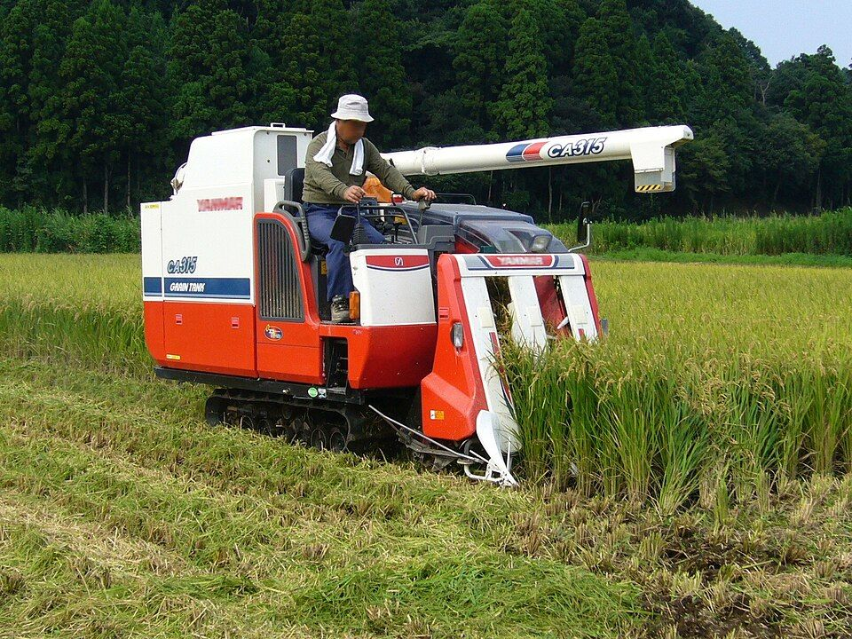
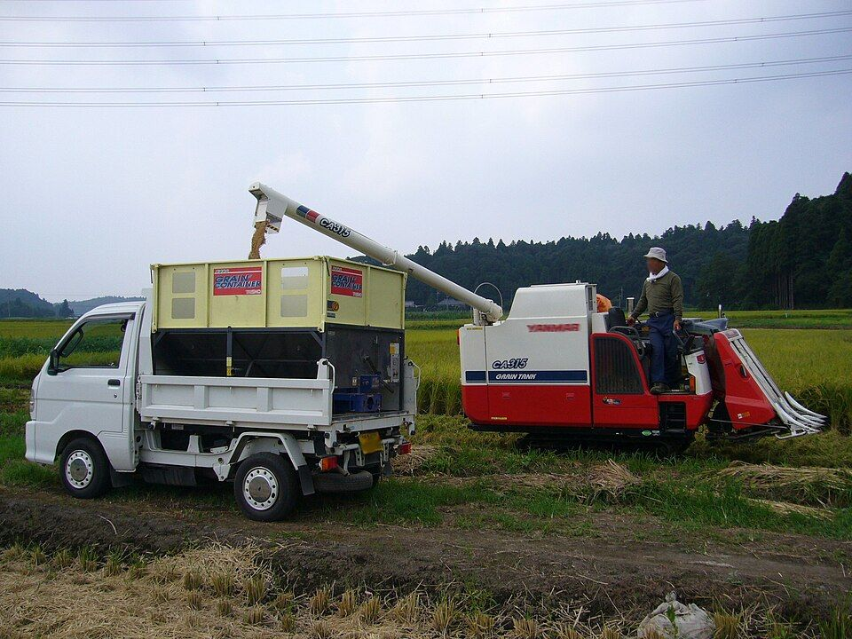
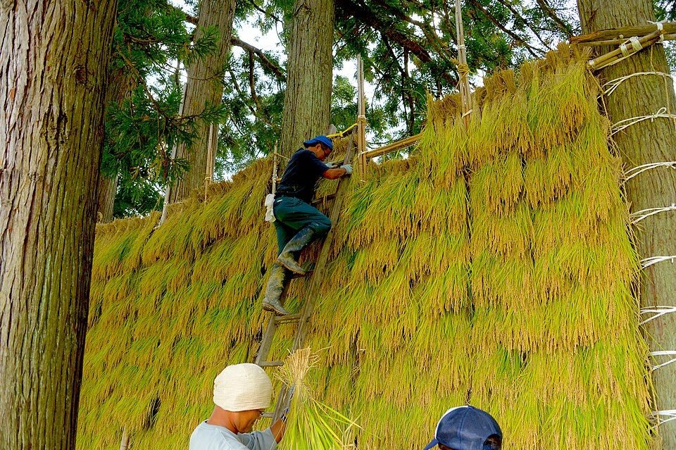
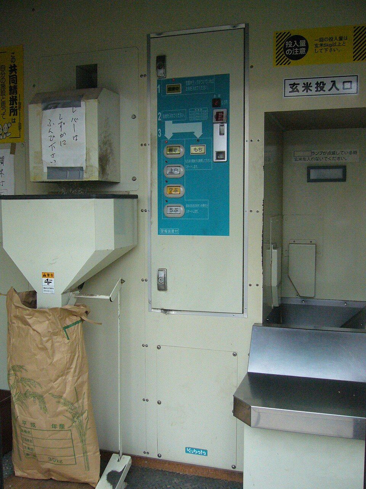
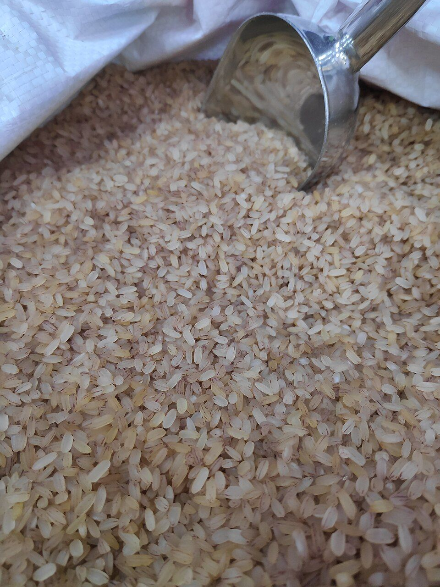
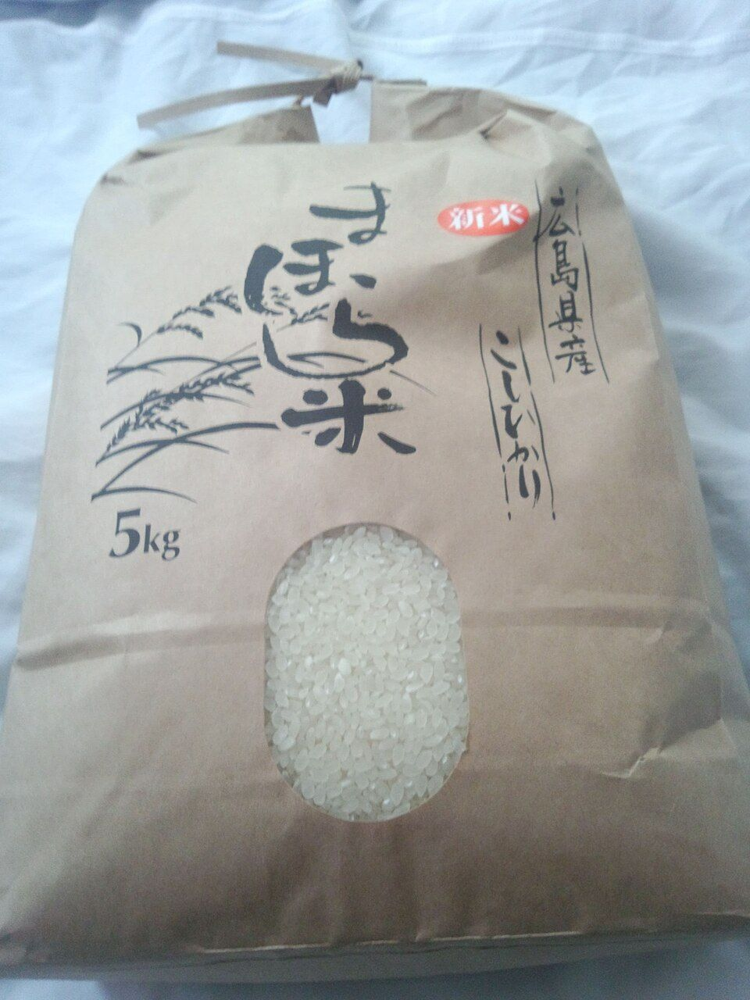

# 6. 収穫から食卓まで

## この章でわかること

- 刈りどきの見きわめ方
- コンバイン・乾燥・籾摺り・選別
- 米の検査と等級
- 米の売り方と値段
- 減反の歴史と、令和の米騒動

## 刈りどき

- 目安は、出穂からの**積算気温 1,000 ℃前後**、または出穂から40〜45日ほど
- 田んぼで見る目安: 籾の**8〜9割が黄色く**なったころ（穂の根もとの数粒に、少し緑が残るくらい）
- 早すぎると、青い米（未熟粒）が混ざり、収量も減る。遅すぎると、米が割れたり（胴割れ）、色がくすんだりして、等級が下がる
- 雨や朝露で稲が濡れているときは刈りません。籾の水分が多いと、乾かすのに燃料がかかるからです

## 稲刈り

- いまの稲刈りは、ほとんどが**自脱型コンバイン**（日本で生まれた、稲の穂の部分だけを脱穀部に通す機械）です。4〜6条刈りが多い
- 刈った籾は、コンバインのタンクにため、トラックのコンテナに移して乾燥施設へ運びます

- 昔は、刈った稲を束にして、木や竹の棚にかけて天日で干していました（**はざかけ**、はさがけ、稲架）。いまも、こだわりの米として続ける所があります

## 乾燥・籾摺り・選別

| 作業 | 機械 | 中身 |
| --- | --- | --- |
| **乾燥** | 循環式の乾燥機 | 刈ったときの水分（20〜25%）を、**15%前後**（14.5〜15.0%）まで、ゆっくり下げる。速く乾かすと米が割れる |
| **籾摺り** | 籾摺り機 | もみ殻を取って玄米にする。もみ殻は、たい肥・敷料・燃料にする |
| **選別** | 選別機（ふるい） | 網の目（**1.80〜1.90 mm** がふつう）で、小さい米・割れた米（**くず米**）を落とす |
| **色彩選別** | 色彩選別機 | カメラで1粒ずつ見て、黒い斑点米や異物を空気ではじく |

- 個人の農家は、自分の乾燥機と籾摺り機を持つか、JA の**カントリーエレベーター**（大きな乾燥・貯蔵施設）や**ライスセンター**に持ち込みます
- 玄米は、30 kg の紙袋かフレコン（1 t の大きな袋）に入れ、低温倉庫（15 ℃以下）で保管します
- 国の統計の収穫量は、ふるい目 1.70 mm で数えます。農家がふつう使う 1.80〜1.90 mm で数えると、2025年産は約718万トンで、統計の量より約30万トン少なくなります

## 精米

- 玄米を精米機で削り、ぬかと胚芽を取って白米にします。白米になるのは玄米の約90%（歩留まり）
- 精米すると、米はだんだん酸化して味が落ちます。精米した日が新しいものほどおいしい
- 玄米は、ぬかに栄養（ビタミン B1・食物繊維）が多い。胚芽を残した「胚芽米」、ぬかを少しだけ削った「分づき米」もあります

## 米の検査と等級

- 出荷する玄米は、登録された検査機関（農産物検査）で、**1等・2等・3等・規格外**に分けられます

| 項目 | 1等の基準（うるち玄米） |
| --- | --- |
| 整粒（きれいな粒）の割合 | 70%以上 |
| 水分 | 15.0%以下 |
| 着色粒（斑点米など） | 0.1%以下 |
| 被害粒・死米・異種穀粒など | それぞれの上限以下 |

- 等級が1つ下がると、60 kg あたり数百〜千円ほど安くなります。高温障害の白未熟粒と、カメムシの斑点米が、等級が下がるおもな原因です
- 袋には、産地・品種・産年が書かれます（**3点セット**）。「新潟県産 コシヒカリ 2025年産」のように売るには、検査か、その内容を確かめた記録が必要です
- 味の良し悪しは、等級とは別に、たんぱく質の割合（低いほどおいしいとされる）、食味計、食味ランキング（日本穀物検定協会の「特A」など）で評価します

## 米の売り方と値段

- おもな売り先
  - **JA**（農協）に出荷: 秋に**概算金**（仮払い）をもらい、売れたあとで精算する
  - 米の卸売業者・集荷業者に売る
  - 自分で、お店・飲食店・ネット・ふるさと納税で売る（**直販**）
- 値段の目安
  - **相対取引価格**: JA などの集荷業者が、卸売業者に売る値段（玄米 60 kg あたり）。国が毎月 発表する
  - スーパーの店頭の値段（精米 5 kg あたり）。国が毎週 発表する
- 米は、外国の米に高い関税（1 kg あたり341円）をかけて守っています

## 減反の歴史

- 戦後、米は足りない食べ物でしたが、1960年代に生産が増え、食べる量は減りはじめ、**米が余る**ようになりました
- 1970年から、国が田んぼの面積を割り当てて、米を作る量を減らす**減反**（生産調整）を始めました。米の代わりに麦・大豆・エサの作物を作ると、補助金が出ます（**転作**）
- **2018年**に、国が都道府県ごとに作る量を割り当てるやり方はやめました。いまは国が「需要の見通し」と「生産の目安」を出し、それを見て産地が作る量を決めます
- それでも、転作への補助金（**水田活用の直接支払交付金**。10a あたり 2万〜10万5千円）は続いてきました。国は2027年度から、これを「田んぼか畑かにかかわらず、麦・大豆・飼料作物などの**収量を上げる農家**を支える」しくみに変える予定です（7章）

## 令和の米騒動（2024〜2025年）

| 時期 | できごと |
| --- | --- |
| 2023年夏 | 猛暑で、白く濁った米が増え、精米して食べられる量が減る |
| 2024年夏 | 店から米が消える。外国からの観光客の増加、地震の情報での買いだめ、新米を待つ時期が重なった |
| 2024年秋〜2025年春 | 新米が出ても値段が上がり続け、スーパーの5 kg が4,000円をこえる（前の年の約2倍） |
| 2025年3〜6月 | 国が**備蓄米**（非常用に国が持つ米）を売り出す。5月からは入札をやめて随意契約にし、5 kg 2,000円ほどの備蓄米が店に並んだ |
| 2025年夏 | 政府が「米を増やす」方針を出し、農家は作付けを増やした |
| 2025年秋 | **2025年産は約747万トン**。前の年より約68万トン多く、2018年からでいちばん多い |
| 2025年10月〜 | 新しい内閣で、方針は「需要に応じた生産」に戻り、2026年産の生産の目安は711万トンに |
| 2026年 | 在庫が増えて値段が下がる。6月の民間の在庫は過去最大級、10月にはスーパーの5 kg が約2,800円まで下がった |

- この騒ぎは、「米は毎年 少しずつ余る」と考えてきた国の見通しと、ぎりぎりまで作る量を減らしてきた結果、少しの変化で足りなくなるもろさを見せました
- いっぽう、値段が下がりすぎると、米づくりをやめる農家が増える心配もあります。**作る人がもうかり、食べる人も買える値段**をどう保つかが、これからの課題です
