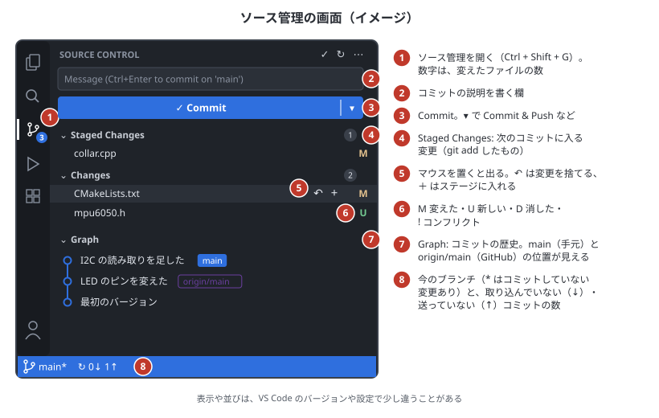
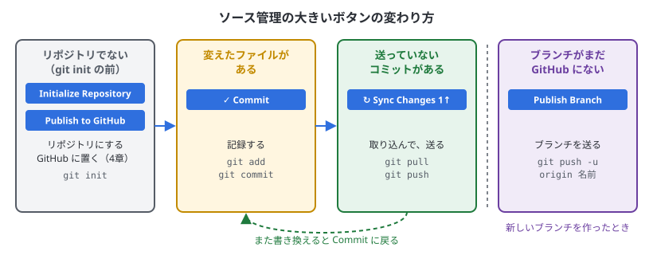
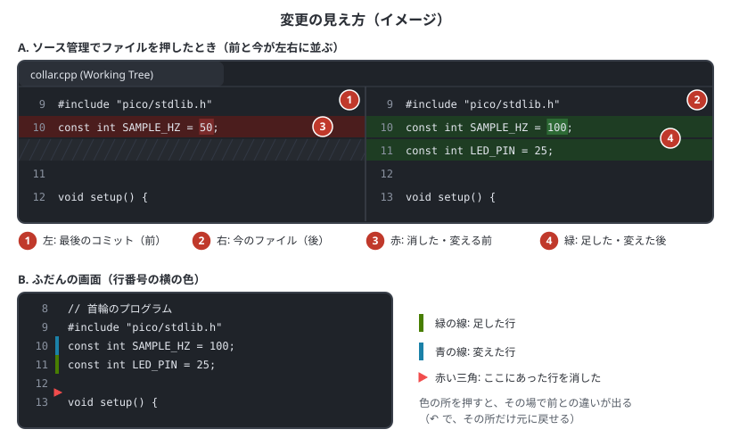
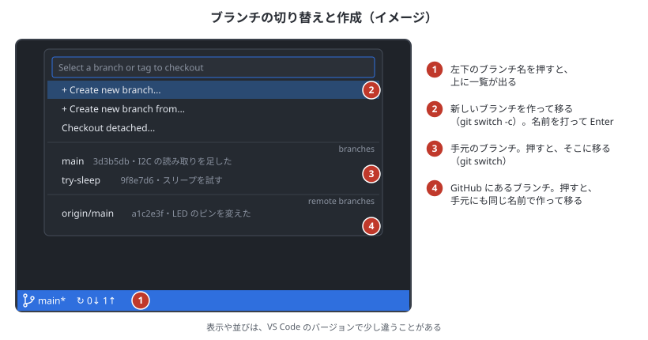
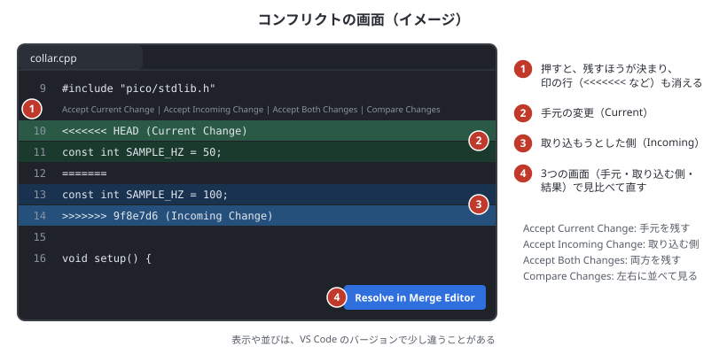
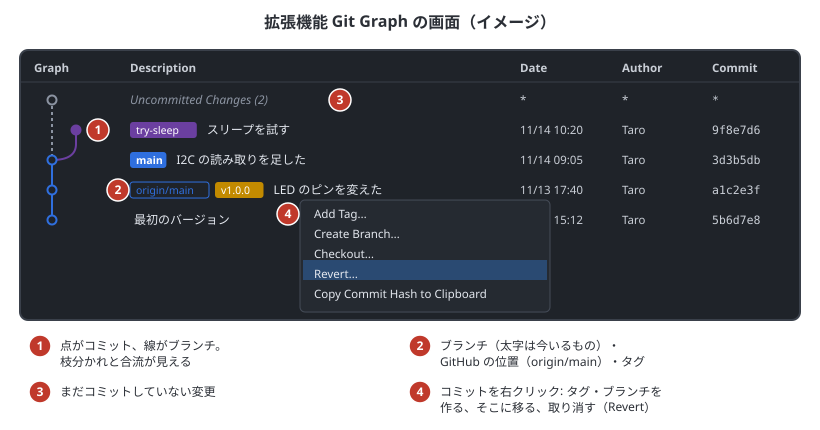

# 9. VS Code で git を使う

## この章でわかること

- ソース管理の画面の見方と、大きいボタンの変わり方
- ボタンでのコミット・プッシュ・プルと、変更の見方
- GitHub に置く・クローンする・ブランチ・コンフリクト・前の状態に戻す、を VS Code でする方法
- あると便利な拡張機能と設定

VS Code には git が最初から組み込まれていて、ここまでの章のコマンドの多くを、ボタンでできます。
VS Code の中で動くのは、PC に入っている git（2章）です。名前・メールアドレス・SSH キー（2章・3章）の設定も、そのまま使われます。

ボタンの名前は英語の表示で書きます。日本語の表示（Japanese Language Pack）にしているときは、次のように読みかえます。

| 英語の表示 | 日本語の表示 |
| --- | --- |
| Source Control | ソース管理 |
| Changes / Staged Changes | 変更 / ステージされている変更 |
| Commit | コミット |
| Sync Changes | 変更の同期 |
| Publish Branch | Branch の発行 |
| Stage Changes（＋）/ Discard Changes（↶） | 変更をステージ / 変更を破棄 |

## ソース管理の画面

左の枝分かれのアイコン（**Source Control**）を押すか、**Ctrl + Shift + G** で開きます。

- ①のアイコンの数字で、変えたファイルがあるかがすぐわかります
- ⑥の文字は、`git status`（5章）と同じことを表しています。M は modified（変えた）、U は untracked（git がまだ知らない、新しいファイル）、D は deleted（消した）です
- ⑧は、押すとブランチの切り替え（下の「ブランチ」）、↻ を押すと Sync Changes と同じです

### 大きいボタンの変わり方

ソース管理の一番上の青いボタンは、**今の状態で次にすること**に変わります。

迷ったら、青いボタンを見れば、次に何をすればよいかがわかります。

## GitHub に置く（Publish to GitHub）

まだ git のリポジトリになっていないフォルダを開くと、ソース管理に **Initialize Repository** と **Publish to GitHub** が出ます（4章のコマンドと同じことを、ボタンでする）。

1. **Publish to GitHub** を押す
2. 初めてのときは「The extension 'GitHub' wants to sign in using GitHub.」と出る。**Allow** → ブラウザが開くので、GitHub で許可する
3. **Publish to GitHub private repository**（非公開）か **public repository**（公開）を選ぶ。リポジトリの名前は、フォルダの名前が入っている
4. 上げるファイルの一覧が出たら、そのまま OK
5. 右下に「Successfully published…」と出たら完了。**Open on GitHub** でブラウザに出る

- サインインしている GitHub のアカウントは、左下の人のアイコン（Accounts）で見られます
- この方法で置いたリポジトリは、HTTPS の URL になります。SSH にしたいときは、3章の「HTTPS で使っていたリポジトリを SSH に切り替える」をします
- `.gitignore` がないと、`build` も上がってしまいます。先に作っておきます（4章）

## クローンする

1. **Ctrl + Shift + P**（コマンドパレット）で `git clone` と打ち、**Git: Clone** を選ぶ
2. **Clone from GitHub** を選ぶと、自分のリポジトリの一覧が出る（SSH の URL を貼り付けてもよい）
3. 置く場所に `~/apps` を選ぶ
4. 「Would you like to open the cloned repository?」と出たら **Open**

フォルダを何も開いていないときは、ソース管理に出る **Clone Repository** からでも同じです。

## ふだんの記録

1. 始める前に、ソース管理の **Sync Changes**（または ⋯ → **Pull**）で、GitHub の新しい分を取り込む
2. ファイルを書き換えて保存すると、Changes に並ぶ。押すと、前との違いが左右に出る（下の図の A）
3. 入れたいファイルの **＋** を押して、ステージに入れる（全部なら Changes の行の ＋）
4. 上の欄に説明（「I2C の読み取りを足した」など）を書いて、**Commit**（Ctrl + Enter でも）
5. 青いボタンが **Sync Changes 1↑** になるので、押して GitHub に送る

途中で、次のように聞かれることがあります。

| 出てくる文 | 意味と答え方 |
| --- | --- |
| There are no staged changes to commit. Would you like to stage all your changes and commit them directly? | ステージに何も入れずに Commit を押した。**Yes** で全部をコミットする。**Always** にすると、次からは聞かない |
| This action will pull and push commits from and to 'origin/main'. | Sync Changes は「取り込んでから、送る」という確認。**OK**（OK, Don't Show Again で次から聞かない） |
| Would you like Code to periodically run 'git fetch'? | GitHub に新しいコミットがあるかを、ときどき確かめるか。**Yes** にすると、⑧の ↓ に数が出る（取り込むのは Sync を押したとき） |
| Enter passphrase for key '/home/…/.ssh/id_ed25519' | SSH キーのパスフレーズ。3章の「5. パスフレーズを毎回聞かれないようにする」をすると、聞かれなくなる |

- **Commit ▾** の **Commit & Push** や **Commit & Sync** で、コミットと送るのを1回でできます
- 記録しない新しいファイルは、Changes で右クリック → **Add to .gitignore** で `.gitignore` に足せます
- 出荷したバージョンに印を付けるのは、コマンドパレットの **Git: Create Tag** → **Git: Push Tags** です

### ボタンとコマンドの対応

| やること | VS Code | コマンド |
| --- | --- | --- |
| 状態を見る | ソース管理の一覧 | `git status` |
| 変えたところを見る | 一覧のファイルを押す | `git diff` |
| ステージに入れる | ファイルの **＋** | `git add` |
| 記録する | 説明を書いて **Commit** | `git commit -m "…"` |
| 送る・取り込む | **Sync Changes**（⋯ → Push / Pull で片方だけ） | `git push`、`git pull` |
| 歴史を見る | ソース管理の **Graph** | `git log --oneline` |

## 前の状態に戻す

6章のコマンドの多くは、ボタンでもできます。

| やりたいこと | VS Code | コマンド |
| --- | --- | --- |
| コミットしていない変更を捨てる | ファイルの **↶**（Discard Changes） | `git restore ファイル名` |
| 一部の行だけ戻す | 行番号の横の色を押す → ↶（上の図の B） | |
| ステージから出す | Staged Changes のファイルの **−**（Unstage Changes） | `git restore --staged ファイル名` |
| 直前のコミットの説明を直す（プッシュ前） | **Commit ▾** → **Commit (Amend)** | `git commit --amend` |
| 直前のコミットを取り消す（プッシュ前） | ⋯ → Commit → **Undo Last Commit**。変更はステージに戻る | `git reset --soft HEAD~1` |
| 作業中の変更を、一時的によける | ⋯ → Stash → **Stash** / **Pop Stash...** | `git stash`、`git stash pop` |
| ファイルの歴史を見る | エクスプローラーの下の **Timeline**（タイムライン）。押すと、そのときとの違いが出る | `git log -p ファイル名` |
| プッシュしたコミットを取り消す | 拡張機能 Git Graph でコミットを右クリック → **Revert...**（下） | `git revert コミットの番号` |

> **新しいファイル（U）の ↶ は、ファイルを消します。** 「This file will be FOREVER LOST if you proceed.」と出たら、本当に要らないかを確かめてから **Delete File** を押します。

## ブランチ

左下のブランチ名を押すと、作成と切り替えの一覧が出ます。

1. 左下の `main` を押す → **+ Create new branch...** → 名前（`try-sleep`）を打って Enter。そのブランチに移る
2. ふだんどおり書き換えて **Commit**。青いボタンが **Publish Branch** になるので、押すと GitHub に送る
3. うまくいったら、左下で `main` に移る → コマンドパレットの **Git: Merge...** → `try-sleep` を選ぶ → **Sync Changes**
4. 要らなくなったブランチは **Git: Delete Branch...** で消す

- ブランチを移る前に、変更をコミットするか、Stash でよけておきます（7章）
- `main` に取り込む前に GitHub で見比べたいときは、Pull Request を使います（下の拡張機能 GitHub Pull Requests）

## コンフリクトを直す

Sync Changes や Merge で、両方が同じ所を変えていると、ソース管理に **Merge Changes** という欄ができ、そこに `!` の付いたファイルが並びます。開くと、次のように出ます。

1. 印の上の **Accept Current Change**・**Accept Incoming Change**・**Accept Both Changes** のどれかを押す（手で書き直してもよい）
2. 全部の所を直したら保存し、ビルドして動くか確かめる
3. Merge Changes のファイルの **＋** を押す
4. 説明は「Merge branch …」と入っているので、そのまま **Commit** → **Sync Changes**

- **Resolve in Merge Editor** を押すと、手元・取り込む側・結果の3つが並ぶ画面で直せます。直したら **Complete Merge** を押します
- やめて、取り込む前に戻すときは、ターミナルで `git merge --abort` です（7章）

## よく使う Git: コマンド

**Ctrl + Shift + P** で `git` と打つと、ボタンにない操作も選べます。

| コマンドパレット | すること | コマンド |
| --- | --- | --- |
| Git: Clone | クローンする | `git clone` |
| Git: Initialize Repository | 今のフォルダをリポジトリにする | `git init` |
| Git: Create Branch... | ブランチを作って移る | `git switch -c` |
| Git: Checkout to... | ブランチを移る | `git switch` |
| Git: Merge... | 今のブランチに取り込む | `git merge` |
| Git: Delete Branch... | ブランチを消す | `git branch -d` |
| Git: Create Tag / Git: Push Tags | 印を付ける・送る | `git tag`、`git push --tags` |
| Git: Undo Last Commit | 直前のコミットを取り消す（変更は残る） | `git reset --soft HEAD~1` |
| Git: Show Git Output | VS Code が打った git のコマンドと、エラーの全文を見る | |

ボタンでエラーが出たときは、**Git: Show Git Output** で本当のエラーの文を見て、付録A で探します。

## あると便利な拡張機能

git と GitHub へのサインインは、最初から VS Code に入っています。次のものは、入れるともっと使いやすくなります。

| 拡張機能（作者） | 役割 | 入れ方 |
| --- | --- | --- |
| **Git Graph**（mhutchie） | コミットの歴史を、枝分かれの図で見る。右クリックでタグ・ブランチ・取り消し | `code --install-extension mhutchie.git-graph` |
| **GitLens**（GitKraken） | 行の右に「誰が・いつ・どのコミットで」変えたかを薄く出す。歴史を細かく調べる（一部の機能は有料） | `code --install-extension eamodio.gitlens` |
| **GitHub Pull Requests**（GitHub） | Pull Request と Issue を、VS Code の中で作る・見る・レビューする | `code --install-extension github.vscode-pull-request-github` |
| **GitHub Actions**（GitHub） | GitHub での自動ビルドの結果を VS Code で見る | `code --install-extension github.vscode-github-actions` |
| **Remote - SSH**（Microsoft） | ラズパイ・Jetson のフォルダを、PC の VS Code で開く。ソース管理もその機械の git で動く | `code --install-extension ms-vscode-remote.remote-ssh` |

入っている拡張機能は、左の **拡張機能**（四角が4つのアイコン、Ctrl + Shift + X）で見られます。名前で探して **Install** を押しても入ります。

### Git Graph

ソース管理の上の Git Graph のアイコンか、左下の **Git Graph** を押すと開きます。

- ブランチを分けたり取り込んだりしたときに、どこで分かれて、どこで合流したかが一目でわかります
- コミットを押すと、そのコミットで変えたファイルの一覧が出ます。ファイルを押すと、違いが左右に出ます
- ソース管理の **Graph** でも歴史は見られます。Git Graph は、右クリックでできることが多いのが違いです

### Remote - SSH

ラズパイや Jetson の中のファイルを、PC の VS Code でそのまま書き換えます。

1. 左下の **><**（Open a Remote Window）→ **Connect to Host...** → `pi@raspberrypi.local` と打つ
2. 新しい窓が開き、ラズパイにつながる（初めてのときは、ラズパイに VS Code の部品が入るので少し待つ）
3. **Open Folder** で `~/collar` を開く

ソース管理・ターミナルも、ラズパイの中で動きます。ラズパイから GitHub に送るには、ラズパイでも SSH キーを登録しておきます（8章）。

## 設定

**Ctrl + ,**（設定）の上の欄に名前を打つと、その設定が出ます。好みで変えます。

| 設定 | 変えると | おすすめ |
| --- | --- | --- |
| `git.autofetch` | GitHub の新しいコミットを、ときどき確かめる | ☑（オン） |
| `git.enableSmartCommit` | ステージに何も入れずに Commit を押したら、全部をコミットする | ☑（1人で開発するとき） |
| `git.confirmSync` | Sync Changes の確認を出す | ☐ にすると、聞かれなくなる |
| `git.postCommitCommand` | コミットのあとに、自動で送る（`push`）・取り込んで送る（`sync`） | 好みで |

## まとめ

- ソース管理（Ctrl + Shift + G）の青いボタンが、次にすること。Commit → Sync Changes をくり返す
- ファイルを押すと前との違いが出る。行番号の横の色は、足した（緑）・変えた（青）・消した（赤）
- ブランチは左下の名前から。コンフリクトは Accept … を押して ＋ → Commit
- ボタンにない操作は、コマンドパレットの `Git:`。エラーは Git: Show Git Output で見る
- 歴史を図で見るなら Git Graph、ラズパイ・Jetson を PC から触るなら Remote - SSH
