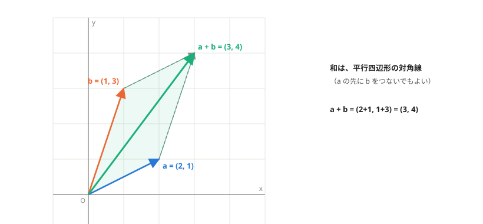
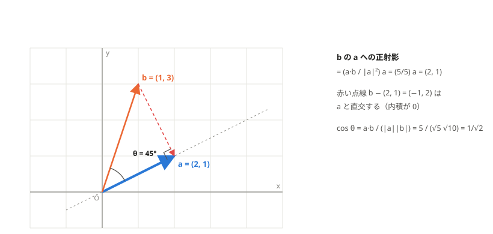

# 1. ベクトル

## この章でわかること

- ベクトルの成分と、和・差・実数倍
- ベクトルの大きさと単位ベクトル
- 内積と、2つのベクトルのなす角・直交
- 正射影
- 空間ベクトルの外積

この教科書は、大学1〜2年で学ぶ線形代数を、例題を1つずつ解きながら進めます。高校の数学（ベクトル・2次方程式・三角関数）がわかれば読めるように書きました。各章の終わりに練習問題と答えがあります。Python（NumPy）での計算は10章にまとめました。

## ベクトルとは

**ベクトル**は、「向き」と「大きさ」を持つ量です。矢印で表し、成分（座標）で書きます。

$$\boldsymbol{a} = \begin{pmatrix} 2 \\ 1 \end{pmatrix} \quad\text{または}\quad \boldsymbol{a} = (2, 1)$$

- 平面のベクトルは2つの数、空間のベクトルは3つの数。一般に $n$ 個の数を並べたものを **$n$ 次元のベクトル**といい、その全体を $\mathbb{R}^n$ と書きます
- 線形代数では、ベクトルを**縦に並べる**（列ベクトル）のが基本です。紙面の都合で横に書くこともあります
- 向きと大きさが同じなら、どこに描いても同じベクトルです。ふつうは原点から描きます

## 和・差・実数倍

成分ごとに計算します。

$$\boldsymbol{a} + \boldsymbol{b} = \begin{pmatrix} a_1 + b_1 \\ a_2 + b_2 \end{pmatrix}, \qquad k\boldsymbol{a} = \begin{pmatrix} k a_1 \\ k a_2 \end{pmatrix}$$

### 例題 1-1

$\boldsymbol{a} = (2, 1)$、$\boldsymbol{b} = (1, 3)$ のとき、$\boldsymbol{a} + \boldsymbol{b}$ と $2\boldsymbol{a} - \boldsymbol{b}$ を求めよ。

**解答**

$$\boldsymbol{a} + \boldsymbol{b} = (2+1,\ 1+3) = (3, 4)$$

$$2\boldsymbol{a} - \boldsymbol{b} = (4-1,\ 2-3) = (3, -1)$$

> **ポイント**: 和は「平行四辺形の対角線」、実数倍は「同じ向きに $k$ 倍に伸ばす（$k<0$ なら逆向き）」。図をイメージしながら、計算は成分で行う。

## 大きさと単位ベクトル

ベクトル $\boldsymbol{a} = (a_1, a_2)$ の**大きさ**（長さ、ノルム）は、三平方の定理で求めます。

$$|\boldsymbol{a}| = \sqrt{a_1^2 + a_2^2}$$

空間なら $|\boldsymbol{a}| = \sqrt{a_1^2 + a_2^2 + a_3^2}$。大きさが1のベクトルを**単位ベクトル**といい、$\boldsymbol{a}$ と同じ向きの単位ベクトルは $\dfrac{\boldsymbol{a}}{|\boldsymbol{a}|}$ です。

### 例題 1-2

$\boldsymbol{a} = (3, 4)$ の大きさと、同じ向きの単位ベクトルを求めよ。

**解答** $|\boldsymbol{a}| = \sqrt{9 + 16} = 5$。単位ベクトルは $\dfrac{1}{5}(3, 4) = \left(\dfrac{3}{5}, \dfrac{4}{5}\right)$。

## 内積

2つのベクトルの**内積**は、成分どうしをかけて足したものです。答えはベクトルではなく**数**（スカラー）です。

$$\boldsymbol{a} \cdot \boldsymbol{b} = a_1 b_1 + a_2 b_2 \quad(\text{空間なら} + a_3 b_3)$$

内積には、もう1つの表し方があります。2つのベクトルのなす角を $\theta$ とすると、

$$\boldsymbol{a} \cdot \boldsymbol{b} = |\boldsymbol{a}||\boldsymbol{b}|\cos\theta$$

この2つを組み合わせると、成分から角度がわかります。

$$\cos\theta = \frac{\boldsymbol{a} \cdot \boldsymbol{b}}{|\boldsymbol{a}||\boldsymbol{b}|}$$

### 例題 1-3

$\boldsymbol{a} = (2, 1)$、$\boldsymbol{b} = (1, 3)$ のなす角 $\theta$ を求めよ。

**解答**

$$\boldsymbol{a} \cdot \boldsymbol{b} = 2 \cdot 1 + 1 \cdot 3 = 5, \quad |\boldsymbol{a}| = \sqrt{5}, \quad |\boldsymbol{b}| = \sqrt{10}$$

$$\cos\theta = \frac{5}{\sqrt{5}\sqrt{10}} = \frac{5}{\sqrt{50}} = \frac{5}{5\sqrt{2}} = \frac{1}{\sqrt{2}}$$

$0 \le \theta \le \pi$ なので、$\theta = \dfrac{\pi}{4}$（$45°$）。

### 直交

$\boldsymbol{a} \ne \boldsymbol{0}$、$\boldsymbol{b} \ne \boldsymbol{0}$ のとき、

$$\boldsymbol{a} \perp \boldsymbol{b} \iff \boldsymbol{a} \cdot \boldsymbol{b} = 0$$

$\cos 90° = 0$ だからです。「内積が0なら直交」は、この先ずっと使う大事な道具です。

### 例題 1-4

$\boldsymbol{a} = (1, 2, 2)$ と $\boldsymbol{b} = (2, 1, -2)$ は直交することを示せ。

**解答** $\boldsymbol{a} \cdot \boldsymbol{b} = 1 \cdot 2 + 2 \cdot 1 + 2 \cdot (-2) = 2 + 2 - 4 = 0$。よって直交する。

### 内積の性質

- $\boldsymbol{a} \cdot \boldsymbol{b} = \boldsymbol{b} \cdot \boldsymbol{a}$（交換法則）
- $\boldsymbol{a} \cdot (\boldsymbol{b} + \boldsymbol{c}) = \boldsymbol{a} \cdot \boldsymbol{b} + \boldsymbol{a} \cdot \boldsymbol{c}$（分配法則）
- $(k\boldsymbol{a}) \cdot \boldsymbol{b} = k(\boldsymbol{a} \cdot \boldsymbol{b})$
- $\boldsymbol{a} \cdot \boldsymbol{a} = |\boldsymbol{a}|^2 \ge 0$（等号は $\boldsymbol{a} = \boldsymbol{0}$ のときだけ）

この4つの性質は、9章で「内積」を一般のベクトル空間に広げるときの、もとになります。

## 正射影

ベクトル $\boldsymbol{b}$ に、$\boldsymbol{a}$ の方向から光を当てたときの「影」を、$\boldsymbol{b}$ の $\boldsymbol{a}$ への**正射影**といいます。

$$\text{proj}_{\boldsymbol{a}}\,\boldsymbol{b} = \frac{\boldsymbol{a} \cdot \boldsymbol{b}}{|\boldsymbol{a}|^2}\,\boldsymbol{a}$$

### 例題 1-5

$\boldsymbol{a} = (2, 1)$、$\boldsymbol{b} = (1, 3)$ のとき、$\boldsymbol{b}$ の $\boldsymbol{a}$ への正射影を求め、残り $\boldsymbol{b} - \text{proj}_{\boldsymbol{a}}\boldsymbol{b}$ が $\boldsymbol{a}$ と直交することを確かめよ。

**解答** $\boldsymbol{a} \cdot \boldsymbol{b} = 5$、$|\boldsymbol{a}|^2 = 5$ なので、

$$\text{proj}_{\boldsymbol{a}}\,\boldsymbol{b} = \frac{5}{5}(2, 1) = (2, 1)$$

残りは $(1, 3) - (2, 1) = (-1, 2)$ で、$\boldsymbol{a}$ との内積は $2 \cdot (-1) + 1 \cdot 2 = 0$。直交している。

> **ポイント**: 正射影は「あるベクトルを、ある方向の成分と、それに直角な成分に分ける」操作。9章のグラム・シュミットの直交化と、10章の最小二乗法は、この考え方の延長です。

## 外積（空間ベクトル）

空間のベクトル $\boldsymbol{a} = (a_1, a_2, a_3)$、$\boldsymbol{b} = (b_1, b_2, b_3)$ の**外積**は、次のベクトルです。

$$\boldsymbol{a} \times \boldsymbol{b} = (a_2 b_3 - a_3 b_2,\ a_3 b_1 - a_1 b_3,\ a_1 b_2 - a_2 b_1)$$

- $\boldsymbol{a} \times \boldsymbol{b}$ は、$\boldsymbol{a}$ にも $\boldsymbol{b}$ にも**直交**する
- 大きさ $|\boldsymbol{a} \times \boldsymbol{b}|$ は、$\boldsymbol{a}$ と $\boldsymbol{b}$ でできる**平行四辺形の面積**
- 向きは、$\boldsymbol{a}$ から $\boldsymbol{b}$ へ右ねじを回したときに進む向き。$\boldsymbol{b} \times \boldsymbol{a} = -\boldsymbol{a} \times \boldsymbol{b}$

覚え方: 成分を縦に2回並べ、1行目を隠して「たすきがけ」、2行目、3行目…と順に計算します（5章の行列式でもう一度出てきます）。

### 例題 1-6

$\boldsymbol{a} = (1, 2, 0)$、$\boldsymbol{b} = (0, 1, 3)$ の外積を求め、2つのベクトルでできる平行四辺形の面積を求めよ。

**解答**

$$\boldsymbol{a} \times \boldsymbol{b} = (2 \cdot 3 - 0 \cdot 1,\ 0 \cdot 0 - 1 \cdot 3,\ 1 \cdot 1 - 2 \cdot 0) = (6, -3, 1)$$

確かめ: $\boldsymbol{a} \cdot (6, -3, 1) = 6 - 6 + 0 = 0$、$\boldsymbol{b} \cdot (6, -3, 1) = 0 - 3 + 3 = 0$。両方に直交している。

面積は $|(6, -3, 1)| = \sqrt{36 + 9 + 1} = \sqrt{46}$。

## 練習問題

1. $\boldsymbol{a} = (1, -2)$、$\boldsymbol{b} = (3, 1)$ のとき、$3\boldsymbol{a} + 2\boldsymbol{b}$ と $|\boldsymbol{a} - \boldsymbol{b}|$ を求めよ。
2. $\boldsymbol{a} = (1, 1, 0)$、$\boldsymbol{b} = (1, 0, 1)$ のなす角を求めよ。
3. $(1, k, 2)$ と $(3, 1, -1)$ が直交するように $k$ を定めよ。
4. $\boldsymbol{a} = (1, 1, 1)$、$\boldsymbol{b} = (1, 2, 3)$ の両方に直交する単位ベクトルを求めよ。

## 練習問題の答え

1. $3\boldsymbol{a} + 2\boldsymbol{b} = (3 + 6,\ -6 + 2) = (9, -4)$。$\boldsymbol{a} - \boldsymbol{b} = (-2, -3)$ なので $|\boldsymbol{a} - \boldsymbol{b}| = \sqrt{4 + 9} = \sqrt{13}$
2. $\boldsymbol{a} \cdot \boldsymbol{b} = 1$、$|\boldsymbol{a}| = |\boldsymbol{b}| = \sqrt{2}$ なので $\cos\theta = \dfrac{1}{2}$、$\theta = \dfrac{\pi}{3}$（$60°$）
3. $3 + k - 2 = 0$ より $k = -1$
4. 外積 $\boldsymbol{a} \times \boldsymbol{b} = (1 \cdot 3 - 1 \cdot 2,\ 1 \cdot 1 - 1 \cdot 3,\ 1 \cdot 2 - 1 \cdot 1) = (1, -2, 1)$。大きさ $\sqrt{6}$ で割って、$\pm\dfrac{1}{\sqrt{6}}(1, -2, 1)$
