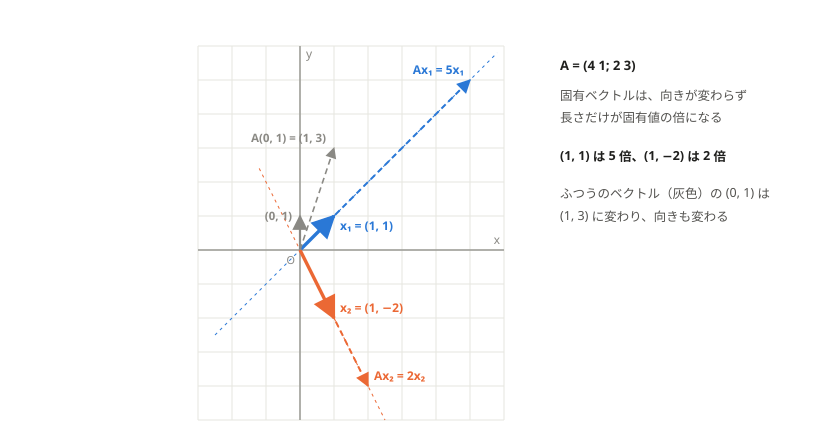

# 8. 固有値と固有ベクトル

## この章でわかること

- 固有値と固有ベクトルの意味
- 固有方程式で固有値を求め、固有ベクトルを求める
- 対角化と、その条件
- 対角化で $A^n$ を求める

## 固有値と固有ベクトル

正方行列 $A$ について、

$$A\boldsymbol{x} = \lambda\boldsymbol{x} \qquad (\boldsymbol{x} \ne \boldsymbol{0})$$

となる数 $\lambda$ を $A$ の**固有値**、$\boldsymbol{x}$ を $\lambda$ に対する**固有ベクトル**といいます。

- ふつうのベクトルは、$A$ をかけると向きが変わります。ところが、**固有ベクトルは向きが変わらず、長さが $\lambda$ 倍になるだけ**です
- 固有ベクトルは、その線形変換の「軸」のようなものです。7章の例題 7-4 で、$A$ が「$(1, 1)$ の方向に5倍、$(1, -2)$ の方向に2倍」と見えたのは、この2つが固有ベクトルだったからです
- 固有ベクトルを何倍しても、また固有ベクトルです（向きだけが大事）

## 固有値の求め方

$A\boldsymbol{x} = \lambda\boldsymbol{x}$ を変形すると、$(A - \lambda E)\boldsymbol{x} = \boldsymbol{0}$。これが $\boldsymbol{x} \ne \boldsymbol{0}$ の解を持つ条件は（4章・5章）、

$$\det(A - \lambda E) = 0$$

これを**固有方程式**（特性方程式）といいます。$n$ 次の行列なら $\lambda$ の $n$ 次方程式です。

> **手順**: (1) 固有方程式 $\det(A - \lambda E) = 0$ を解いて固有値 $\lambda$ を出す。(2) それぞれの $\lambda$ について $(A - \lambda E)\boldsymbol{x} = \boldsymbol{0}$ を解いて、固有ベクトルを出す。

### 例題 8-1

$A = \begin{pmatrix} 4 & 1 \\ 2 & 3 \end{pmatrix}$ の固有値と固有ベクトルを求めよ。

**解答** 固有方程式は

$$\begin{vmatrix} 4 - \lambda & 1 \\ 2 & 3 - \lambda \end{vmatrix} = (4 - \lambda)(3 - \lambda) - 2 = \lambda^2 - 7\lambda + 10 = (\lambda - 2)(\lambda - 5) = 0$$

固有値は $\lambda = 5, 2$。

$\lambda = 5$ のとき: $(A - 5E)\boldsymbol{x} = \begin{pmatrix} -1 & 1 \\ 2 & -2 \end{pmatrix}\begin{pmatrix} x \\ y \end{pmatrix} = \boldsymbol{0}$ より $-x + y = 0$。固有ベクトルは $t\begin{pmatrix} 1 \\ 1 \end{pmatrix}$（$t \ne 0$）。

$\lambda = 2$ のとき: $(A - 2E)\boldsymbol{x} = \begin{pmatrix} 2 & 1 \\ 2 & 1 \end{pmatrix}\begin{pmatrix} x \\ y \end{pmatrix} = \boldsymbol{0}$ より $2x + y = 0$。固有ベクトルは $t\begin{pmatrix} 1 \\ -2 \end{pmatrix}$（$t \ne 0$）。

> **ポイント**: $(A - \lambda E)$ の2つの行は、必ず比例します（行列式が0だから）。比例していなかったら、固有値の計算が間違っています。よい確かめになります。

2次の行列では、固有方程式は $\lambda^2 - (\text{tr}\,A)\lambda + \det A = 0$ です。3章のケーリー・ハミルトンの式と同じ形ですね。また、一般に

- 固有値の和 $= \text{tr}\,A$（例: $5 + 2 = 7 = 4 + 3$）
- 固有値の積 $= \det A$（例: $5 \times 2 = 10 = 12 - 2$）

### 例題 8-2

$A = \begin{pmatrix} 1 & 2 & 0 \\ 0 & 3 & 0 \\ 2 & -4 & 2 \end{pmatrix}$ の固有値と固有ベクトルを求めよ。

**解答** 3列目で余因子展開すると（0が2つある）、

$$\det(A - \lambda E) = \begin{vmatrix} 1 - \lambda & 2 & 0 \\ 0 & 3 - \lambda & 0 \\ 2 & -4 & 2 - \lambda \end{vmatrix} = (2 - \lambda)\begin{vmatrix} 1 - \lambda & 2 \\ 0 & 3 - \lambda \end{vmatrix} = (1 - \lambda)(2 - \lambda)(3 - \lambda)$$

固有値は $\lambda = 1, 2, 3$。

- $\lambda = 1$: $A - E = \begin{pmatrix} 0 & 2 & 0 \\ 0 & 2 & 0 \\ 2 & -4 & 1 \end{pmatrix}$ より $y = 0$、$2x + z = 0$。固有ベクトル $t(1, 0, -2)$
- $\lambda = 2$: $A - 2E = \begin{pmatrix} -1 & 2 & 0 \\ 0 & 1 & 0 \\ 2 & -4 & 0 \end{pmatrix}$ より $y = 0$、$x = 0$。固有ベクトル $t(0, 0, 1)$
- $\lambda = 3$: $A - 3E = \begin{pmatrix} -2 & 2 & 0 \\ 0 & 0 & 0 \\ 2 & -4 & -1 \end{pmatrix}$ より $x = y$、$2x - 4y - z = 0$ から $z = -2y$。固有ベクトル $t(1, 1, -2)$

確かめ: $A(1, 1, -2) = (1 + 2,\ 3,\ 2 - 4 - 4) = (3, 3, -6) = 3(1, 1, -2)$。

## 対角化

$n$ 次の正方行列 $A$ が $n$ 個の1次独立な固有ベクトル $\boldsymbol{p}_1, \dots, \boldsymbol{p}_n$（固有値 $\lambda_1, \dots, \lambda_n$）を持つとき、それを列に並べた $P = (\boldsymbol{p}_1\ \cdots\ \boldsymbol{p}_n)$ を使って、

$$P^{-1}AP = \begin{pmatrix} \lambda_1 & & \\ & \ddots & \\ & & \lambda_n \end{pmatrix}$$

と**対角行列**にできます。これを**対角化**といいます（7章の基底の取りかえで、固有ベクトルを基底に選んだ、ということ）。

- 固有値が**全部ちがう**なら、固有ベクトルは自動的に1次独立なので、必ず対角化できます
- 固有値が重なる（重解の）ときは、その固有値の固有ベクトルが重なりの数だけ1次独立に取れれば対角化でき、取れなければ対角化できません

### 対角化できない例

$A = \begin{pmatrix} 1 & 1 \\ 0 & 1 \end{pmatrix}$ の固有方程式は $(1 - \lambda)^2 = 0$ で、固有値は $\lambda = 1$（重解）。$(A - E)\boldsymbol{x} = \begin{pmatrix} 0 & 1 \\ 0 & 0 \end{pmatrix}\boldsymbol{x} = \boldsymbol{0}$ より $y = 0$ で、固有ベクトルは $t(1, 0)$ の1方向だけ。2つの1次独立な固有ベクトルが取れないので、**対角化できません**。

### 例題 8-3

$A = \begin{pmatrix} 4 & 1 \\ 2 & 3 \end{pmatrix}$ を対角化し、$A^n$ を求めよ。

**解答** 例題 8-1 より、$P = \begin{pmatrix} 1 & 1 \\ 1 & -2 \end{pmatrix}$ とおくと、

$$P^{-1}AP = \begin{pmatrix} 5 & 0 \\ 0 & 2 \end{pmatrix} = D$$

（7章の例題 7-4 で計算したとおり）。$A = PDP^{-1}$ なので、

$$A^n = (PDP^{-1})(PDP^{-1})\cdots(PDP^{-1}) = PD^nP^{-1}$$

真ん中の $P^{-1}P$ が全部 $E$ になって消えるのがポイントです。対角行列の $n$ 乗は、対角成分を $n$ 乗するだけなので、

$$A^n = \begin{pmatrix} 1 & 1 \\ 1 & -2 \end{pmatrix}\begin{pmatrix} 5^n & 0 \\ 0 & 2^n \end{pmatrix}\frac{1}{3}\begin{pmatrix} 2 & 1 \\ 1 & -1 \end{pmatrix} = \frac{1}{3}\begin{pmatrix} 2 \cdot 5^n + 2^n & 5^n - 2^n \\ 2 \cdot 5^n - 2^{n+1} & 5^n + 2^{n+1} \end{pmatrix}$$

確かめ: $n = 1$ で $\dfrac{1}{3}\begin{pmatrix} 12 & 3 \\ 6 & 9 \end{pmatrix} = \begin{pmatrix} 4 & 1 \\ 2 & 3 \end{pmatrix} = A$。

> **ポイント**: 対角化は「うまい座標で見れば、行列はただの各方向への伸び縮み」ということ。$A^n$ の計算、漸化式（数列）、微分方程式、マルコフ連鎖、機械学習の主成分分析（10章）など、使い道がとても広い道具です。

### 応用: 連立漸化式

$a_{n+1} = 4a_n + b_n$、$b_{n+1} = 2a_n + 3b_n$、$a_1 = 1$、$b_1 = 0$ のような連立漸化式は、

$$\begin{pmatrix} a_{n+1} \\ b_{n+1} \end{pmatrix} = A\begin{pmatrix} a_n \\ b_n \end{pmatrix} \quad\text{より}\quad \begin{pmatrix} a_n \\ b_n \end{pmatrix} = A^{n-1}\begin{pmatrix} 1 \\ 0 \end{pmatrix}$$

と書けるので、例題 8-3 の $A^{n-1}$ の1列目から、$a_n = \dfrac{2 \cdot 5^{n-1} + 2^{n-1}}{3}$、$b_n = \dfrac{2 \cdot 5^{n-1} - 2^{n}}{3}$ が求まります。

## 練習問題

1. $\begin{pmatrix} 1 & 2 \\ 2 & 1 \end{pmatrix}$ の固有値と固有ベクトルを求めよ。
2. $\begin{pmatrix} 2 & 1 \\ 0 & 3 \end{pmatrix}$ を対角化せよ（$P$ と $P^{-1}AP$ を答える）。
3. 3次の正方行列 $A$ の固有値が $1, 2, 4$ のとき、$\det A$ と $\text{tr}\,A$ を求めよ。

## 練習問題の答え

1. $(1 - \lambda)^2 - 4 = 0$ より $\lambda = 3, -1$。$\lambda = 3$: $t(1, 1)$、$\lambda = -1$: $t(1, -1)$
2. 固有値は対角成分の $2, 3$（三角行列）。$\lambda = 2$: $(A - 2E) = \begin{pmatrix} 0 & 1 \\ 0 & 1 \end{pmatrix}$ より $y = 0$、$t(1, 0)$。$\lambda = 3$: $\begin{pmatrix} -1 & 1 \\ 0 & 0 \end{pmatrix}$ より $x = y$、$t(1, 1)$。$P = \begin{pmatrix} 1 & 1 \\ 0 & 1 \end{pmatrix}$、$P^{-1}AP = \begin{pmatrix} 2 & 0 \\ 0 & 3 \end{pmatrix}$
3. $\det A = 1 \cdot 2 \cdot 4 = 8$、$\text{tr}\,A = 1 + 2 + 4 = 7$
