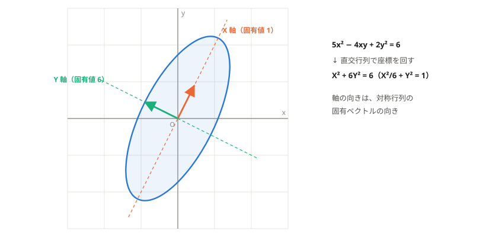

# 9. 内積空間と対称行列の対角化

## この章でわかること

- 正規直交基底と、グラム・シュミットの直交化
- 直交行列（長さと角度を変えない変換）
- 実対称行列は、直交行列で必ず対角化できる
- 2次形式の標準形（斜めの楕円をまっすぐにする）

## 正規直交基底

1章の内積は、$\mathbb{R}^n$ でも同じように $\boldsymbol{a} \cdot \boldsymbol{b} = a_1b_1 + \cdots + a_nb_n$ で決まります（$(\boldsymbol{a}, \boldsymbol{b})$ とも書く）。内積が決まったベクトル空間を**内積空間**（計量空間）といいます。

どの2つも直交し、どれも長さ1の基底を**正規直交基底**といいます。

$$\boldsymbol{u}_i \cdot \boldsymbol{u}_j = \begin{cases} 1 & (i = j) \\ 0 & (i \ne j) \end{cases}$$

- 標準基底 $\boldsymbol{e}_1, \dots, \boldsymbol{e}_n$ は正規直交基底です
- 正規直交基底での座標は、**内積をとるだけ**で求まります: $\boldsymbol{x} = (\boldsymbol{x} \cdot \boldsymbol{u}_1)\boldsymbol{u}_1 + \cdots + (\boldsymbol{x} \cdot \boldsymbol{u}_n)\boldsymbol{u}_n$。6章の例題 6-4 のように連立方程式を解かなくてよいので、とても便利です

## グラム・シュミットの直交化

1次独立なベクトル $\boldsymbol{a}_1, \boldsymbol{a}_2, \dots$ から、正規直交基底を作る方法です。1章の**正射影**を引いていきます。

1. $\boldsymbol{u}_1 = \dfrac{\boldsymbol{a}_1}{|\boldsymbol{a}_1|}$
2. $\boldsymbol{a}_2' = \boldsymbol{a}_2 - (\boldsymbol{a}_2 \cdot \boldsymbol{u}_1)\boldsymbol{u}_1$（$\boldsymbol{u}_1$ の方向の成分を取り除く）、$\boldsymbol{u}_2 = \dfrac{\boldsymbol{a}_2'}{|\boldsymbol{a}_2'|}$
3. $\boldsymbol{a}_3' = \boldsymbol{a}_3 - (\boldsymbol{a}_3 \cdot \boldsymbol{u}_1)\boldsymbol{u}_1 - (\boldsymbol{a}_3 \cdot \boldsymbol{u}_2)\boldsymbol{u}_2$、$\boldsymbol{u}_3 = \dfrac{\boldsymbol{a}_3'}{|\boldsymbol{a}_3'|}$
4. 以下同じ

### 例題 9-1

$\boldsymbol{a}_1 = (1, 1, 0)$、$\boldsymbol{a}_2 = (1, 0, 1)$、$\boldsymbol{a}_3 = (0, 1, 1)$ から、正規直交基底を作れ。

**解答**

(1) $|\boldsymbol{a}_1| = \sqrt{2}$ より $\boldsymbol{u}_1 = \dfrac{1}{\sqrt{2}}(1, 1, 0)$。

(2) $\boldsymbol{a}_2 \cdot \boldsymbol{u}_1 = \dfrac{1}{\sqrt{2}}$ なので、

$$\boldsymbol{a}_2' = (1, 0, 1) - \frac{1}{\sqrt{2}} \cdot \frac{1}{\sqrt{2}}(1, 1, 0) = \left(\frac{1}{2}, -\frac{1}{2}, 1\right) = \frac{1}{2}(1, -1, 2)$$

長さを1にして $\boldsymbol{u}_2 = \dfrac{1}{\sqrt{6}}(1, -1, 2)$（向きだけが大事なので、$\frac{1}{2}$ は無視してよい）。

(3) $\boldsymbol{a}_3 \cdot \boldsymbol{u}_1 = \dfrac{1}{\sqrt{2}}$、$\boldsymbol{a}_3 \cdot \boldsymbol{u}_2 = \dfrac{-1 + 2}{\sqrt{6}} = \dfrac{1}{\sqrt{6}}$ なので、

$$\boldsymbol{a}_3' = (0, 1, 1) - \frac{1}{2}(1, 1, 0) - \frac{1}{6}(1, -1, 2) = \left(-\frac{2}{3}, \frac{2}{3}, \frac{2}{3}\right)$$

$\boldsymbol{u}_3 = \dfrac{1}{\sqrt{3}}(-1, 1, 1)$。

確かめ: $\boldsymbol{u}_1 \cdot \boldsymbol{u}_3 \propto -1 + 1 + 0 = 0$、$\boldsymbol{u}_2 \cdot \boldsymbol{u}_3 \propto -1 - 1 + 2 = 0$。

> **ポイント**: 計算の途中では、分数を気にせず、**向きが同じなら何倍してもよい**。最後に長さで割ればすむ。

## 直交行列

正規直交基底を列に並べた行列 $P$ を**直交行列**といいます。次の性質があります。

- ${}^tP\,P = E$、つまり **$P^{-1} = {}^tP$**（逆行列が転置だけで求まる）
- 内積を変えない: $(P\boldsymbol{a}) \cdot (P\boldsymbol{b}) = \boldsymbol{a} \cdot \boldsymbol{b}$。だから**長さも角度も変えない**
- $\det P = \pm 1$。$+1$ なら回転、$-1$ なら回転と鏡の組み合わせ

3章の回転の行列 $\begin{pmatrix} \cos\theta & -\sin\theta \\ \sin\theta & \cos\theta \end{pmatrix}$ は、直交行列の代表です。

## 実対称行列の対角化

成分が実数の対称行列（${}^tA = A$）には、次のすばらしい性質があります。

1. 固有値は**すべて実数**
2. ちがう固有値の固有ベクトルは、**直交する**
3. **直交行列** $P$ で、必ず対角化できる: ${}^tP\,A\,P = P^{-1}AP = $ 対角行列

8章では、対角化できない行列もありました。対称行列なら、その心配はありません。しかも $P^{-1}$ を計算する必要もありません（${}^tP$ でよい）。

> **手順**: (1) 固有値を求める。(2) 固有ベクトルを求める。(3) 同じ固有値の中で、固有ベクトルをグラム・シュミットで直交させる（ちがう固有値どうしは、もともと直交している）。(4) 全部の長さを1にして、列に並べる。

### 例題 9-2

$A = \begin{pmatrix} 2 & 1 & 1 \\ 1 & 2 & 1 \\ 1 & 1 & 2 \end{pmatrix}$ を、直交行列で対角化せよ。

**解答** 固有方程式は（1行目に2行目と3行目を足して $(4 - \lambda)$ をくくり出すと楽）、

$$\det(A - \lambda E) = -(\lambda - 4)(\lambda - 1)^2 = 0$$

固有値は $\lambda = 4$、$1$（重解）。

- $\lambda = 4$: $A - 4E = \begin{pmatrix} -2 & 1 & 1 \\ 1 & -2 & 1 \\ 1 & 1 & -2 \end{pmatrix}$ を掃き出すと $x = y = z$。固有ベクトル $(1, 1, 1)$
- $\lambda = 1$: $A - E = \begin{pmatrix} 1 & 1 & 1 \\ 1 & 1 & 1 \\ 1 & 1 & 1 \end{pmatrix}$ より $x + y + z = 0$。固有ベクトルの空間は平面（2次元）。その中から**直交する2つ**を選ぶ: $(1, -1, 0)$ と、それに直交して $x + y + z = 0$ を満たす $(1, 1, -2)$

確かめ: 3つ $(1, 1, 1)$、$(1, -1, 0)$、$(1, 1, -2)$ は互いに直交しています（$\lambda = 4$ と $\lambda = 1$ の固有ベクトルは自動的に直交）。長さで割って並べると、

$$P = \begin{pmatrix} \frac{1}{\sqrt{3}} & \frac{1}{\sqrt{2}} & \frac{1}{\sqrt{6}} \\ \frac{1}{\sqrt{3}} & -\frac{1}{\sqrt{2}} & \frac{1}{\sqrt{6}} \\ \frac{1}{\sqrt{3}} & 0 & -\frac{2}{\sqrt{6}} \end{pmatrix}, \qquad {}^tP\,A\,P = \begin{pmatrix} 4 & 0 & 0 \\ 0 & 1 & 0 \\ 0 & 0 & 1 \end{pmatrix}$$

## 2次形式

$ax^2 + 2bxy + cy^2$ のような2次の式（**2次形式**）は、対称行列で書けます。

$$ax^2 + 2bxy + cy^2 = \begin{pmatrix} x & y \end{pmatrix}\begin{pmatrix} a & b \\ b & c \end{pmatrix}\begin{pmatrix} x \\ y \end{pmatrix} = {}^t\boldsymbol{x}A\boldsymbol{x}$$

$A$ を直交行列 $P$ で対角化し、$\boldsymbol{x} = P\boldsymbol{X}$（座標を回す）とおくと、

$${}^t\boldsymbol{x}A\boldsymbol{x} = {}^t\boldsymbol{X}\,({}^tPAP)\,\boldsymbol{X} = \lambda_1X^2 + \lambda_2Y^2$$

と、$XY$ の項が消えます（**標準形**）。

### 例題 9-3

曲線 $5x^2 - 4xy + 2y^2 = 6$ は、どんな図形か。

**解答** $A = \begin{pmatrix} 5 & -2 \\ -2 & 2 \end{pmatrix}$。固有方程式は $(5 - \lambda)(2 - \lambda) - 4 = \lambda^2 - 7\lambda + 6 = (\lambda - 1)(\lambda - 6) = 0$ で、固有値 $1, 6$。

- $\lambda = 1$: $4x - 2y = 0$ より $(1, 2)$、単位ベクトル $\dfrac{1}{\sqrt{5}}(1, 2)$
- $\lambda = 6$: $-x - 2y = 0$ より $(-2, 1)$、単位ベクトル $\dfrac{1}{\sqrt{5}}(-2, 1)$

この2つの向きを新しい $X$ 軸・$Y$ 軸にとると、

$$X^2 + 6Y^2 = 6 \quad\text{つまり}\quad \frac{X^2}{6} + Y^2 = 1$$

$(1, 2)$ の方向に長さ $\sqrt{6}$、$(-2, 1)$ の方向に長さ 1 の半径を持つ、**斜めの楕円**です。

> **ポイント**: 2次形式の値の符号は、固有値で決まります。固有値が全部正なら、$\boldsymbol{x} \ne \boldsymbol{0}$ でいつも正（**正定値**）。統計の分散共分散行列は、正定値（か半正定値）の対称行列です（10章）。

## 練習問題

1. $\begin{pmatrix} \frac{3}{5} & -\frac{4}{5} \\ \frac{4}{5} & \frac{3}{5} \end{pmatrix}$ が直交行列であることを確かめよ。
2. $A = \begin{pmatrix} 1 & 2 \\ 2 & 1 \end{pmatrix}$ を直交行列で対角化せよ。
3. $x^2 + 4xy + y^2 = 3$ はどんな図形か。

## 練習問題の答え

1. 列どうしの内積 $\frac{3}{5} \cdot (-\frac{4}{5}) + \frac{4}{5} \cdot \frac{3}{5} = 0$、それぞれの長さ $\sqrt{\frac{9}{25} + \frac{16}{25}} = 1$。正規直交なので直交行列（$\det = 1$ なので回転）
2. 8章の練習問題1より固有値 $3, -1$、固有ベクトル $(1, 1)$、$(1, -1)$。$P = \dfrac{1}{\sqrt{2}}\begin{pmatrix} 1 & 1 \\ 1 & -1 \end{pmatrix}$、${}^tPAP = \begin{pmatrix} 3 & 0 \\ 0 & -1 \end{pmatrix}$
3. 2の行列なので $3X^2 - Y^2 = 3$、つまり $X^2 - \dfrac{Y^2}{3} = 1$。$(1, 1)$ の方向を軸とする**双曲線**（固有値に負があると楕円ではなく双曲線）
