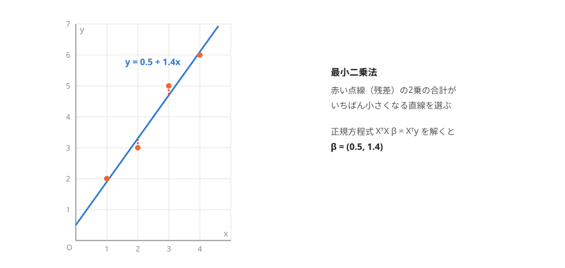

# 10. NumPy と、統計・機械学習とのつながり

## この章でわかること

- NumPy で行列を計算する
- 最小二乗法（回帰分析）は「正射影」と「正規方程式」
- 主成分分析は「分散共分散行列の固有値と固有ベクトル」
- 特異値分解（SVD）のあらまし

「統計の教科書」の回帰分析（OLS）と、「機械学習の教科書」の次元削減（PCA）は、この教科書の線形代数でできています。コードは NumPy 2.5 で確かめました（Python の書き方は「Python の教科書」）。

## NumPy で行列を計算する

```python
import numpy as np

A = np.array([[4.0, 1.0],
              [2.0, 3.0]])
b = np.array([5.0, 6.0])

print(A @ A)                     # 行列の積（* は成分ごとの積なので注意）
print(A.T)                       # 転置
print(np.linalg.det(A))          # 行列式
print(np.linalg.inv(A))          # 逆行列
print(np.linalg.solve(A, b))     # A x = b を解く
print(np.linalg.matrix_rank(A))  # ランク

vals, vecs = np.linalg.eig(A)    # 固有値と固有ベクトル（列）
print(vals)
print(vecs)
```

```text
[[18.  7.]
 [14. 11.]]
[[4. 2.]
 [1. 3.]]
10.000000000000002
[[ 0.3 -0.1]
 [-0.2  0.4]]
[0.9 1.4]
2
[5.+0.j 2.+0.j]
[[ 0.70710678+0.j -0.4472136 +0.j]
 [ 0.70710678+0.j  0.89442719+0.j]]
```

- 行列式が `10.000000000000002` になるのは、コンピューターの小数の誤差です。$\det A = 12 - 2 = 10$
- 固有値 5、2 は 8章の例題 8-1 と同じ。固有ベクトルは**長さ1にそろえて**出てきます: $(0.707, 0.707) = \frac{1}{\sqrt{2}}(1, 1)$、$(-0.447, 0.894) = \frac{1}{\sqrt{5}}(-1, 2)$。8章の $(1, 1)$、$(1, -2)$ と同じ向きです（−1倍も同じ固有ベクトル）
- NumPy 2.5 の `eig` は、固有値が実数でも `5.+0.j` のように複素数の形（虚部が0）で返します。**対称行列なら `np.linalg.eigh`** を使うと、実数で、小さい順に並んで返ります
- 連立方程式は、`inv(A) @ b` より `solve(A, b)` を使います（速く、誤差も小さい）

## 最小二乗法と正規方程式

データに直線 $y = \beta_0 + \beta_1x$ を当てはめる、回帰分析を考えます。データ $(1, 2)$、$(2, 3)$、$(3, 5)$、$(4, 6)$ なら、

$$\begin{pmatrix} 1 & 1 \\ 1 & 2 \\ 1 & 3 \\ 1 & 4 \end{pmatrix}\begin{pmatrix} \beta_0 \\ \beta_1 \end{pmatrix} \approx \begin{pmatrix} 2 \\ 3 \\ 5 \\ 6 \end{pmatrix} \qquad (X\boldsymbol{\beta} \approx \boldsymbol{y})$$

式が4つ、未知数が2つなので、ぴったりの解はありません（4章の「解なし」）。そこで、**残差** $\boldsymbol{y} - X\boldsymbol{\beta}$ の長さ（の2乗）がいちばん小さくなる $\boldsymbol{\beta}$ を選びます。

### 正射影で考える

$X\boldsymbol{\beta}$ は、$X$ の列ベクトルの1次結合なので、$X$ の列で生成される部分空間（7章の $\text{Im}$）の中を動きます。$\boldsymbol{y}$ にいちばん近い点は、$\boldsymbol{y}$ をその部分空間に**正射影**した点です（1章の正射影の延長）。そのとき、残差は部分空間に**直交**します。

$${}^tX(\boldsymbol{y} - X\boldsymbol{\beta}) = \boldsymbol{0} \quad\Longrightarrow\quad {}^tX X\boldsymbol{\beta} = {}^tX\boldsymbol{y}$$

これを**正規方程式**といいます。${}^tXX$ が逆行列を持てば、$\boldsymbol{\beta} = ({}^tXX)^{-1}\,{}^tX\boldsymbol{y}$。

### 例題 10-1

上のデータで、回帰直線を求めよ。

**解答**

$${}^tXX = \begin{pmatrix} 4 & 10 \\ 10 & 30 \end{pmatrix}, \qquad {}^tX\boldsymbol{y} = \begin{pmatrix} 16 \\ 47 \end{pmatrix}$$

$\det({}^tXX) = 120 - 100 = 20$ なので（3章の逆行列の公式）、

$$\boldsymbol{\beta} = \frac{1}{20}\begin{pmatrix} 30 & -10 \\ -10 & 4 \end{pmatrix}\begin{pmatrix} 16 \\ 47 \end{pmatrix} = \frac{1}{20}\begin{pmatrix} 10 \\ 28 \end{pmatrix} = \begin{pmatrix} 0.5 \\ 1.4 \end{pmatrix}$$

回帰直線は $y = 0.5 + 1.4x$。



```python
import numpy as np

x = np.array([1, 2, 3, 4])
y = np.array([2, 3, 5, 6])
X = np.column_stack([np.ones_like(x), x])    # 1列目は切片のための 1

beta = np.linalg.solve(X.T @ X, X.T @ y)     # 正規方程式 XᵀX β = Xᵀy
print(beta)

beta2, *_ = np.linalg.lstsq(X, y, rcond=None)  # ふつうはこちら（数値的に安定）
print(beta2)

r = y - X @ beta                             # 残差
print(X.T @ r)                               # 残差は X の列と直交する（ほぼ 0）
```

```text
[0.5 1.4]
[0.5 1.4]
[2.66453526e-15 5.77315973e-15]
```

- 最後の行は、残差と $X$ の列の内積で、計算の誤差を除けば0。**残差が直交している**ことが確かめられます
- 説明変数が似すぎていると（**多重共線性**）、$X$ の列がほとんど1次従属になり、${}^tXX$ の行列式が0に近くなって、$\boldsymbol{\beta}$ が大きくぶれます。「統計の教科書」8章の話は、線形代数で見るとこういうことです

## 主成分分析（PCA）

たくさんの項目のデータを、少ない軸に**要約**する方法です。

1. データの平均を引く（中心を原点に）
2. **分散共分散行列** $C$（対称行列）を作る
3. $C$ の固有値と固有ベクトルを求める（9章の対称行列の対角化）
4. 固有値の大きい順に並べた固有ベクトルが、**第1主成分・第2主成分…の軸**。固有値は、その軸の方向の**分散**（ばらつきの大きさ）

9章の楕円の図を思い出してください。データの点が斜めの楕円のように広がっているとき、その**長い軸**が第1主成分です。

```python
import numpy as np

# 5頭の牛の、1日の乳量（kg）と、エサを食べた量（kg）
data = np.array([[25, 18],
                 [30, 21],
                 [28, 20],
                 [35, 24],
                 [32, 23]], dtype=float)

C = np.cov(data, rowvar=False)        # 分散共分散行列（対称行列）
print(C)

vals, vecs = np.linalg.eigh(C)        # 対称行列用。固有値は小さい順に並ぶ
order = vals.argsort()[::-1]          # 大きい順に並べかえる
vals, vecs = vals[order], vecs[:, order]
vecs = vecs * np.sign(vecs[0])       # 向きをそろえる（固有ベクトルは −1 倍しても同じ）
print(vals)
print(vecs)
print(vals / vals.sum())              # 寄与率（全体のばらつきのうち、その軸で説明できる割合）

centered = data - data.mean(axis=0)
score = centered @ vecs[:, 0]         # 第1主成分の値（1次元に要約した値）
print(score.round(2))
```

```text
[[14.5  9. ]
 [ 9.   5.7]]
[20.11798383  0.08201617]
[[ 0.84829539  0.52952331]
 [ 0.52952331 -0.84829539]]
[0.99593979 0.00406021]
[-5.94 -0.11 -2.33  5.72  2.65]
```

- 第1主成分の軸は $(0.85, 0.53)$ の向き（乳量もエサも多い方向）。寄与率は **99.6%** で、この2つの項目は、ほぼ「たくさん食べて、たくさん出す」という1つの軸で説明できる、ということです
- 最後の行は、5頭を1つの数に要約した値です。4頭目（乳量35 kg）がいちばん大きく、1頭目（25 kg）がいちばん小さい
- 項目の単位がちがうとき（kg と ℃ など）は、先に標準化（平均0・分散1）してから行います。scikit-learn の `PCA` は、中でこの計算をしています（「機械学習の教科書」）

## 特異値分解（SVD）

正方行列でない行列や、対角化できない行列でも、必ずできる分解があります。

$$A = U\Sigma\,{}^tV$$

- $U$、$V$ は直交行列、$\Sigma$ は対角に**特異値**（$\sigma_1 \ge \sigma_2 \ge \cdots \ge 0$）が並ぶ行列です
- 意味: どんな線形変換も「回転（${}^tV$）→ 各軸方向への伸び縮み（$\Sigma$）→ 回転（$U$）」に分けられる
- 特異値の大きいものだけを残すと、行列を少ないデータで近似できます（画像の圧縮、おすすめのしくみ、ノイズ除去）。PCA も、データの行列の SVD で計算するのが実際のやり方です
- NumPy では `U, s, Vt = np.linalg.svd(A)`

## この先に学ぶこと

- **ジョルダン標準形**: 対角化できない行列の、それに近い形
- **行列の指数関数** $e^{At}$: 連立の微分方程式（制御工学・ROS 2 と ArduPilot のドローンの制御の理論）
- **数値線形代数**: 大きな行列を、速く正確に計算する方法（LU 分解・QR 分解・反復法）
