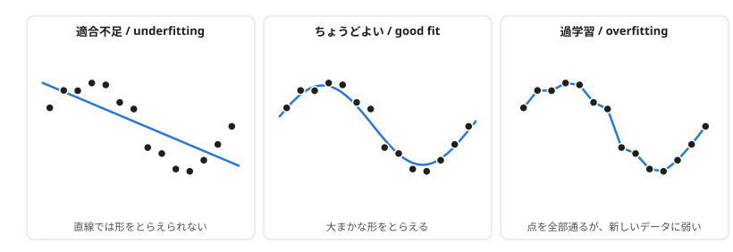

# 2. 教師あり学習と回帰

## この章でわかること

- 分類と回帰
- 汎化・適合不足・過学習
- 教師あり学習の進め方
- 線形回帰と、その評価（MSE・$R^2$）
- 正則化（Lasso・Ridge）

## 分類と回帰

| 種類 | 当てるもの | 例 |
| --- | --- | --- |
| 分類 | 種類（とびとびの値） | 良性か悪性か、品種、行動 |
| 回帰 | 数（続いた値） | 風速、乳量、価格 |

数を当てる問題でも、データによっては「多い・ふつう・少ない」の分類にしたほうがうまくいくこともあります。

## 汎化と過学習

新しいデータでもよく当たることを**汎化**といいます。



| 状態 | 学習データ | 新しいデータ | 原因 |
| --- | --- | --- | --- |
| 適合不足（underfitting） | 当たらない | 当たらない | モデルが単純すぎる |
| ちょうどよい | よく当たる | よく当たる | |
| 過学習（overfitting） | とてもよく当たる | 当たらない | モデルが複雑すぎ、学習データのくせ（雑音）まで覚えた |

学習データとテストデータの成績に大きな差があれば、過学習を疑います。

## 教師あり学習の進め方

1. データを学習用とテスト用に分ける
2. 学習用データでモデルを学ぶ
3. テスト用データで成績を確かめる
4. 特徴量を選ぶ・変換する・作る（6章）、モデルの設定（ハイパーパラメータ）を変える（7章）
5. 2 に戻ってくり返す

## 線形回帰

目的変数 $y$ と特徴量 $x_1, \dots, x_k$ の間に、直線（平面）の関係があると考えるモデルです。統計の教科書の7章（OLS）と同じものです。

$$\hat{y} = w_0 + w_1 x_1 + w_2 x_2 + \cdots + w_k x_k$$

- 特徴量が1つなら単回帰、2つ以上なら重回帰
- 予測と答えの差の2乗の和が最小になるように、重み $w$ を決める

元のノートでは、ハンガリーの天気のデータ（Kaggle の「Weather in Szeged 2006-2016」）で、気温・湿度・気圧など6つの特徴量から風速を当てました。ここでは scikit-learn に入っている糖尿病のデータで、同じ流れを試します。

```python
from sklearn.datasets import load_diabetes
from sklearn.model_selection import train_test_split
from sklearn.linear_model import LinearRegression
from sklearn.metrics import mean_squared_error, r2_score

X, y = load_diabetes(return_X_y=True)
X_train, X_test, y_train, y_test = train_test_split(X, y, test_size=0.2, random_state=1)

model = LinearRegression()
model.fit(X_train, y_train)
y_pred = model.predict(X_test)
print("MSE:", mean_squared_error(y_test, y_pred))
print("R2 (train):", model.score(X_train, y_train))
print("R2 (test):", r2_score(y_test, y_pred))
print("重み:", model.coef_, "切片:", model.intercept_)
```

### 回帰の評価

| 指標 | 式 | 読み方 |
| --- | --- | --- |
| 平均二乗誤差（MSE） | $\frac{1}{n}\sum (y_i - \hat{y}_i)^2$ | 小さいほどよい。単位が2乗になる（平方根をとったものが RMSE） |
| 決定係数（$R^2$） | $1 - \frac{\sum (y_i - \hat{y}_i)^2}{\sum (y_i - \bar{y})^2}$ | 1 に近いほどよい。平均で当てるより、どれだけよいか |

- どちらも、モデルどうしを比べるために使う
- 予測値と答えの散布図も描いて、どこで外れているかを見る
- 1回の分け方だけでは運もあるので、交差検証（7章）で確かめるとよい

## 正則化（Lasso・Ridge）

特徴量が多いと、次のことが起きます。

- 過学習しやすい
- どの特徴量が効いているか、説明しにくい
- 特徴量どうしの相関が高い（**多重共線性**）と、重みが不安定になる（統計の教科書の8章）

そこで、重みが大きくなりすぎないように、誤差に「重みの大きさ」の罰を足して最小にします。これを**正則化**といいます。

$$\text{Ridge（L2）:}\quad \sum_i (y_i - \hat{y}_i)^2 + \alpha \sum_j w_j^2$$

$$\text{Lasso（L1）:}\quad \sum_i (y_i - \hat{y}_i)^2 + \alpha \sum_j \lvert w_j \rvert$$

| | Ridge（L2） | Lasso（L1） |
| --- | --- | --- |
| 罰 | 重みの2乗の和 | 重みの絶対値の和 |
| 重み | 全部を少しずつ小さくする | いくつかをちょうど 0 にする（特徴量を選ぶ） |
| 向いているとき | 多くの特徴量が少しずつ効く | 効く特徴量が少ない |

- $\alpha$ を大きくするほど罰が強く、モデルが単純になる
- 両方を混ぜたものを Elastic Net という
- 正則化をするときは、特徴量の単位をそろえる（4章の標準化）

```python
from sklearn.linear_model import Lasso, Ridge

ridge = Ridge(alpha=1.0).fit(X_train, y_train)
lasso = Lasso(alpha=0.1).fit(X_train, y_train)
print("Lasso で 0 になった重み:", (lasso.coef_ == 0).sum(), "個")
```

> 分類で使うロジスティック回帰（3章）も、scikit-learn では標準で L2 正則化がかかっています（強さは `C`。小さいほど強い）。

## まとめ

- 分類は種類を、回帰は数を当てる
- 学習データだけよく当たり、新しいデータで当たらないのが過学習
- 分ける → 学ぶ → 確かめる → 特徴量や設定を変える、をくり返す
- 線形回帰は MSE と $R^2$ で評価する
- 正則化（Ridge・Lasso）で重みを抑えると、過学習や多重共線性に強くなる。Lasso は特徴量を選べる
