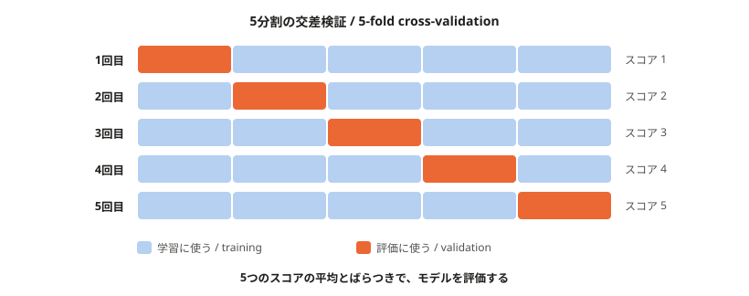
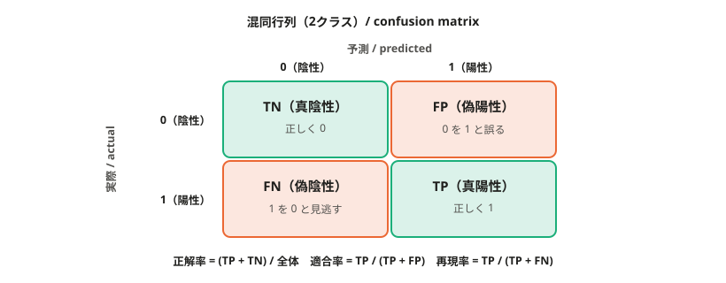
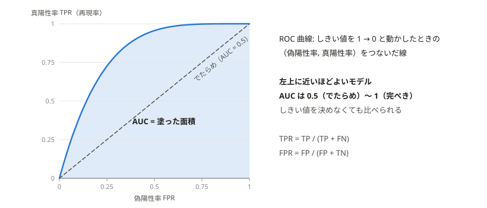

# 7. モデルの評価

## この章でわかること

- 交差検証とグループ付き交差検証
- グリッドサーチと、学習用・検証用・テスト用の3つのデータ
- 2値分類の指標（混同行列・正解率・適合率・再現率・F1・ROC/AUC・AR値・AIC）
- 多クラス分類の指標

## 交差検証

学習用とテスト用の分け方が1回だけだと、たまたまよい（悪い）分け方だったかもしれません。データを $k$ 個に分け、評価に使う部分を入れ替えながら $k$ 回学んで評価するのが**交差検証**です。



- ふつう 5〜10 に分ける
- スコアの平均でモデルの良さを、ばらつきで安定しているかを見る

```python
from sklearn.datasets import load_breast_cancer
from sklearn.model_selection import KFold, StratifiedKFold, cross_val_score
from sklearn.linear_model import LogisticRegression
from sklearn.pipeline import make_pipeline
from sklearn.preprocessing import StandardScaler

X, y = load_breast_cancer(return_X_y=True)
model = make_pipeline(StandardScaler(), LogisticRegression(max_iter=1000))
cv = StratifiedKFold(n_splits=5, shuffle=True, random_state=0)
scores = cross_val_score(model, X, y, cv=cv, scoring="roc_auc")
print(scores, scores.mean())
```

- `KFold(n_splits=5, shuffle=True, random_state=0)`: 5つに分ける。`shuffle` で混ぜてから分ける
- 分類では `StratifiedKFold` を使うと、どの部分もクラスの割合がそろう

### グループ付き交差検証

同じ人の顔、同じ牛のデータのように、まとまり（グループ）があるときは、同じグループが学習と評価の両方に入らないようにします。入ると、新しい人（牛）での成績より、よく見えてしまいます。

```python
from sklearn.model_selection import GroupKFold

groups = cow_ids          # サンプルごとの牛の番号など
scores = cross_val_score(model, X_cows, y_cows, cv=GroupKFold(n_splits=4), groups=groups)
```

## グリッドサーチ

モデルの設定（**ハイパーパラメータ**。SVM の `C`、木の深さなど）は、データから自動では決まりません。候補の組み合わせを全部試して、一番よいものを選ぶのが**グリッドサーチ**です。

設定を選ぶのに使ったデータで最終の成績を測ると、よく見えすぎます。データを3つに分けます。

| データ | 使い道 |
| --- | --- |
| 学習用 | モデルを学ぶ |
| 検証用 | 設定を選ぶ（交差検証の評価の部分がこれにあたる） |
| テスト用 | 最後に1回だけ、成績を測る |

```python
from sklearn.model_selection import GridSearchCV, train_test_split

X_trval, X_test, y_trval, y_test = train_test_split(X, y, test_size=0.2, random_state=42, stratify=y)
grid = GridSearchCV(
    make_pipeline(StandardScaler(), LogisticRegression(solver="liblinear", max_iter=1000)),
    {"logisticregression__C": [0.01, 0.1, 1, 10, 100], "logisticregression__l1_ratio": [0, 1]},   # 0 は L2、1 は L1
    cv=5, scoring="roc_auc")
grid.fit(X_trval, y_trval)              # 学習用＋検証用の中で交差検証して選ぶ
print("一番よい設定:", grid.best_params_, "検証の AUC:", round(grid.best_score_, 3))
print("テストの AUC:", grid.score(X_test, y_test))   # 選んだ設定で学び直したモデルを、最後に1回だけ
```

## 2値分類の指標

### 正解率の落とし穴

正解率（accuracy）は、当たった割合です。ところが、95% が正常のデータなら、全部「正常」と答えるだけで正解率は 95% になります。異常を1つも見つけていないのに、です。数の偏ったデータでは、次の指標を使います。

### 混同行列



| 言葉 | 意味 |
| --- | --- |
| TP（真陽性） | 実際 1 を、1 と当てた |
| TN（真陰性） | 実際 0 を、0 と当てた |
| FP（偽陽性） | 実際 0 を、1 と誤った（空振り） |
| FN（偽陰性） | 実際 1 を、0 と見逃した |

### 適合率・再現率・F1

$$\text{正解率} = \frac{TP + TN}{TP + TN + FP + FN} \qquad \text{適合率} = \frac{TP}{TP + FP} \qquad \text{再現率} = \frac{TP}{TP + FN}$$

$$F_1 = \frac{2 \times \text{適合率} \times \text{再現率}}{\text{適合率} + \text{再現率}}$$

| 指標 | 意味 | 大事なとき |
| --- | --- | --- |
| 適合率（precision） | 1 と答えたもののうち、本当に 1 だった割合 | 空振り（FP）を減らしたい。誤報が多いと困る |
| 再現率（recall） | 本当の 1 のうち、見つけられた割合 | 見逃し（FN）を減らしたい。病気や不正の発見 |
| F1 | 適合率と再現率の調和平均 | 両方をまとめて1つの数で見たい |

> 「精度」という言葉は、正解率・適合率・再現率のどれの意味でも使われます。式で確かめます。

元のノートでは、アイリスを「versicolor か、それ以外か」の2値に分けて試したところ、正解率は 0.73 でしたが、versicolor の再現率は 0.31、F1 は 0.40 でした。正解率だけを見ると、見逃しの多さに気づけません。

```python
from sklearn.metrics import confusion_matrix, classification_report

model.fit(X_trval, y_trval)
y_pred = model.predict(X_test)
print(confusion_matrix(y_test, y_pred))        # [[TN, FP], [FN, TP]]
print(classification_report(y_test, y_pred))
```

### ROC 曲線と AUC



- 1 と判定するしきい値を動かしながら、**真陽性率** TPR $= TP/(TP+FN)$（再現率と同じ）と、**偽陽性率** FPR $= FP/(FP+TN)$ を描いた線が ROC 曲線
- 左上に近いほどよい。左上に一番近い点は、しきい値の候補になる
- 曲線の下の面積が **AUC**。0.5 がでたらめ、1 が完ぺき。目安として 0.7 以上で使えることが多い
- AUC は全部のしきい値をまとめた値なので、しきい値を決めなくても比べられる。しきい値を変えて AUC が変わったら、ラベル（0/1）を渡しているなどの誤り（3章）

```python
from sklearn.metrics import roc_curve, roc_auc_score

prob = model.predict_proba(X_test)[:, 1]
fpr, tpr, thresholds = roc_curve(y_test, prob)
print("AUC:", roc_auc_score(y_test, prob))
```

### AR 値（ジニ係数）

金融の与信モデルなどでは、AUC の代わりに **AR 値**（Accuracy Ratio、ジニ係数とも）をよく使います。でたらめを 0、完ぺきを 1 にした値です。

$$\text{AR} = 2 \times \text{AUC} - 1$$

AUC が 0.8 なら AR は 0.6 です。

### AIC

**AIC**（赤池情報量規準）は、当てはまりのよさとモデルの複雑さのバランスを見る指標です。小さいほどよいモデルです。

$$\text{AIC} = 2k - 2\ln L$$

- $k$ はパラメータ（重みと切片）の数、$L$ は尤度（そのモデルのもとで、データが得られる確率）
- 特徴量を増やすと当てはまり（$\ln L$）はよくなるが、$2k$ の罰が増える。成績が同じくらいなら、AIC の小さい、単純なモデルを選ぶ
- 学んだデータ（学習用）の当てはまりで計算する。正則化したモデルでは目安になる
- scikit-learn には AIC を出す関数がないので、対数損失から計算するか、`statsmodels` のロジスティック回帰（`.aic`）を使う

```python
from sklearn.metrics import log_loss

prob_tr = model.predict_proba(X_trval)[:, 1]
log_l = -log_loss(y_trval, prob_tr, normalize=False)    # 学習用データでの対数尤度
k = model[-1].coef_.size + 1                            # 重みの数 + 切片
print("AIC:", 2 * k - 2 * log_l)
```

## 多クラス分類の指標

3つ以上のクラスでは、混同行列は クラス数 × クラス数 の表になります。F1 はクラスごとに計算し、まとめ方を選びます。

| まとめ方 | 計算 | 向いているとき |
| --- | --- | --- |
| macro | クラスごとの F1 を、同じ重みで平均 | どのクラスも同じくらい大事 |
| micro | 全クラスの TP・FP・FN を足してから計算 | 全体の当たり具合。数の多いクラスが効く |
| weighted | クラスごとの F1 を、サンプル数で重み付け平均 | 数の偏りを考えたいとき |

```python
from sklearn.metrics import f1_score
f1_score(y_true, y_pred, average="macro")   # "micro"・"weighted" も選べる
```

## まとめ

- 交差検証で、分け方による運を減らす。まとまりがあるデータはグループ付きで
- 設定はグリッドサーチで選ぶ。学習用・検証用・テスト用を分け、テスト用は最後に1回だけ
- 偏ったデータでは正解率ではなく、適合率・再現率・F1・AUC を見る。真陽性率は再現率と同じ
- AR 値 $= 2\,\text{AUC} - 1$。AIC は当てはまりと複雑さのバランス
- 多クラスは macro・micro・weighted の F1
