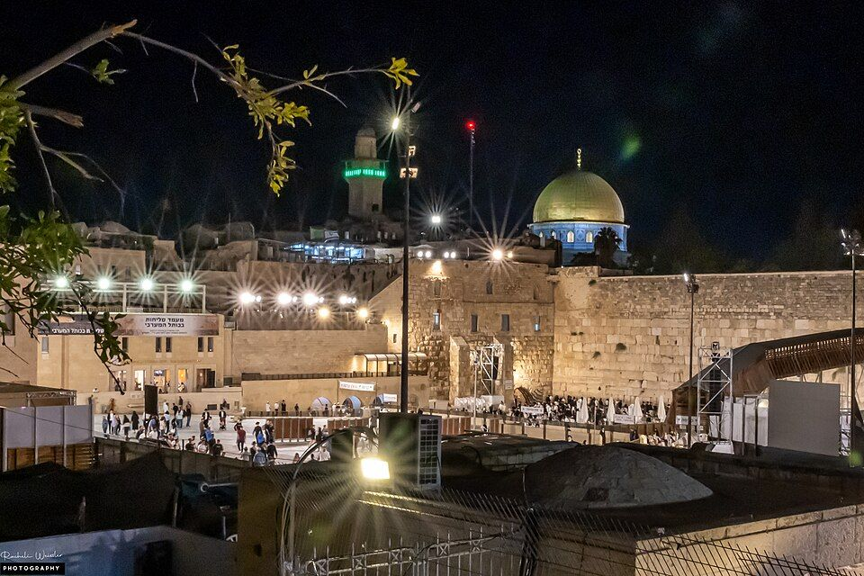
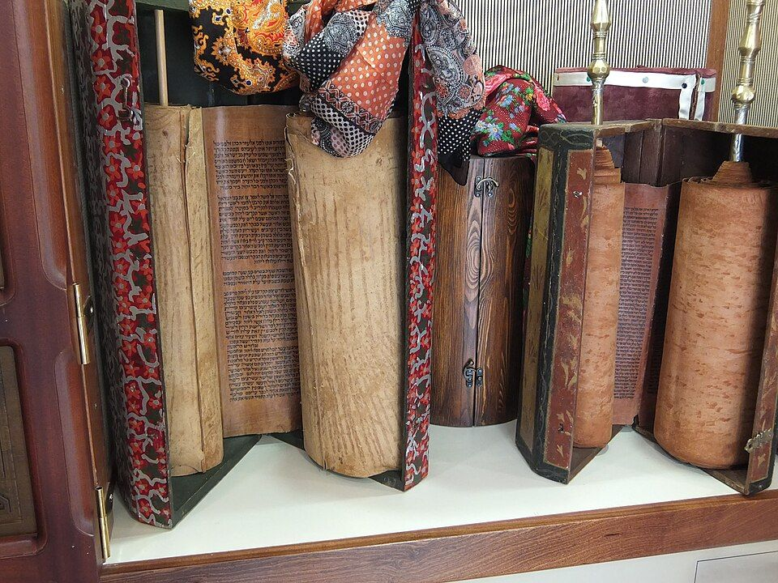
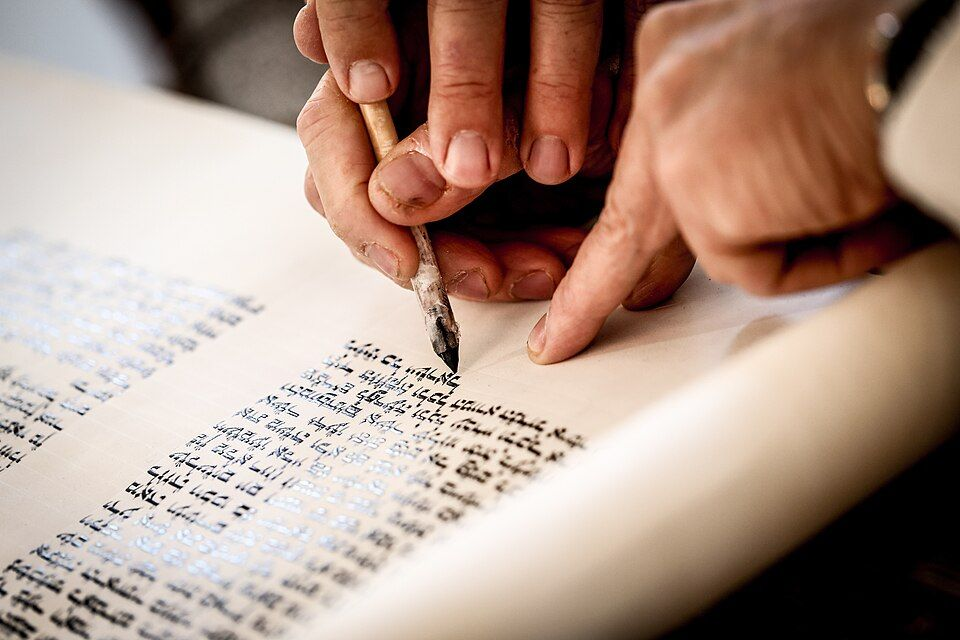
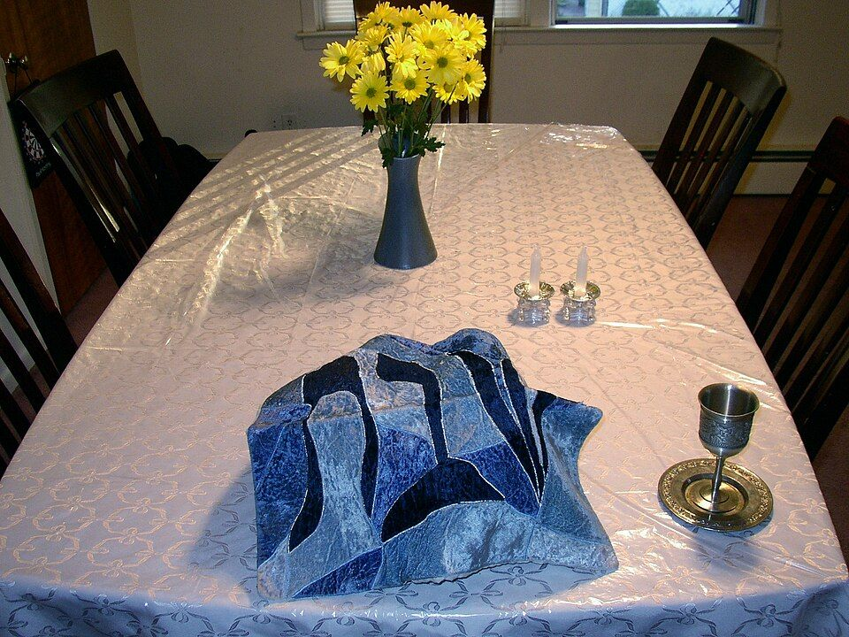
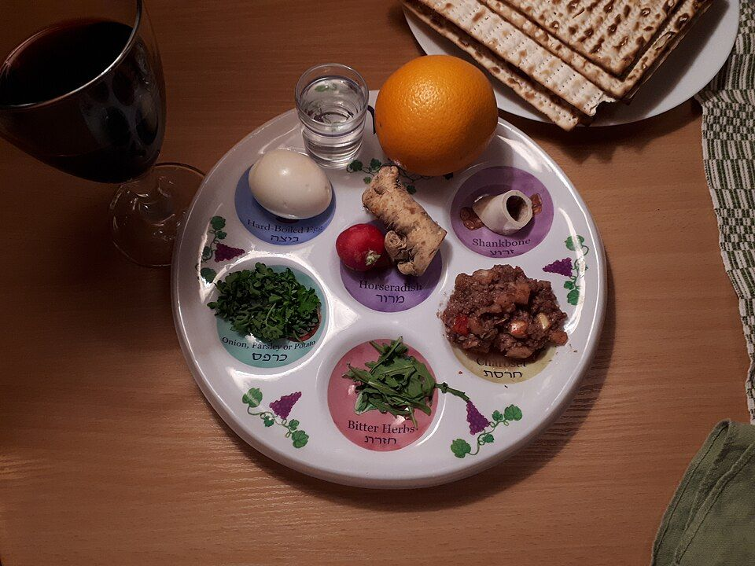
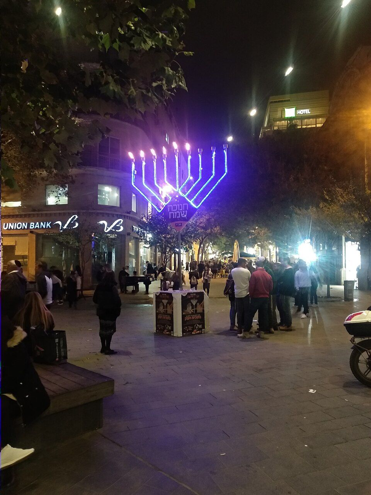
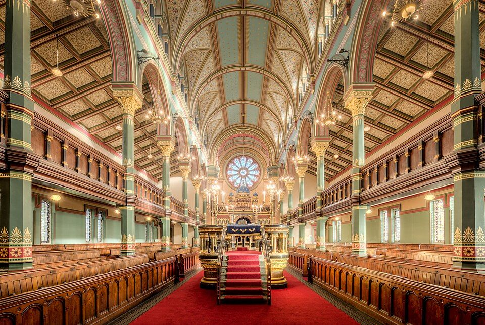

# 3. ユダヤ教

## この章でわかること

- ユダヤ教のあらましと、長い歴史
- 唯一の神との「契約」と、律法（トーラー）
- 安息日・食べ物の決まり・祭り
- キリスト教・イスラム教とのつながり

## あらまし

| 項目 | 内容 |
| --- | --- |
| 信者 | 約1,500万人（2020年）。世界の人口の0.2% |
| 多い国 | イスラエル（約半分）とアメリカ。この2か国で85% |
| 神 | 唯一の神。名前（ヤハウェ）を口にせず、「主（アドナイ）」「御名（ハシェム）」とよぶ |
| 聖典 | ヘブライ語聖書（タナハ。キリスト教の「旧約聖書」と同じ中身）。いちばん大事なのは、はじめの5つの書の「トーラー」（律法）。その解釈をまとめた「タルムード」 |
| 祈る場所 | シナゴーグ（会堂） |
| 指導者 | ラビ（先生。律法にくわしい人） |
| 聖地 | エルサレム |
| 言葉 | 祈りはヘブライ語 |

- ユダヤ教は、キリスト教とイスラム教のもとになった宗教です。3つとも同じ神を信じ、アブラハムを信仰の祖先とします
- 「ユダヤ人」は宗教だけでなく、民族・文化・家族のつながりでもあります。宗教を信じていなくても、自分をユダヤ人と考える人が多くいます

## 始まりと歴史

| いつ | できごと |
| --- | --- |
| 前2000年ごろ（伝承） | アブラハムが神の声を聞き、カナン（いまのイスラエル・パレスチナ）へ移ったとされる |
| 前13世紀ごろ（伝承） | モーセがエジプトで奴隷だった人々を連れ出す（出エジプト）。シナイ山で神から「十戒」を授かる |
| 前1000年ごろ | ダビデ王・ソロモン王の王国。エルサレムに神殿を建てる |
| 前586年 | 新バビロニアが神殿を壊し、人々をバビロンへ連れて行く（バビロン捕囚） |
| 前515年 | エルサレムに戻った人々が、神殿を建て直す（第二神殿） |
| 70年 | ローマ帝国が第二神殿を壊す。残ったのが西の壁（いまの「嘆きの壁」） |
| 2世紀〜 | 多くのユダヤ人が、中東・ヨーロッパ・北アフリカに散らばって暮らす（ディアスポラ）。神殿の代わりに、シナゴーグとラビが信仰の中心になる |
| 中世〜近代 | ヨーロッパで差別と追放をくり返し受ける（1492年のスペインからの追放など） |
| 19世紀末 | 祖先の土地に自分たちの国を作ろうという「シオニズム」が起こる |
| 1933〜45年 | ナチス・ドイツによるホロコースト。約600万人のユダヤ人が殺された |
| 1948年 | イスラエルが建国される。もとから住んでいたパレスチナの人々との争いが、いまも続いている |

## 何を信じるか

- **唯一の神**: 神は世界を作り、歴史を動かす。形がないので、神の像は作らない
- **契約**: 神はアブラハムの子孫（イスラエルの民）を選び、約束を結んだ。民は神の教えを守る
- **律法（トーラー）**: 神が与えた決まりを、毎日の暮らしの中で守ることが信仰そのもの。伝統では、決まりは613あるとされる
- **行いを大事にする**: 何を信じているかより、どう生きるかを重く見る
- **メシア（救い主）**: いつか救い主が来て、世界に平和が来ると待つ。キリスト教は「イエスがメシア」と考えるが、ユダヤ教はそう考えない

### 十戒（おもなもの）

1. わたしのほかに神があってはならない
2. 像を作って拝んではならない
3. 神の名をみだりに唱えてはならない
4. 安息日を守りなさい
5. 父と母を敬いなさい
6. 殺してはならない
7. 姦淫してはならない
8. 盗んではならない
9. うその証言をしてはならない
10. 隣人のものを欲しがってはならない

## きまり

| きまり | 中身 |
| --- | --- |
| 安息日（シャバット） | 金曜の日没から土曜の日没まで。仕事をせず、家族で食事をし、祈る。火を起こさない・電気のスイッチを入れないなど、厳しく守る人もいる |
| コーシャ（食べてよいもの） | ひづめが割れていて反芻する動物（牛・羊）、ひれとうろこのある魚はよい。豚・えび・かに・貝・うなぎはだめ。肉と乳製品を一緒に食べない。決まった方法で処理した肉だけ |
| 割礼 | 男の子は、生まれて8日目に割礼を受ける |
| 成人の儀式 | 男の子は13歳でバル・ミツワー、女の子は12歳ごろバト・ミツワー。人前でトーラーを読む |
| キッパ | 男性が頭にのせる小さな帽子。神を敬うしるし |

## 祭り

| 祭り | いつ（目安） | 中身 |
| --- | --- | --- |
| ロシュ・ハシャナ（新年） | 9〜10月 | ユダヤ暦の新年。角笛（ショファル）を吹く |
| ヨム・キプール（贖罪の日） | 新年の10日後 | 1日断食して、罪を悔い改める。いちばん大事な日 |
| ペサハ（過越祭） | 3〜4月 | 出エジプトを思い出す。1週間、ふくらませないパン（マツァ）を食べる |
| ハヌカ | 11〜12月 | 神殿を取りもどしたことを祝う。8日間、毎晩1本ずつろうそくを増やして灯す |

## 宗派

| 宗派 | 特徴 |
| --- | --- |
| 正統派 | 律法を昔のまま厳しく守る。黒い服とひげの「超正統派」（ハレディーム）を含む |
| 保守派 | 伝統を大事にしながら、少しずつ時代に合わせる |
| 改革派 | 律法を時代に合わせて考える。女性のラビもいる。アメリカに多い |
| 世俗的なユダヤ人 | 宗教の決まりはあまり守らないが、文化や祭りは大事にする |

- 祖先の住んだ地域で、アシュケナジム（ドイツ・東ヨーロッパ系）とセファルディム（スペイン・中東・北アフリカ系）に分けることもあります

## いまの様子

- イスラエルでは、ユダヤ教の決まりが国の暮らしにも入っています（安息日に公共交通が止まる所がある、結婚は宗教の決まりで行うなど）
- 超正統派は子どもが多く、イスラエルの中で割合が増えています
- エルサレムは、ユダヤ教・キリスト教・イスラム教の3つの聖地が集まる町です。「神殿の丘」には、ユダヤ教の神殿があった場所に、いまはイスラム教の岩のドームとアル・アクサー・モスクが建っています（5章）

## 日本とのつながり

- 1940年、リトアニアの日本領事館にいた杉原千畝は、ナチスから逃げるユダヤ人にビザを出し、多くの人の命を救いました
- 日本に住むユダヤ人は少なく、東京と神戸にシナゴーグがあります

## まとめ

- ユダヤ教は唯一の神との契約を大事にし、律法を守って暮らすことが信仰の中心
- 安息日（金曜の夜〜土曜）、コーシャの食べ物、ペサハやハヌカの祭り
- キリスト教とイスラム教のもとになった。エルサレムは3つの宗教の聖地
