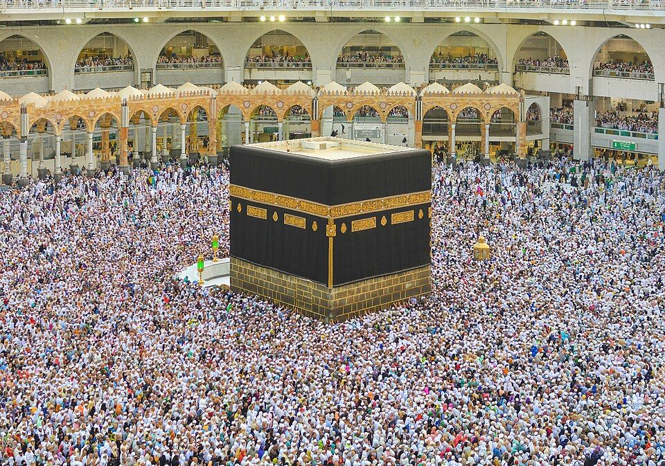
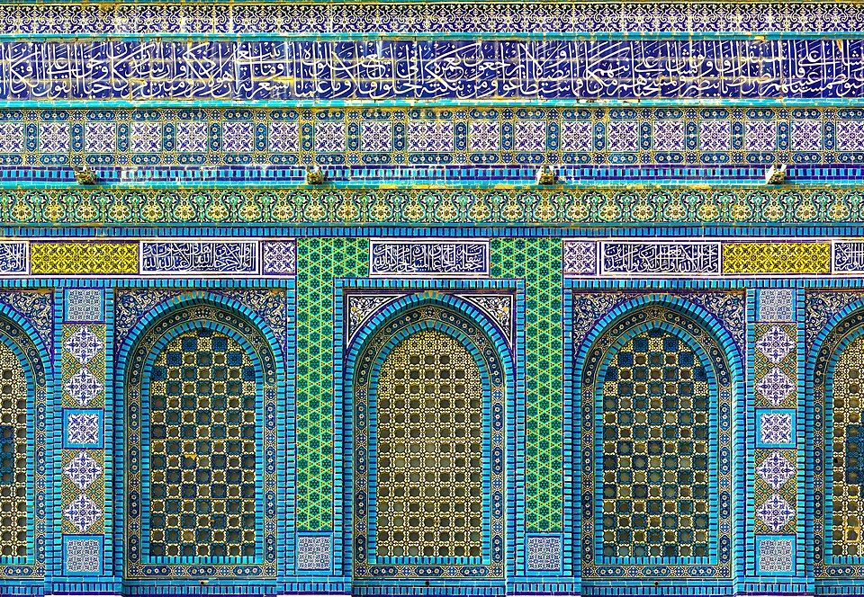
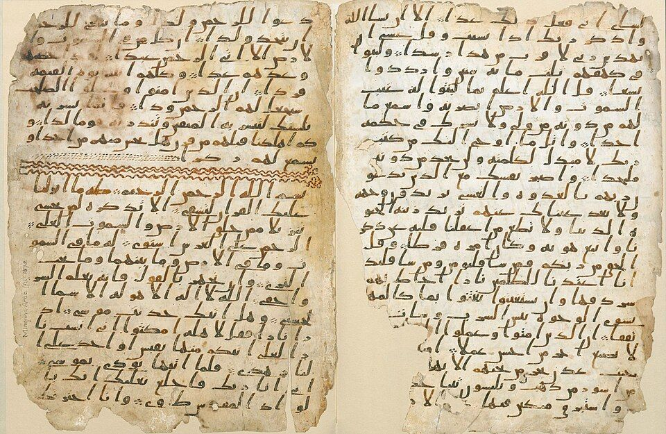
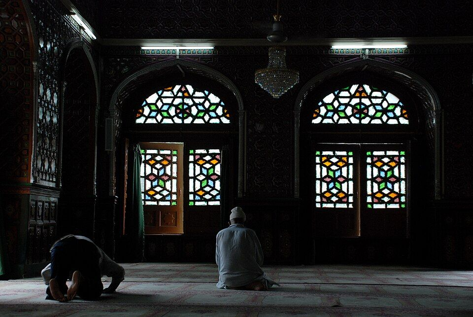
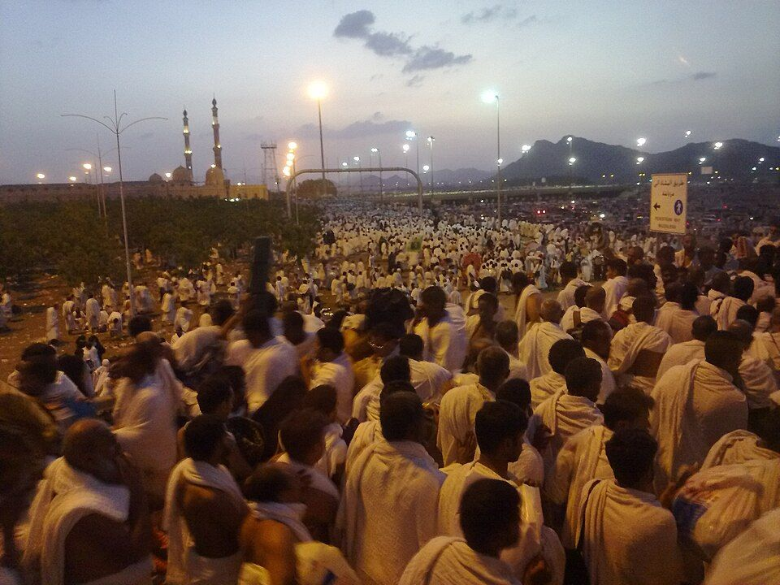
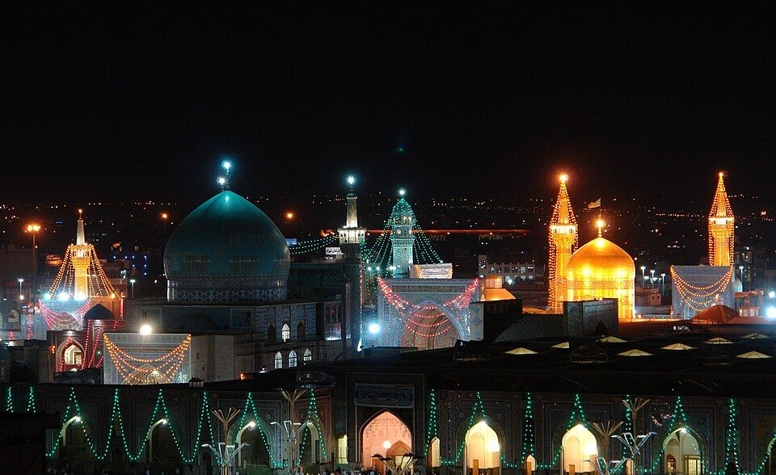
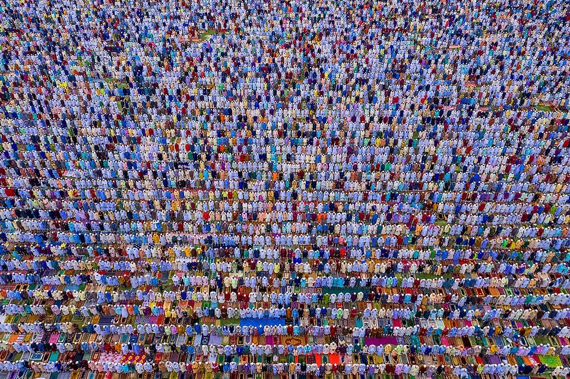
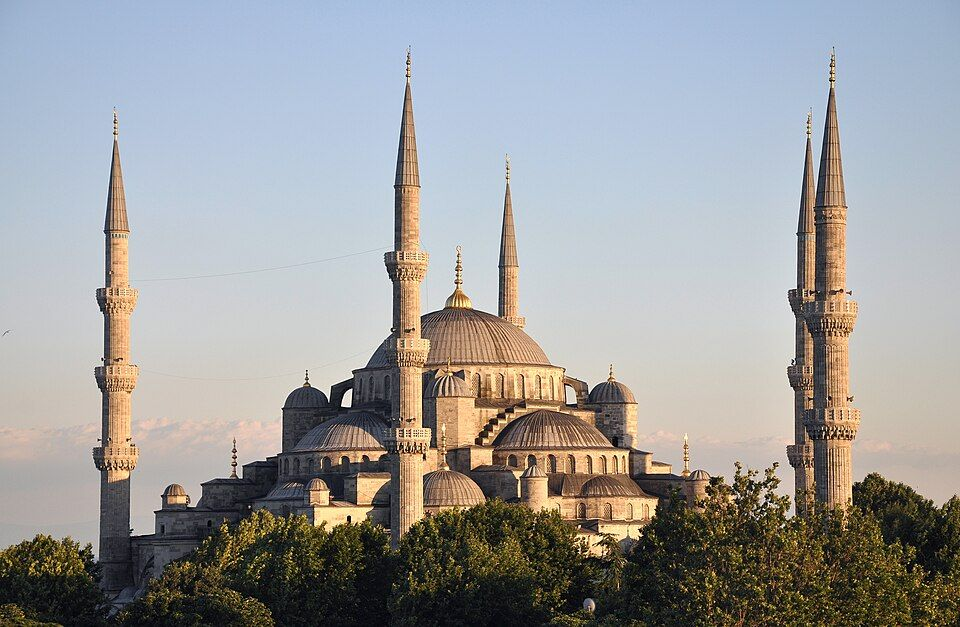
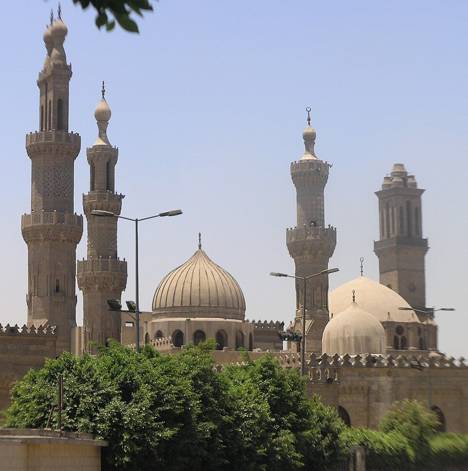
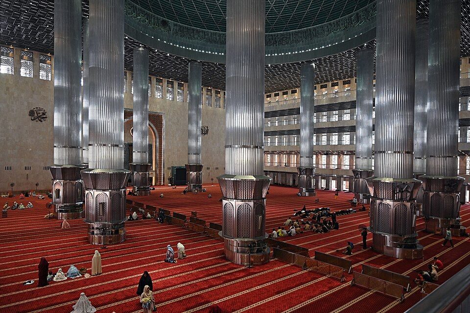

# 5. イスラム教

## この章でわかること

- イスラム教のあらましと、ムハンマドから始まる歴史
- 6つの信じることと、5つの行い（六信五行）
- スンニ派とシーア派
- ハラール・ラマダンなど、暮らしの決まり

## あらまし

| 項目 | 内容 |
| --- | --- |
| 信者 | 約20億人（2020年）。世界の人口の約4分の1で、いちばん速く増えている |
| 多い国 | インドネシア（約2.4億人）、パキスタン（約2.3億人）、インド（約2.1億人）、バングラデシュ（約1.5億人）。信者の約6割がアジア・太平洋に住む |
| 神 | アッラー（アラビア語で「神」）。ユダヤ教・キリスト教と同じ、唯一の神 |
| 預言者 | ムハンマド（570年ごろ〜632年）。神の言葉を伝えた最後の預言者とされる。アブラハム・モーセ・イエスも預言者として敬う |
| 聖典 | クルアーン（コーラン）。神がムハンマドに伝えた言葉そのものとされ、アラビア語で読む。ムハンマドの言葉と行いの記録「ハディース」も大事 |
| 祈る場所 | モスク |
| 指導者 | イマーム（礼拝を導く人）、ウラマー（イスラム法の学者） |
| 聖地 | メッカ（カアバ神殿）、メディナ（ムハンマドの墓のあるモスク）、エルサレム |

- 「イスラーム」はアラビア語で「（神に）身をゆだねること」、「ムスリム」は「身をゆだねた人」、つまり信者のことです

## 始まりと歴史

| いつ | できごと |
| --- | --- |
| 570年ごろ | ムハンマドがアラビア半島のメッカで生まれる。商人として暮らす |
| 610年ごろ | メッカ近くのヒラー山の洞窟で、天使ジブリール（ガブリエル）を通して神の言葉を受けたとされる |
| 622年 | メッカで迫害され、メディナへ移る（ヒジュラ、聖遷）。この年がイスラム暦の始まり |
| 630年 | メッカを治め、カアバから偶像を取り除く |
| 632年 | ムハンマドが亡くなる。後継者（カリフ）が共同体を率いる |
| 7〜8世紀 | 中東・北アフリカ・イラン・中央アジア・スペインまで広がる |
| 680年 | カルバラーの戦いで、ムハンマドの孫フサインが殺される。シーア派にとって大事な出来事 |
| 8〜13世紀 | アッバース朝のバグダッドで、学問が栄える（数学の代数、医学、天文学。ギリシャの本の翻訳） |
| 13世紀〜 | 商人や神秘主義者（スーフィー）によって、東南アジアやアフリカに広がる |
| 1299〜1922年 | オスマン帝国。中東・北アフリカ・東ヨーロッパを治める |
| 20世紀 | 植民地からの独立と、石油の発見。1979年にイランでイスラム革命 |

## 何を信じるか（六信）

| 信じること | 中身 |
| --- | --- |
| 神（アッラー） | 唯一の神。形がなく、像は作らない |
| 天使 | 神の言葉を伝える。ジブリールなど |
| 啓典 | 神が与えた本。トーラー、福音書、そして最後で完全な啓典がクルアーン |
| 預言者 | アダム・ノア・アブラハム・モーセ・イエス、そして最後がムハンマド |
| 来世 | 死んだあと、最後の審判で天国と地獄に分けられる |
| 定め（天命） | すべては神の意思による |

## 5つの行い（五行）

| 行い | 中身 |
| --- | --- |
| 信仰告白（シャハーダ） | 「神のほかに神はなし。ムハンマドは神の使徒である」と唱える |
| 礼拝（サラート） | 1日5回（夜明け・昼・午後・日没・夜）、メッカの方向（キブラ）に向かって祈る。金曜の昼は、モスクに集まって祈る |
| 喜捨（ザカート） | 財産の一部（ふつう2.5%）を、貧しい人のために出す |
| 断食（サウム） | ラマダン月の1か月、日の出から日没まで、食べ物も水もとらない |
| 巡礼（ハッジ） | できる人は一生に一度、決まった時期にメッカへ巡礼する。毎年200万人近くが集まる |

## スンニ派とシーア派

| | スンニ派 | シーア派 |
| --- | --- | --- |
| 割合 | 約85〜90% | 約10〜15% |
| 考え方 | 共同体が選んだカリフを、正しい後継者と認める。ムハンマドの言行（スンナ）に従う | ムハンマドのいとこで娘むこのアリーと、その子孫（イマーム）だけが正しい指導者だとする |
| 多い国 | サウジアラビア、トルコ、エジプト、インドネシア、パキスタンなど、ほとんどの国 | イラン、イラク、バーレーン、アゼルバイジャン。レバノンにも多い |
| 行事 | | フサインの死をいたむアーシューラー。聖人の墓への巡礼 |

- もとは「誰が後継者か」の争いでした。教えの中身はほとんど同じですが、政治の対立（サウジアラビアとイランなど）と重なることがあります
- このほか、神との一体を求める神秘主義（スーフィズム）があり、回って祈る踊りなどで知られます

## 暮らしの決まり

| 決まり | 中身 |
| --- | --- |
| ハラール（許されたもの） | 決まった方法で処理した肉。豚肉と、豚から作ったもの（ラード・ゼラチンなど）は禁止（ハラーム）。酒も禁止 |
| 服 | 男女とも肌を出しすぎない。女性が髪をおおうスカーフ（ヒジャブ）や、全身をおおう服をどこまで着るかは、国や人によってちがう |
| 金融 | 利子を取ることを禁じる。利子の代わりに、もうけを分け合う「イスラム金融」 |
| 法 | クルアーンとハディースをもとにしたイスラム法（シャリーア）。結婚・相続・食べ物・商売まで決める。国の法律にどこまで使うかは国によってちがう |
| 左手 | 食事や物の受け渡しは右手で |

## 祭りと暦

| 行事 | 中身 |
| --- | --- |
| ラマダン | 断食の月。日没後に家族や仲間と食事（イフタール）をとる。夜のモスクがにぎわう |
| イード・アル＝フィトル | 断食明けの祭り。新しい服を着て礼拝し、ごちそうを食べ、親せきを回る |
| イード・アル＝アドハー（犠牲祭） | 巡礼の月の祭り。羊や牛をささげ、肉を家族・親せき・貧しい人に分ける |
| 預言者の生誕祭 | ムハンマドの誕生を祝う（祝わない考えの人もいる） |

- イスラム暦は月の満ち欠けで数えるので、1年が約354日です。ラマダンや祭りは、太陽の暦（西暦）では毎年11日ほど早くなります
- 金曜が休みの国が多い（サウジアラビアなどは金・土曜、インドネシア・トルコは土・日曜）

## 世界のモスク

## いまの様子

- いちばん速く増えている宗教です。子どもが多く、2010〜20年に約3.5億人増えました
- 信者の大部分は、アラブの国ではなくアジアにいます。アラビア語を話さないムスリムのほうが多い
- ヨーロッパや北アメリカでは、移民とともに増えています
- 一部の過激な武装組織がイスラムの名を使いますが、ほとんどのムスリムは暴力に反対しています。「イスラム教徒＝危ない」という決めつけは、まちがいで、差別につながります
- 日本でも、インドネシアなどから働きに来た人や留学生が増え、モスク・空港の礼拝室・ハラールの店が増えています

## まとめ

- 唯一の神アッラーと、最後の預言者ムハンマド。聖典はクルアーン
- 六信五行。1日5回の礼拝、ラマダンの断食、メッカへの巡礼
- スンニ派が大部分で、シーア派はイランなどに多い
- 豚肉と酒を避けるハラール。信者の多くはアジアにいる
