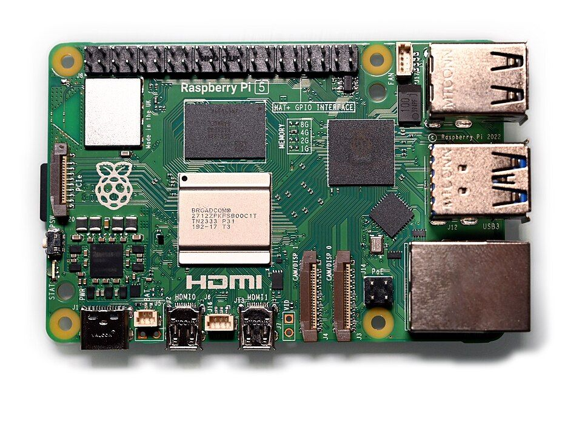
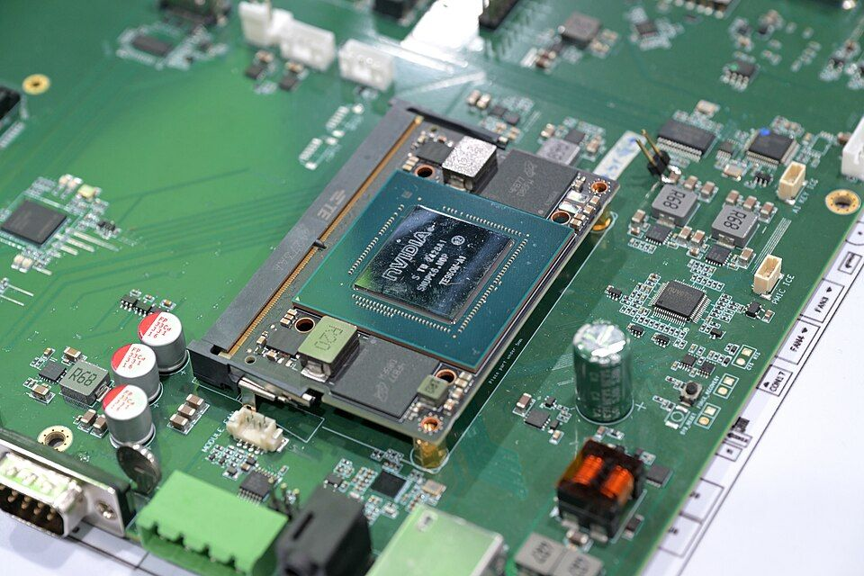
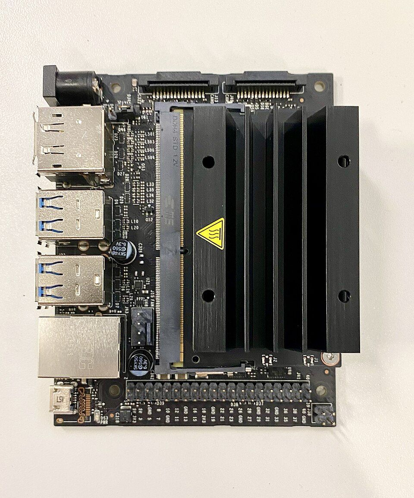
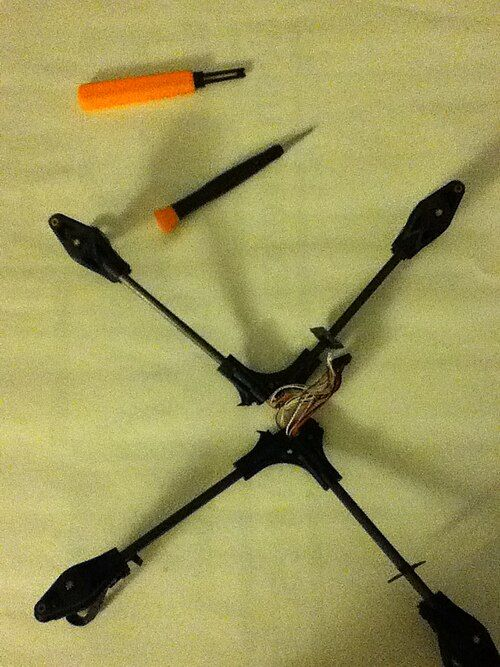

# 11. 実機: Jetson・ラズパイとつなぐ

## この章でわかること

- コンパニオンコンピューターの選び方
- フライトコントローラーに DDS 入りのファームウェアを入れる
- シリアル（UART）・USB でつなぐ配線とパラメータ
- micro-ROS Agent を、起動したら自動で動かす（systemd）
- 机の上で試す順番

## コンパニオンコンピューターを選ぶ



| 機種 | よいところ | OS と ROS 2 |
| --- | --- | --- |
| **Raspberry Pi 5** | 安い・小さい・電気が少ない。情報が多い | Ubuntu 24.04（arm64）＋ **Jazzy**（`ros-jazzy-ros-base`） |
| **Jetson Orin Nano / NX** | GPU があり、カメラの AI（物体検出など）が速い | JetPack 6（Ubuntu 22.04）＋ **Humble**。Jazzy を使うなら Docker |



- カメラで作物や牛を見分けるなど、AI を機体の上で動かすなら Jetson、センサーを読んで指令を出すだけならラズパイで十分です
- Jetson で Humble を使うときは、この教科書のコマンドの `jazzy` を `humble` に、`ros2.jazzy.repos` を `ros2.repos` に読みかえます
- 機体の上では画面を使わないので、`ssh` で入って作業します。開発はパソコンの SITL で行い、できたパッケージを git で機体のコンピューターに持っていきます（「GitHub の教科書」）



## DDS 入りのファームウェア

- AP_DDS は、**H7 の CPU のフライトコントローラー**（Pixhawk 6C/6X、Cube Orange など）で使います
- ふつうに配られているファームウェアには、DDS が入っていないことがあります。ArduPilot の **Custom Firmware Builder**（custom.ardupilot.org）で、機体の種類・基板・版を選び、機能の一覧で **DDS** にチェックを入れてビルドし、地上局で書き込みます
- 自分でビルドするなら、`./waf configure --board Pixhawk6X --enable-DDS` のように `--enable-DDS` を付けます

## つなぐ

### シリアル（UART）でつなぐ

FC の **TELEM2**（ふつう SERIAL2）と、コンパニオンコンピューターの UART をつなぎます。

| FC（TELEM2） | ラズパイ（40ピンのヘッダー） |
| --- | --- |
| TX | RX（GPIO15、10番ピン） |
| RX | TX（GPIO14、8番ピン） |
| GND | GND（6番ピンなど） |
| 5V | **つながない**（電源は別々にとる） |

- TX と RX は**交差**させます。どちらも 3.3 V の信号です（5 V の信号をラズパイにつなぐと壊れる）
- ラズパイ 5 の UART は `/dev/ttyAMA0`。`/boot/firmware/config.txt` で UART を有効にし（`enable_uart=1`）、シリアルのログイン（コンソール）は止めておきます
- Jetson の UART は機種によって `/dev/ttyTHS0` か `/dev/ttyTHS1` です

FC のパラメータ（地上局で設定して、再起動）:

| パラメータ | 値 | 意味 |
| --- | --- | --- |
| `DDS_ENABLE` | 1 | DDS を使う |
| `SERIAL2_PROTOCOL` | **45** | この口を DDS（XRCE）に使う |
| `SERIAL2_BAUD` | 921 | 921,600 bps（公式の例は 115 = 115,200。両方を同じにする） |
| `DDS_DOMAIN_ID` | 0 | `ROS_DOMAIN_ID` と同じ番号にする |

コンパニオンコンピューターで、micro-ROS Agent を動かします（9章のワークスペースを、機体のコンピューターでもビルドしておく）。

```bash
source ~/ardu_ws/install/setup.bash
ros2 run micro_ros_agent micro_ros_agent serial -b 921600 -D /dev/ttyAMA0
```

- つながると、別のターミナルの `ros2 topic list` に `/ap/...` が出ます
- 機体のコンピューターでは、ArduPilot のファームウェア自体のビルドは要りません。`colcon build --packages-up-to micro_ros_agent ardupilot_msgs` で、必要なものだけビルドできます

### USB でつなぐ

- FC の USB を、コンパニオンコンピューターにさすだけでもつながります。H7 の FC は、USB に2つめの口（2つめの仮想シリアル）を持ち、それを DDS に使えます
- ArduPilot の例（Pixhawk 6X）では、USB の2つめの口が SERIAL8 なので、`SERIAL8_PROTOCOL` を 45、`SERIAL8_BAUD` を 115 にして、`/dev/serial/by-id/usb-ArduPilot_...-if02` を指定します
- `/dev/serial/by-id/` の名前は、さし直しても変わらないので、`/dev/ttyACM1` のような番号より安全です

### イーサネット（UDP）でつなぐ

- イーサネットのある FC（Pixhawk 6X など）は、UDP でもつなげます（`DDS_IP0`〜`DDS_IP3` に Agent の IP アドレス、`DDS_UDP_PORT` に 2019）
- Agent は `ros2 run micro_ros_agent micro_ros_agent udp4 -p 2019`

## 起動したら自動で動かす（systemd）

機体の電源を入れたら、Agent が自動で起動するようにします（Linux の systemd のサービス）。

`/etc/systemd/system/micro-ros-agent.service`:

```ini
[Unit]
Description=micro-ROS Agent for ArduPilot
After=network-online.target

[Service]
User=ubuntu
Environment=ROS_DOMAIN_ID=0
ExecStart=/bin/bash -c 'source /opt/ros/jazzy/setup.bash && source /home/ubuntu/ardu_ws/install/setup.bash && exec ros2 run micro_ros_agent micro_ros_agent serial -b 921600 -D /dev/ttyAMA0'
Restart=always
RestartSec=2

[Install]
WantedBy=multi-user.target
```

```bash
sudo systemctl daemon-reload
sudo systemctl enable --now micro-ros-agent
journalctl -u micro-ros-agent -f        # ログを見る
```

- `User` が `/dev/ttyAMA0` を使えるように、`dialout` のグループに入れておきます（`sudo usermod -aG dialout ubuntu`）
- 自分のノード（`pilot.py` のようなもの）も、同じように launch ファイルを systemd で起動できます。ただし、**電源を入れただけで機体が動き出すような作りにはしない**こと。アームと離陸は、人が確認してから始める作りにします

## 机の上で試す順番



1. **プロペラを外す**（これがいちばん大事）
2. FC とコンパニオンコンピューターを電源につなぎ、`ros2 topic echo /ap/navsat` で GPS の値が届くか見る
3. 機体を手で傾けて、`/ap/pose/filtered` の向きが正しく変わるか見る（ENU であること）
4. `/ap/prearm_check` で、アームできる状態か確かめる
5. GUIDED にして、ROS 2 からアームとディスアームだけをしてみる（プロペラなし）
6. 地上局で、ジオフェンス・フェイルセーフ・送信機の RTL のスイッチを確かめる
7. 広く人のいない所で、まず送信機で手動で飛ばし、そのあと ROS 2 から短く動かす
8. 毎回、DataFlash のログと `ros2 bag` を残す

- ローバーも同じです。はじめは車輪を浮かせて（台に載せて）試します
