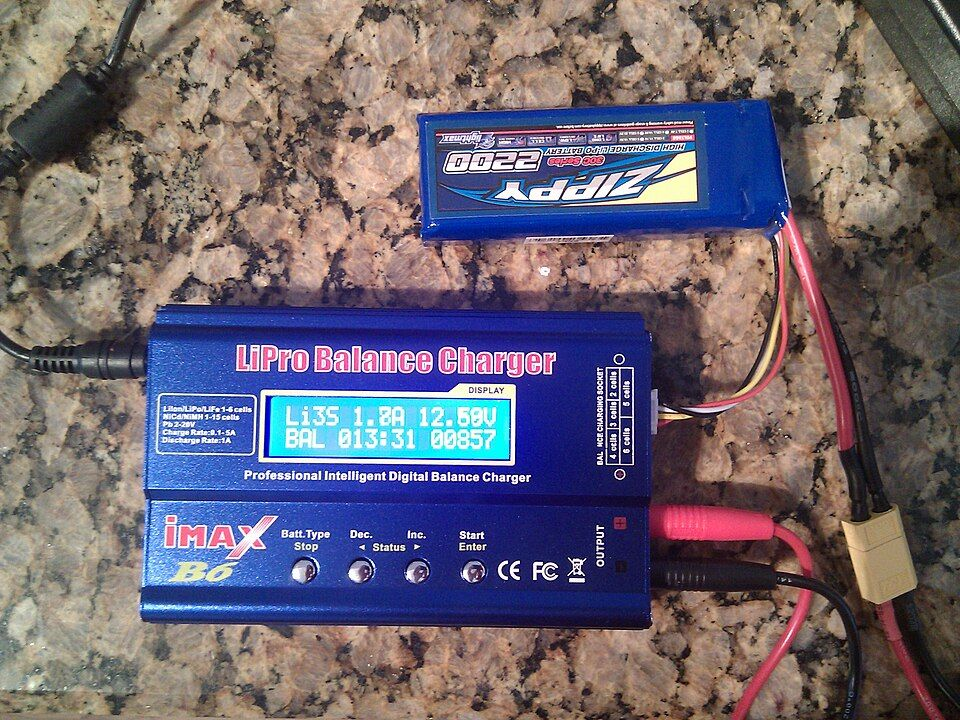
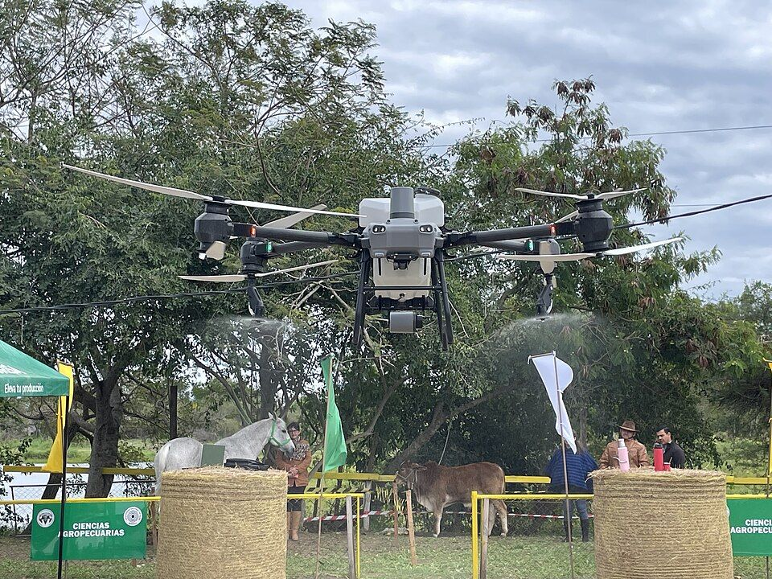
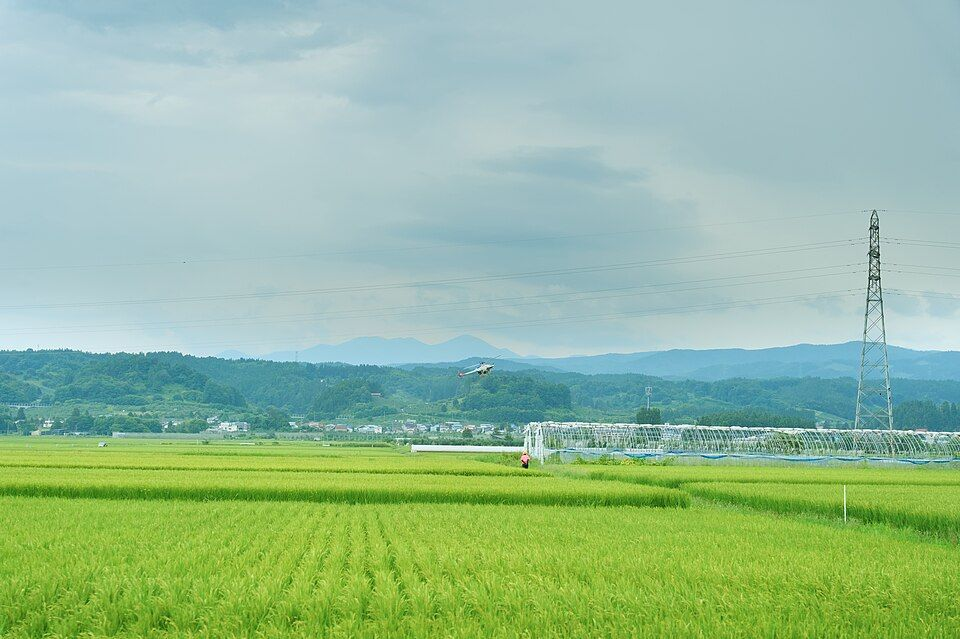

# 12. 安全と法律

## この章でわかること

- 実機を動かす前の安全の決まりごと
- LiPo 電池の扱い
- 日本のドローンの法律（航空法・小型無人機等飛行禁止法）
- 電波の法律（電波法、技適）
- 農薬をまくときと、ローバーの決まり

この章の法律の話は 2026年11月に調べたものです。法律と手続きはよく変わるので、飛ばす前に国土交通省・総務省のページで確かめてください。

## 安全の決まりごと

- **シミュレーションで全部 試してから**実機で試す。新しいプログラムは、毎回 SITL から
- 机の上では**プロペラを外す**。プロペラは指を切り、骨も折ります
- **送信機で、いつでも手動に戻せる**ようにする。LOITER（Copter）・HOLD（Rover）・RTL のスイッチを決め、目をつぶっても押せるようにしておく
- **ジオフェンス**（高さと範囲）と**フェイルセーフ**（RC・GCS・電池・EKF）を必ず設定し、SITL で動作を確かめる（6章）
- モーターを止める**緊急停止**のスイッチ（RC の補助チャンネルに「Motor Emergency Stop」を割り当てる）を用意する
- 人・車・建物から離れる。風（地上で 5 m/s をこえたら注意）、雨、電線、鳥
- 飛ばす前の点検の表（プロペラ・ねじ・電池・GPS の衛星の数・コンパス・モード・フェイルセーフ）を作り、毎回チェックする
- 毎回のログ（DataFlash・ros2 bag）を残す。何か起きたら、まずログを見る

## LiPo 電池

- LiPo（リチウムポリマー）電池は、軽くて大きな電流が出ますが、**扱いを誤ると燃えます**
  - 充電は、専用の**バランス充電器**で、目を離さずに。燃えにくい袋（LiPo バッグ）の中で
  - 1セルあたり 3.0〜3.3 V より下まで使わない（電池を傷め、膨らむ）。`BATT_LOW_VOLT` を設定する
  - 使わないときは、1セル 3.8 V ほどの**保管電圧**にしておく。満充電のまま置かない
  - 膨らんだ・ぶつけた電池は使わない。捨てるときは自治体の決まりに従う

## 航空法（ドローンの決まり）

- 重さ **100 g 以上**のドローン・ラジコン機は「**無人航空機**」で、航空法の決まりに従います（電池を含む重さ）

### 登録とリモート ID

- 無人航空機は、国（国土交通省）の**登録**が必要です（2022年6月から）。登録記号を機体に表示し、**リモート ID**（機体の番号を電波で発信する装置）を付けます
- 手作りの機体も同じです。ArduPilot の機体も、登録とリモート ID が必要です（ArduPilot はリモート ID の装置と連携できます）
- 手続きは、国土交通省の **DIPS 2.0**（ドローン情報基盤システム）で行います

### 特定飛行

次のような飛ばし方は「**特定飛行**」で、国の**許可・承認**（DIPS 2.0 で申請）か、**機体認証**と**操縦者の技能証明**（一等・二等無人航空機操縦士）が必要です。

| 場所（空域） | 飛ばし方 |
| --- | --- |
| 空港のまわり | 夜間 |
| 地面から 150 m 以上 | 目で見えない所（目視外） |
| 人口集中地区（DID）の上 | 人や物から 30 m 未満 |
| 緊急用務空域 | お祭りなど人が集まる所の上 |
| | **危険物を運ぶ**（農薬など） |
| | **物を落とす**（農薬・肥料・種をまく） |

- **ROS 2 で自動で飛ばす**ときも、目で見える所で、すぐに手動に戻せるようにするのが基本です。目視外の自動飛行は、許可・承認の条件が厳しくなります
- 飛ばす前に、DIPS 2.0 で**飛行計画の通報**をし、飛行の**日誌**をつけます（特定飛行のとき）
- お酒を飲んで飛ばすこと、危ない飛ばし方は、いつでも禁止です。事故が起きたら、国への報告が必要です
- 2026年の動き
  - 3月: 人口集中地区のうち、工業専用地域の上空は、許可がいらなくなった
  - 6月: 1人の操縦者が同時に飛ばせる機体の数の上限（目視外で5機）がなくなった
  - 7月14日: **小型無人機等飛行禁止法**の改正。国の大事な施設（国会・官邸・防衛の施設・空港・原子力発電所・大使館など）のまわりで飛ばしてはいけない範囲が、約 300 m から**約 1 km** に広がった（100 g 未満の機体も対象）

## 電波法（技適）

- 日本で電波を出す機器は、日本の基準に合っていることを示す**技適マーク**が必要です。技適のない無線機を使うと、電波法違反になります
- ドローンで使う電波

| 周波数 | 使いみち | 必要なもの |
| --- | --- | --- |
| **2.4 GHz** | 送信機（プロポ）、Wi-Fi、テレメトリ | 技適のある機器なら、免許・資格はいらない |
| **920 MHz** | テレメトリ（特定小電力） | 技適のある機器なら、いらない |
| **5.7 GHz** | 映像・データ（無人移動体画像伝送システム） | 無線局の**免許**と、**第三級陸上特殊無線技士**以上の資格 |
| 169 MHz | 遠くまでの操縦・データ | 無線局の免許と、第三級陸上特殊無線技士以上 |
| 5.8 GHz（アマチュア無線） | 趣味の FPV の映像 | アマチュア無線の免許。**仕事では使えない** |
| 携帯電話（LTE・5G） | 遠くからの操縦・映像 | 携帯会社の「上空で使う」ためのプラン |

- **海外で売られているテレメトリ無線（915 MHz・433 MHz の SiK 無線など）は、日本では使えません**。技適のある 920 MHz・2.4 GHz の製品を選びます
- コンパニオンコンピューターの Wi-Fi・Bluetooth も電波です。ラズパイ・Jetson の Wi-Fi のモジュールは技適のあるものを使います

## 農薬をまくとき

- 航空法: 農薬の散布は「**危険物の輸送**」と「**物件投下**」にあたるので、許可・承認（または機体認証と技能証明）が必要です
- **農薬取締法**: ドローンでまいてよいと登録された農薬だけを、ラベルの濃さ・量・回数・時期で使います。まわりの畑や家・水路に飛ばないように（ドリフト）注意します
- 地域のルール: 散布の前に、まわりの農家・住民に知らせることが多い。農林水産省の「無人マルチコプターによる農薬の空中散布」のガイドラインも見ます
- 「畑作と米の教科書」の12章（スマート農業）もあわせて読んでください

## ローバー（地面を走るロボット）

- 自分の農場（私有地）の中なら、走らせるのに国の許可はいりません
- **公道**を走らせるのは、ナンバー・保安基準・運転者などの決まり（道路運送車両法・道路交通法）があり、ふつうはできません。歩道を走る小型のロボットには、別に届け出の制度（遠隔操作型小型車）があります
- 自動で走る農業機械（ロボットトラクター）は、農林水産省の「農業機械の自動走行に関する安全性確保ガイドライン」があります。人が近くで見張る、人を見つけたら止まる、などが求められます
- 重い機体は、ぶつかると大けがになります。速さを制限し（パラメータ）、緊急停止のボタンを付けます
