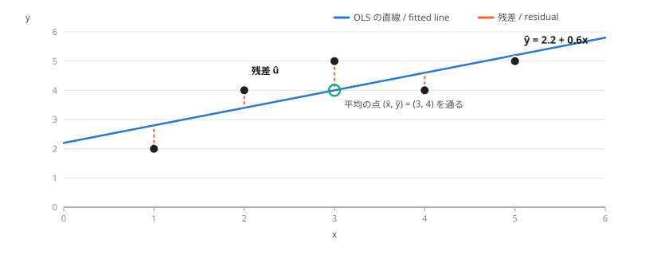

# 7. 回帰分析と OLS

## この章でわかること

- 回帰モデルと誤差項
- 最小二乗法（OLS）の推定量
- 残差の性質
- 決定係数 $R^2$
- 重回帰と Python での計算

## 回帰モデル

$y$ を $x$ で説明する直線のモデルを**単回帰モデル**といいます。

$$y_i = \beta_0 + \beta_1 x_i + u_i$$

- $y$ を**被説明変数**（目的変数）、$x$ を**説明変数**といいます
- $\beta_0$（切片）と $\beta_1$（傾き）が知りたい値。$\beta_1$ は「$x$ が1増えると $y$ が平均でいくら増えるか」
- $u_i$ を**誤差項**といい、$x$ 以外で $y$ を動かすもの全部をまとめたもの

## 最小二乗法（OLS）

データに一番よく合う直線 $\hat{y} = \hat\beta_0 + \hat\beta_1 x$ を、**残差** $\hat{u}_i = y_i - \hat{y}_i$ の2乗の和が一番小さくなるように決めます。これを**最小二乗法**（OLS: Ordinary Least Squares）といいます。

$$\min_{\beta_0,\,\beta_1} \sum_{i=1}^{n} \left(y_i - \beta_0 - \beta_1 x_i\right)^2$$



この最小化を解くと、**OLS 推定量**が求まります。

$$\hat\beta_1 = \frac{\sum (x_i - \bar{x})(y_i - \bar{y})}{\sum (x_i - \bar{x})^2} = \frac{S_{xy}}{S_{xx}} \qquad \hat\beta_0 = \bar{y} - \hat\beta_1 \bar{x}$$

- 傾きは「共変動 ÷ $x$ の総変動」。相関係数を使うと $\hat\beta_1 = r \cdot s_y / s_x$
- 2章のデータ（$S_{xy} = 6$、$S_{xx} = 10$、$\bar{x} = 3$、$\bar{y} = 4$）では、$\hat\beta_1 = 0.6$、$\hat\beta_0 = 4 - 0.6 \times 3 = 2.2$。直線は $\hat{y} = 2.2 + 0.6x$

## 残差の性質

OLS で求めた直線には、いつも次の性質があります（最小化の条件から出てくる）。

| 性質 | 式 |
| --- | --- |
| 残差の合計は 0 | $\sum \hat{u}_i = 0$ |
| 残差と説明変数は相関しない | $\sum x_i \hat{u}_i = 0$ |
| 残差と予測値は相関しない | $\sum \hat{y}_i \hat{u}_i = 0$ |
| 直線は平均の点を通る | $\bar{y} = \hat\beta_0 + \hat\beta_1 \bar{x}$ |

## 決定係数

$y$ の総変動は、直線で説明できた部分と、残差の部分に分けられます。

$$\underbrace{\sum (y_i - \bar{y})^2}_{\text{TSS（総変動）}} = \underbrace{\sum (\hat{y}_i - \bar{y})^2}_{\text{ESS（説明できた変動）}} + \underbrace{\sum \hat{u}_i^2}_{\text{RSS（残差の変動）}}$$

説明できた割合が**決定係数**です。

$$R^2 = \frac{\text{ESS}}{\text{TSS}} = 1 - \frac{\text{RSS}}{\text{TSS}}$$

- 0 から 1 の値で、1 に近いほど直線がよく当てはまる
- 単回帰では、相関係数の2乗と同じ（$R^2 = r^2$）。2章のデータでは TSS = 6、ESS = $0.6^2 \times 10 = 3.6$ なので $R^2 = 0.6$
- $R^2$ が高いことと、因果関係があることは別（8章）

## 重回帰

説明変数が2つ以上のものを**重回帰モデル**といいます。

$$y_i = \beta_0 + \beta_1 x_{1i} + \beta_2 x_{2i} + \cdots + \beta_k x_{ki} + u_i$$

- $\beta_1$ は「ほかの説明変数を一定にしたときの、$x_1$ の効果」
- 行列で書くと、推定量は $\hat\beta = (X^\top X)^{-1} X^\top y$
- 説明変数を増やすと $R^2$ は必ず上がるので、変数の数で調整した**自由度調整済み決定係数**も見ます

$$\bar{R}^2 = 1 - \frac{\text{RSS} / (n - k - 1)}{\text{TSS} / (n - 1)}$$

## Python で計算する

`statsmodels` を使うと、係数・標準誤差・t 値・$R^2$ がまとめて出ます（機械学習の教科書では `scikit-learn` の `LinearRegression` を使います）。

```python
import numpy as np
import statsmodels.api as sm

x = np.array([1, 2, 3, 4, 5])
y = np.array([2, 4, 5, 4, 5])
X = sm.add_constant(x)          # 切片の列を足す
res = sm.OLS(y, X).fit()
print(res.params)               # [2.2 0.6]
print(res.rsquared)             # 0.6
print(res.summary())            # 標準誤差・t値・p値などの表
```

## まとめ

- 回帰モデル $y = \beta_0 + \beta_1 x + u$。誤差項 $u$ は、$x$ 以外の要因全部
- OLS は残差の2乗の和を最小にする。傾き $= S_{xy}/S_{xx}$、直線は平均の点を通る
- $R^2$ は総変動のうち直線で説明できた割合。重回帰では $\bar{R}^2$ も見る
