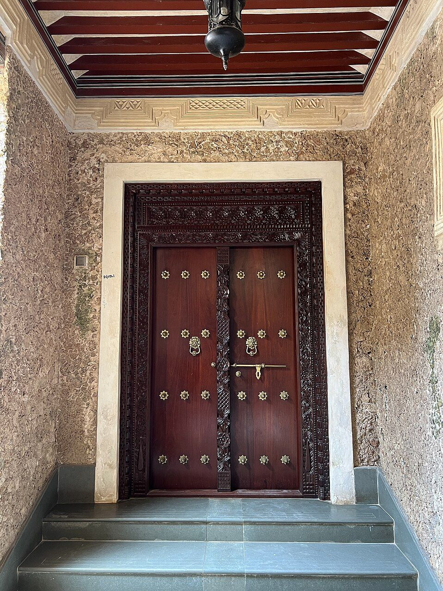

# 1. スワヒリ語とは

スワヒリ語（**Kiswahili** キスワヒリ）は、東アフリカで広く話されている言葉です。タンザニアやケニアでは、民族の言葉がちがう人どうしが、スワヒリ語で話します。

## どこで話されているか

| 国 | スワヒリ語の立場 |
| --- | --- |
| タンザニア | 国語。役所・小学校・国会・新聞・テレビまで、ほとんどスワヒリ語。英語より通じる |
| ケニア | 国語で、英語とならぶ公用語（2010年の憲法）。町では英語もよく通じる |
| ウガンダ | 英語とならぶ公用語。2022年に、学校で必修にすると決めた |
| ルワンダ | 2017年に公用語に加えた（ほかにキニヤルワンダ語・英語・フランス語） |
| コンゴ民主共和国 | 4つの国語の1つ。東部でよく話される |
| ブルンジ・モザンビーク北部・ソマリア南部など | 一部の地域で話される |

- 話す人は2億人を超えるとされます（ユネスコ）。生まれたときからの言葉にしている人は一部で、ほとんどの人は2つ目・3つ目の言葉として話します
- アフリカ連合（AU）は2022年に、スワヒリ語を仕事で使う言葉（作業言語）に加えました。東アフリカ共同体（EAC）も、英語とならぶ公用語にすると決めています
- ユネスコは7月7日を「世界スワヒリ語の日」にしました（2022年から）

## 成り立ち

- 東アフリカの海岸で、バントゥー系の言葉（アフリカの中部から南部に広がる言葉の仲間）から生まれました
- 何百年もの間、アラビア半島・ペルシャ・インドの商人と、ダウ船（季節風で走る帆船）で交易をしたので、アラビア語から来た言葉がたくさんあります。例: **kitabu**（本）、**saa**（時計・時間）、**habari**（ニュース・様子）
- 「スワヒリ」は、アラビア語の「海岸」（sawāḥil）から。「海岸の人たちの言葉」という意味です
- 昔はアラビア文字で書きました。19世紀から、ラテン文字（ローマ字）で書くようになりました
- ヨーロッパの言葉からも入っています: **shule**（学校。ドイツ語の Schule）、**meza**（机。ポルトガル語の mesa）、**basi**（バス）、**kompyuta**（コンピューター）
- タンザニアでは、初代大統領のニエレレが、スワヒリ語を国の言葉として広めました。120以上の民族がいる国が1つにまとまっているのは、スワヒリ語のおかげと言われます

## 日本人にやさしいところ

- 母音は a・e・i・o・u の5つで、日本語とほぼ同じです
- ローマ字のとおりに読めば、ほぼ通じます（2章）
- 言葉の終わりが母音のことが多く、日本語のリズムに近いです: **habari**（ハバリ）、**asante**（アサンテ）
- 知っている言葉もあります: **jambo**（こんにちは）、**hakuna matata**（心配ない）、**safari**（旅）

## むずかしいところ

- **名詞のクラス**: 名詞が、頭の形でいくつかのグループに分かれます。グループによって、形容詞や動詞の頭が変わります（6章）
- **動詞が長い**: 「私は・今・読む」を **ninasoma** の1語で言います（7章）。ただ、決まりはとても規則的です

## タンザニアとケニアのちがい

| | タンザニア | ケニア |
| --- | --- | --- |
| 話し方 | ていねいで、標準に近い | 英語をよく混ぜる |
| 目上へのあいさつ | **Shikamoo**（シカモー）をよく使う | 町ではあまり使わない |
| 若い人のあいさつ | **Mambo?** — **Poa.** | **Sasa?** — **Poa.** |
| 乗り合いバス | **daladala**（ダラダラ） | **matatu**（マタトゥ） |

- ナイロビの若者は、スワヒリ語と英語などを混ぜた「シェン」（Sheng）もよく話します
- この本は、タンザニアの標準のスワヒリ語で書きます。ケニアでのちがいは、そのつど書きます

## この本の使い方

- 第1部（1〜5章）: 発音・あいさつ・自己紹介・数。ここまでで、短い会話ができます
- 第2部（6〜12章）: 文法。名詞のクラスと動詞の形がわかると、知らない言葉でも文を組み立てられます
- 第3部（13〜17章）: 市場・移動・畑・牛・仕事の場面の言葉と会話
- 読み方はカタカナでも書きますが、だいたいの音です
- 2章からは、章の終わりに練習と答えがあります
- 言葉は付録A（単語帳）、形の一覧は付録B（早見表）にまとめました
