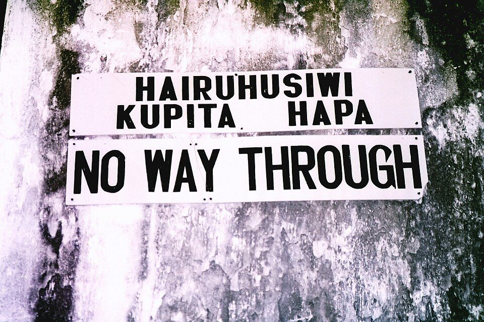

# 2. 発音と文字

スワヒリ語は、ローマ字のとおりに読めば、ほぼ通じます。英語のように、つづりと音がずれることはありません。

## 母音

| 文字 | 音 | 例 |
| --- | --- | --- |
| a | ア | **mama**（ママ）お母さん |
| e | エ | **bei**（ベイ）値段 |
| i | イ | **simu**（シム）電話 |
| o | オ | **moto**（モト）火 |
| u | ウ（くちびるを丸める） | **kuku**（クク）鶏 |

- のばす音はありません。同じ母音が2つ並んだら、2つ分を言います: **kaa**（カア）座る、**shikamoo**（シカモオ）
- 母音はぜんぶ読みます: **mzee**（ムゼエ）年配の人、**bei**（ベイ）

## 子音

ほとんどはローマ字と同じです。気をつける文字は次のとおりです。

| 文字 | 音 | 例 |
| --- | --- | --- |
| g | いつもガ行 | **gari**（ガリ）車 |
| s | いつもサ行。si は「スィ」に近い | **siku**（スィク）日 |
| j | ジャ行 | **jina**（ジナ）名前 |
| ch | チャ行 | **chai**（チャイ）お茶 |
| sh | シャ行 | **shamba**（シャンバ）畑 |
| ny | ニャ行 | **nyama**（ニャマ）肉 |
| ng' | 鼻にかかったガ（鼻濁音） | **ng'ombe**（ンゴンベ）牛 |
| ng | ン＋グ（g をはっきり） | **ngoma**（ンゴマ）太鼓 |
| th | 英語 think の th | **thelathini**（セラスィニ）30 |
| dh | 英語 this の th | **tafadhali**（タファザリ）お願いします |
| gh | のどの奥のガ | **ghali**（ガリ）値段が高い |
| r | 舌を1回はじく（日本語のラ行でよい） | **rafiki**（ラフィキ）友だち |
| w・y | ワ・ヤ行。子音のあとにも付く | **mwalimu**（ムワリム）先生、**kwenda**（クウェンダ）行く |

- c・q・x の文字は使いません（c は ch としてだけ使う）
- l と r を区別しない人もいます。どちらで言っても、たいてい通じます
- **ng'** と **ng** はちがう音です。**ng'ombe**（牛）の ng' は、「ガ」を鼻にぬいて言います

## m と n だけの音

子音の前の m・n は、それだけで1つの音（「ム」「ン」）になります。母音は付けません。

- **mtu**（ム・トゥ）人
- **mzungu**（ム・ズング）外国人（特に白人）
- **ndizi**（ン・ディ・ズィ）バナナ
- **nzuri**（ン・ズ・リ）よい

## アクセント

ほとんどの言葉は、**後ろから2つ目**の音を強く言います。

- ha**BA**ri、a**SAN**te、ka**RI**bu、ki**SWA**hili、tafa**DHA**li
- 後ろに音が付くと、強い所も後ろへずれます: ki**TA**bu（本）→ kita**BU**ni（本の中で）
- m・n だけの音も1つと数えます: **M**tu（ムトゥ）は「ム」を強く言います

## 読む練習

| スワヒリ語 | 読み | 意味 |
| --- | --- | --- |
| jambo | ジャンボ | こんにちは |
| asante | アサンテ | ありがとう |
| karibu | カリブ | ようこそ |
| chakula | チャクラ | 食べ物 |
| maji | マジ | 水 |
| maziwa | マズィワ | 牛乳 |
| ng'ombe | ンゴンベ | 牛 |
| nyumba | ニュンバ | 家 |
| shilingi | シリンギ | シリング（お金） |
| mwalimu | ムワリム | 先生 |
| kesho | ケショ | 明日 |
| asubuhi | アスブヒ | 朝 |

## 練習

1. カタカナで読み方を書いてください: (1) rafiki (2) chai (3) nyama (4) sukari（砂糖） (5) ng'ombe
2. 強く言う所はどこですか: (1) asante (2) chakula (3) Tanzania
3. **ng'ombe** の ng' と、**ngoma** の ng は、どうちがいますか

## 練習の答え

1. (1) ラフィキ (2) チャイ (3) ニャマ (4) スカリ (5) ンゴンベ
2. (1) a**SAN**te (2) cha**KU**la (3) Tanza**NI**a
3. ng' は鼻にかかったガ（鼻濁音）だけ。ng は「ン」のあとに g をはっきり言う
