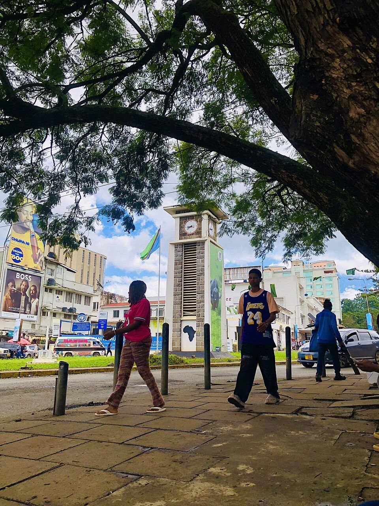

# 3. あいさつ

東アフリカでは、あいさつをとても大事にします。お店でも仕事でも、用件の前に、まずあいさつを交わします。

## まずはこれだけ

| スワヒリ語 | 読み | 意味 |
| --- | --- | --- |
| Habari? | ハバリ | 元気？（様子はどう？） |
| Nzuri. | ンズリ | 元気です（よいです） |
| Asante (sana). | アサンテ（サナ） | ありがとう（ございます） |
| Karibu. | カリブ | ようこそ・どうぞ・どういたしまして |
| Tafadhali | タファザリ | お願いします |
| Samahani | サマハニ | すみません |
| Pole. | ポレ | 大変でしたね |
| Ndiyo. / Hapana. | ンディヨ / ハパナ | はい / いいえ |
| Sawa. | サワ | わかった・オーケー |
| Kwa heri. | クワ ヘリ | さようなら |

## Habari — 「〜の様子は？」

**habari** は「ニュース・様子」という意味です。「〜の様子は？」の形で、いろいろなことをたずねます。

| スワヒリ語 | 意味 | 返事 |
| --- | --- | --- |
| Habari gani? | 調子はどう？ | Nzuri. |
| Habari za asubuhi? | おはよう（朝の様子は？） | Nzuri. / Salama. |
| Habari za mchana? | こんにちは（昼の様子は？） | Nzuri. |
| Habari za jioni? | こんばんは（夕方の様子は？） | Nzuri. |
| Habari yako? | あなたは元気？ | Nzuri. |
| Habari za kazi? | 仕事はどう？ | Nzuri. |
| Habari za nyumbani? | ご家族は元気？ | Salama. |
| Habari za safari? | 旅はどうでした？ | Nzuri. |

- 返事は、ほとんど「よい」（**nzuri**・**salama**・**njema**）です。困ったことがあっても、まず **nzuri** と答えてから話すのがふつうです
- 聞き返すときは **Nzuri, na wewe?**（元気です、あなたは？）
- **za** は「〜の」です（9章）

## Hujambo — ていねいなあいさつ

| たずねる | 返事 | だれに |
| --- | --- | --- |
| Hujambo? | Sijambo. | 1人に |
| Hamjambo? | Hatujambo. | 何人かに |
| Hajambo? | Hajambo. | その場にいない人のこと（彼・彼女は元気？） |

- 「あなたに問題はないか？」「私に問題はない」という意味で、打ち消しの形（8章）でできています
- **Jambo** は、観光客に向けた短い形です。現地の人どうしは **Hujambo** や **Habari** を使います

## Shikamoo — 目上の人に

- 若い人から、年上・目上の人に言います: **Shikamoo.** — 返事は **Marahaba.**
- 「あなたの足元に（ひざまずきます）」という意味から来ています。タンザニアでよく使います
- 年配の男性を **Mzee**（ムゼエ）、年上の女性を **Mama**、男性を **Baba** とよぶと、ていねいです。同じくらいの若い男性は **Kaka**（兄さん）、女性は **Dada**（姉さん）

## 若い人どうし

| たずねる | 返事 |
| --- | --- |
| Mambo? | Poa.（いいよ） / Safi.（ばっちり） |
| Vipi? | Poa. / Freshi. |
| Sasa?（ケニア） | Poa. / Fiti. |

- 友だちどうしで使います。仕事の相手や年上には、**Habari** や **Shikamoo** を使います

## Karibu と Asante

- 家や店に入るとき、外から **Hodi!**（ごめんください）と声をかけます。中の人は **Karibu!**（どうぞ）と答えます
- 何人かに言うときは、終わりに **-ni** を付けます: **Karibuni.**（みなさん、ようこそ）、**Asanteni.**（みなさん、ありがとう）
- 「ありがとう」への返事も **Karibu.** です

## Pole と Samahani

- **Pole.**: 相手がけが・病気・疲れ・不運のときに「大変でしたね」と言います。自分のせいでなくても言います。言われたら **Asante.** と返します
- **Pole pole**（ポレポレ）は「ゆっくり」という意味です
- **Samahani.**: 自分が悪いときの「ごめんなさい」と、人に声をかけるときの「すみません」

## 別れるとき

| スワヒリ語 | 意味 |
| --- | --- |
| Kwa heri. | さようなら（1人に） |
| Kwa herini. | さようなら（何人かに） |
| Tutaonana. | また会いましょう |
| Usiku mwema. | おやすみなさい（よい夜を） |
| Lala salama. | よく寝てね |
| Siku njema. | よい1日を |
| Safari njema. | よい旅を |
| Wasalimie nyumbani. | ご家族によろしく |

## 会話の例

| スワヒリ語 | 意味 |
| --- | --- |
| A: Shikamoo, Mzee. | こんにちは（目上の人に） |
| B: Marahaba. Habari za asubuhi? | こんにちは。おはよう |
| A: Nzuri sana. Habari za nyumbani? | とても元気です。ご家族はお元気ですか |
| B: Salama tu. Karibu. | みんな元気です。どうぞ |
| A: Asante. | ありがとうございます |

## 練習

1. スワヒリ語で言ってください: (1) おはよう（朝の様子は？）とその返事 (2) ありがとう — どういたしまして (3) 年上の人へのあいさつとその返事
2. どう答えますか: (1) Hujambo? (2) Hamjambo? (3) Pole!
3. 知り合いの家に着いて、外から声をかけるときは、何と言いますか

## 練習の答え

1. (1) Habari za asubuhi? — Nzuri. (2) Asante. — Karibu. (3) Shikamoo. — Marahaba.
2. (1) Sijambo. (2) Hatujambo. (3) Asante.
3. Hodi!
