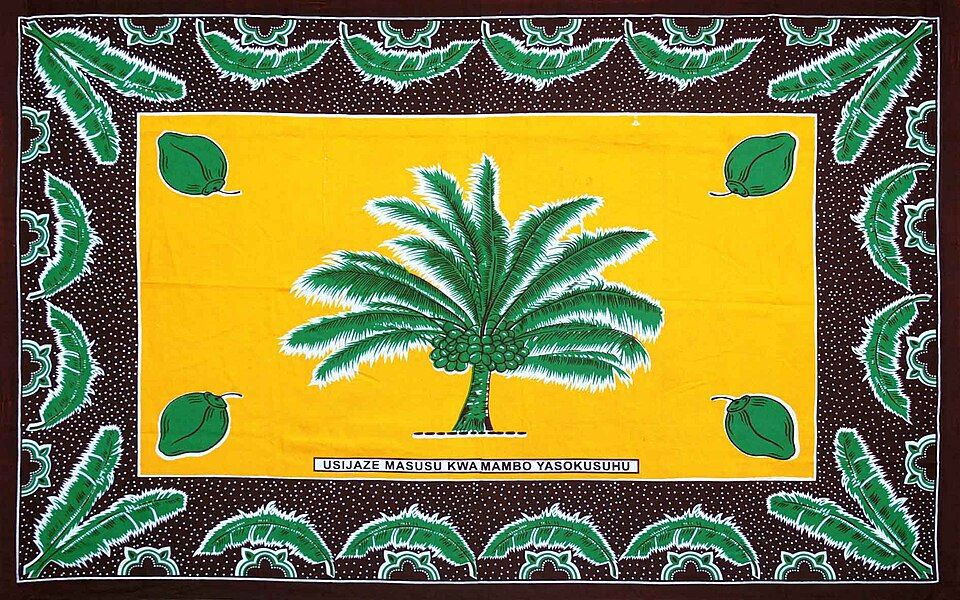
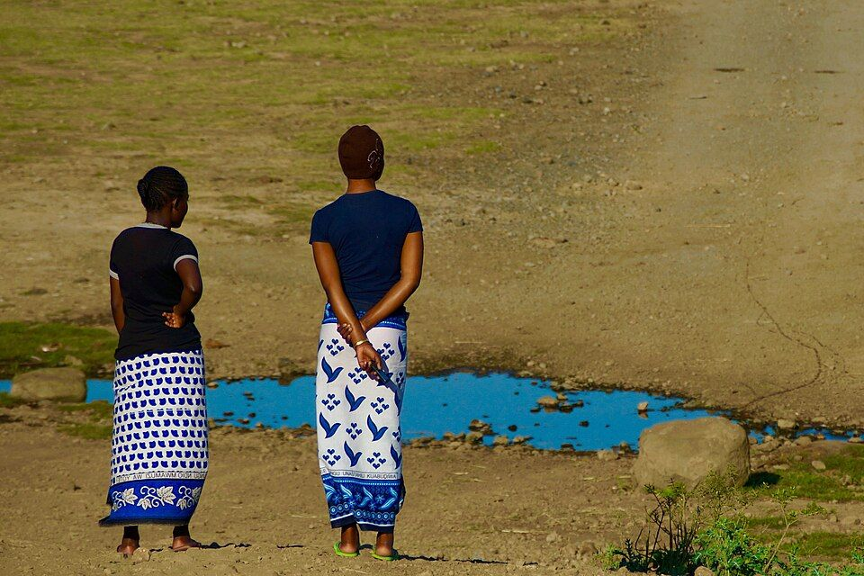

# 12. 動詞の形を変える・長い文

## 動詞の後ろを変える

語幹の後ろを変えると、「〜される」「〜させる」などの意味になります。辞書にのっていない言葉でも、ここから意味がわかります。

| 形 | 付け方 | 意味 | 例 |
| --- | --- | --- | --- |
| 受け身 | -wa | 〜される | kupika（料理する）→ kupikwa（料理される） |
| 〜に・〜のために | -ia / -ea | 人のために | kununua → kununulia（〜に買ってあげる）、kuleta → kuletea（〜に持ってくる） |
| 〜させる | -isha / -esha | 使役 | kula → kulisha（食べさせる・エサをやる）、kunywa → kunywesha（水を飲ませる） |
| おたがいに | -ana | 〜し合う | kuona → kuonana（会う）、kupenda → kupendana（愛し合う） |
| 〜できる・〜になる | -ika / -eka | 状態 | kuvunja（こわす）→ kuvunjika（こわれる） |

- 語幹の母音が a・i・u なら **-ia・-isha**、e・o なら **-ea・-esha** になります: kusoma → **kusomea**、**kusomesha**（教える＝読ませる）
- 語幹が母音で終わるときは **-l-** が入ります: kununua → **kununuliwa**（買われる）、**kununulia**
- **Tutaonana!**（また会いましょう）は、**kuonana**（会う）の未来の形です

### 牛の世話で使う例

- **Nimewalisha ng'ombe.** 牛にエサをやった
- **Nimewanywesha ng'ombe maji.** 牛に水を飲ませた
- **Ng'ombe walichanjwa jana.** 牛は昨日ワクチンを打たれた（kuchanja → kuchanjwa）
- **Maziwa yalinunuliwa na kampuni.** 牛乳は会社に買われた（受け身の「〜に」は **na**）

## つなぐ言葉

| スワヒリ語 | 意味 |
| --- | --- |
| na | 〜と・そして |
| lakini | でも |
| au | または |
| kwa sababu | 〜だから |
| kwa hiyo | だから |
| kama | もし・〜のように |
| ili | 〜するために（後ろは -e の形） |
| halafu / kisha | それから |
| kabla ya | 〜の前に |
| baada ya | 〜のあとで |
| wakati | 〜のとき |
| pia | 〜も |
| tu | 〜だけ |

- **Ninakwenda sokoni ili ninunue mboga.** 野菜を買うために市場へ行く
- **Sikuja kwa sababu nilikuwa mgonjwa.** 病気だったので来なかった
- **Kama mvua itanyesha, tutapanda mahindi.** 雨が降ったら、トウモロコシを植える
- **Baada ya kukamua, safisha ndoo.** 乳をしぼったら、バケツを洗って
- **Kabla ya kula, nawa mikono.** 食べる前に手を洗って
- 「〜と一緒に」は人の言葉とくっつきます: **nami**（私と）、**nawe**（あなたと）、**naye**（彼・彼女と）

## 「〜する人」「〜した物」（amba-）

名詞のあとに **amba-** ＋ 名詞に合う終わりを置くと、「〜する（名詞）」の形になります。

| クラス | 形 |
| --- | --- |
| 人（1人） | ambaye |
| 人（何人か） | ambao |
| KI（1つ） | ambacho |
| VI（2つ以上） | ambavyo |
| JI（1つ） | ambalo |
| MA（2つ以上） | ambayo |
| N（1つ） | ambayo |
| N（2つ以上） | ambazo |

- **Mtu ambaye anafuga ng'ombe ni mfugaji.** 牛を飼う人を mfugaji という
- **ng'ombe ambaye anatoa maziwa mengi** 乳をたくさん出す牛
- **kitabu ambacho nilinunua** 私が買った本
- **maziwa ambayo yameharibika** 傷んだ牛乳
- 話し言葉では、動詞の中に入れた形もよく聞きます: **mtu aliyekuja jana**（昨日来た人。a-li-ye-kuja）

## 「〜したら」「〜なら」

- **-ki-**（〜したら）: **Ukifika, nipigie simu.** 着いたら電話して
- **-nge-**（〜なら…のに）: **Ningekuwa na pesa, ningenunua ng'ombe.** お金があれば、牛を買うのに

## ことわざ

カンガ（2枚1組の布）には、ことわざや短い言葉が書かれています。ことわざは **methali** といいます。

| スワヒリ語 | 意味 |
| --- | --- |
| Haraka haraka haina baraka. | 急いでも、よいことはない（急がば回れ） |
| Pole pole ndio mwendo. | ゆっくりが本当の歩き方 |
| Haba na haba hujaza kibaba. | 少しずつでも、ますはいっぱいになる（ちりも積もれば山となる） |
| Kidole kimoja hakivunji chawa. | 指1本ではシラミはつぶせない（力を合わせよう） |
| Umoja ni nguvu, utengano ni udhaifu. | 団結は力、ばらばらは弱さ |
| Mgeni njoo, mwenyeji apone. | 客よ来い、住む人が助かるように（客は恵みを運んでくる） |

## 練習

1. 形を変えてください: (1) kupika を「〜される」に (2) kula を「食べさせる」に (3) kuona を「おたがいに」に (4) kununua を「〜に買ってあげる」に
2. 日本語にしてください: (1) Ng'ombe walichanjwa jana. (2) Nitakwenda shambani ili nipande mahindi. (3) Mtu ambaye alikuja jana ni daktari.
3. スワヒリ語で言ってください: 着いたら電話してください

## 練習の答え

1. (1) kupikwa (2) kulisha (3) kuonana (4) kununulia
2. (1) 牛は昨日ワクチンを打たれた (2) トウモロコシを植えるために畑へ行く (3) 昨日来た人は医者です
3. Ukifika, nipigie simu.
