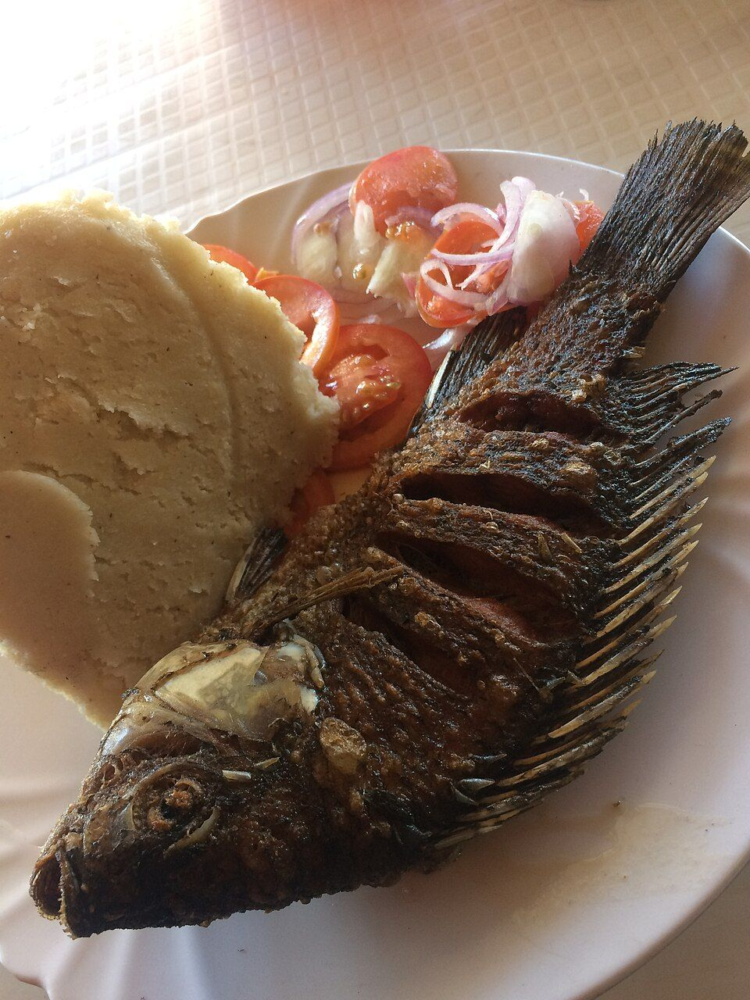
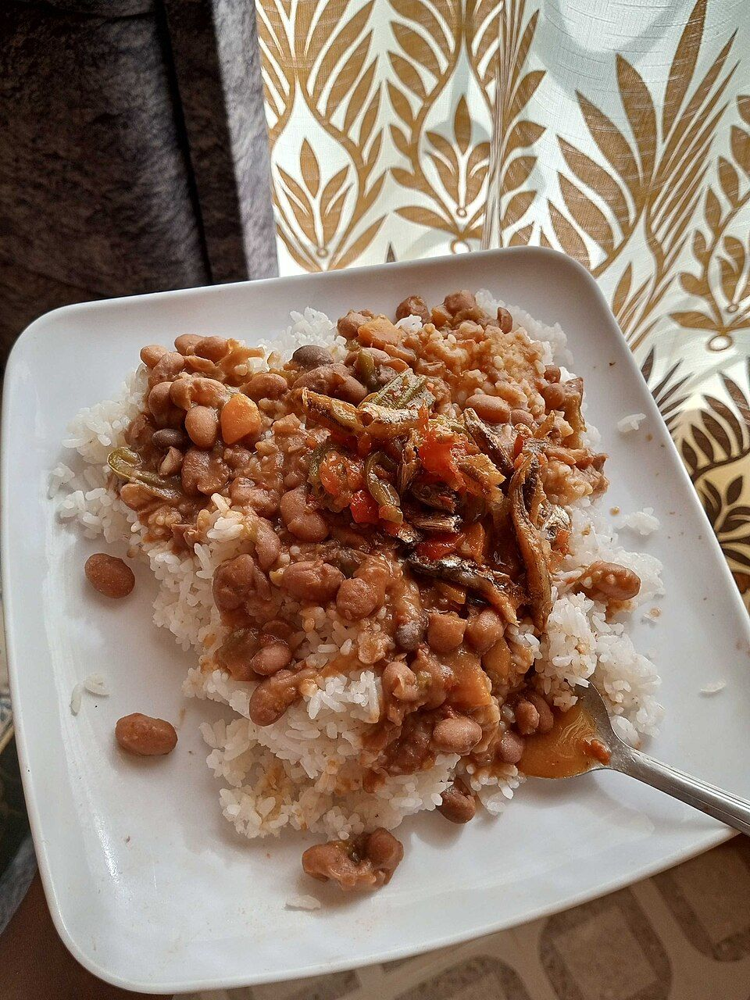
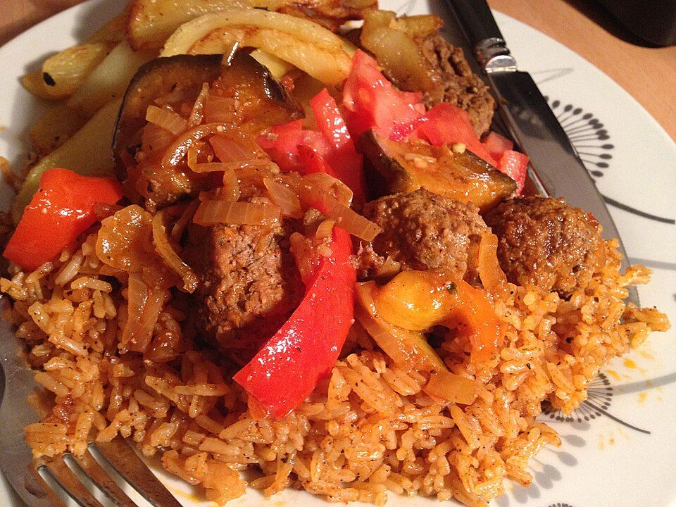
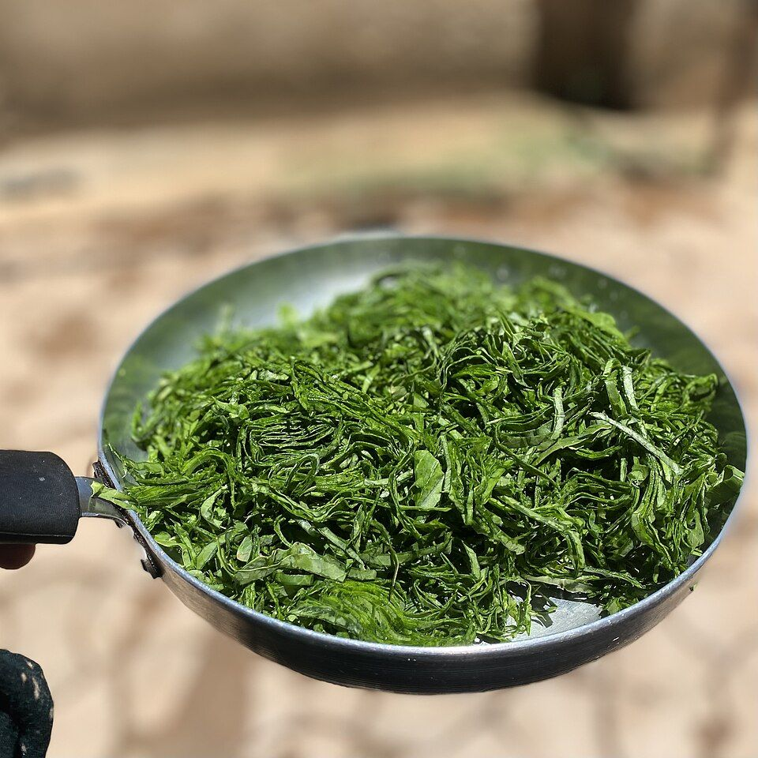
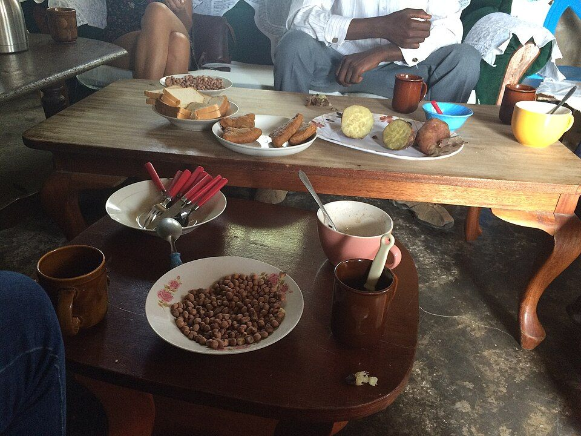
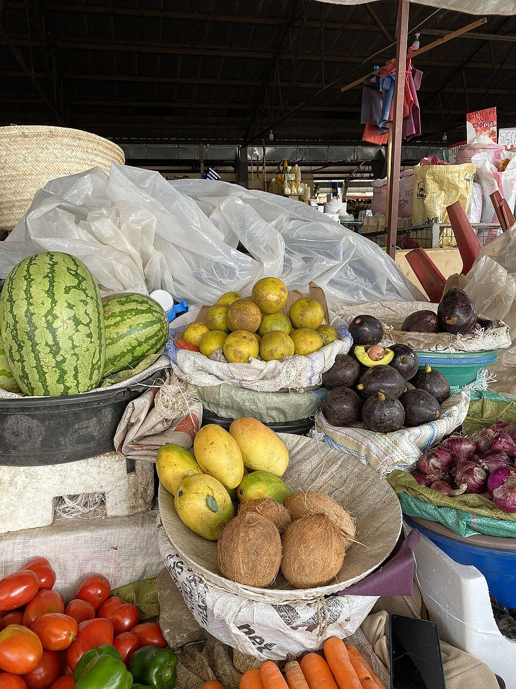
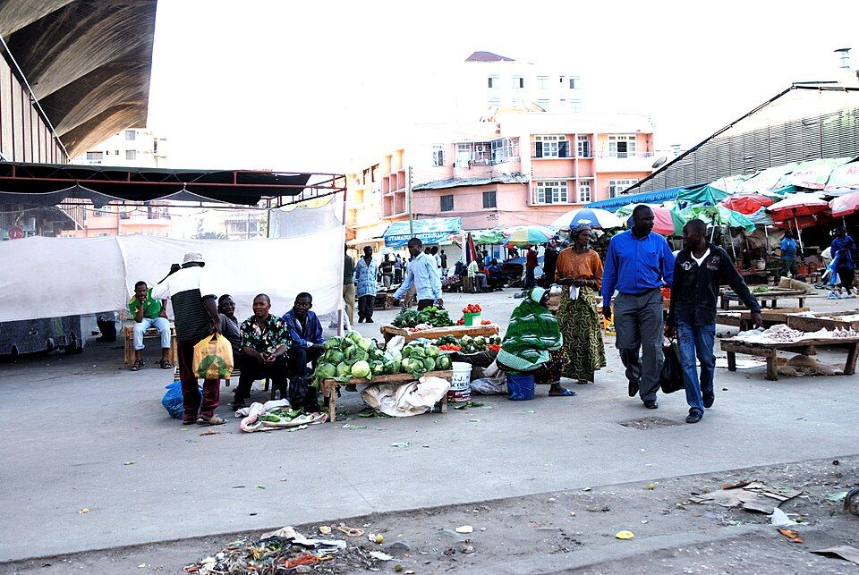
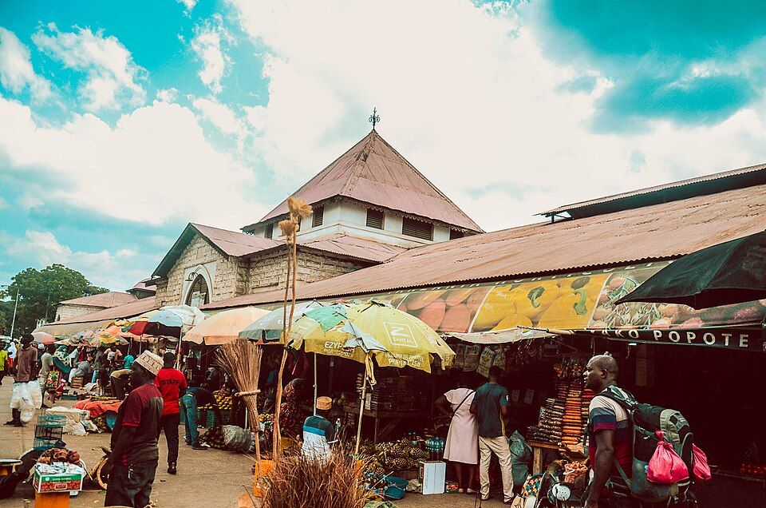

# 13. 食べ物と市場

## 主食とおかず

| スワヒリ語 | 読み | 意味 |
| --- | --- | --- |
| ugali | ウガリ | トウモロコシの粉をお湯で練ったもの。いちばんの主食 |
| wali | ワリ | ごはん（炊いた米） |
| mchele | ムチェレ | 米（炊く前） |
| chapati | チャパティ | 小麦粉の平たいパン |
| mkate | ムカテ | パン |
| ndizi | ンディズィ | バナナ。料理用のバナナを煮て食べることも多い |
| viazi | ヴィアズィ | じゃがいも（viazi vitamu はさつまいも） |
| muhogo | ムホゴ | キャッサバ |
| maharage | マハラゲ | 豆（いんげん豆の煮豆） |
| mboga | ムボガ | 野菜・おかず |
| nyama | ニャマ | 肉（nyama ya ng'ombe 牛肉、nyama ya mbuzi ヤギ肉） |
| kuku | クク | 鶏・鶏肉 |
| samaki | サマキ | 魚 |
| mayai | マヤイ | 卵（1個は yai） |

### 名物の料理

| スワヒリ語 | 何か |
| --- | --- |
| sukuma wiki | ケールなどの青菜の炒め物。「週を押し出す」（給料日までもたせる）という意味 |
| pilau | スパイスで炊いたごはん |
| nyama choma | 炭火の焼き肉 |
| chipsi mayai | フライドポテトを卵でとじたもの（タンザニア） |
| maandazi | 揚げパン（1つは andazi） |
| supu | スープ（朝に食べることも多い） |

## 飲み物と味

| スワヒリ語 | 意味 |
| --- | --- |
| maji | 水（maji ya kunywa 飲み水） |
| chai | お茶（ミルクティーが多い） |
| kahawa | コーヒー |
| maziwa | 牛乳 |
| mtindi / maziwa lala | 発酵乳（ヨーグルトのような飲み物。maziwa lala はケニア） |
| juisi | ジュース |
| sukari | 砂糖 |
| chumvi | 塩 |
| pilipili | とうがらし |
| -tamu | 甘い・おいしい |
| -chungu | 苦い |

- **Chakula ni kitamu sana!** とてもおいしい！（chakula は KI → kitamu）

## 食堂で

| スワヒリ語 | 意味 |
| --- | --- |
| Kuna chakula gani leo? | 今日は何がありますか |
| Naomba wali na maharage. | ごはんと豆をください |
| Bila pilipili, tafadhali. | とうがらしなしでお願いします |
| Chai bila sukari. | 砂糖なしのお茶 |
| Nimeshiba. | おなかいっぱいです |
| Naomba bili. | お会計をお願いします |
| Karibu chakula! | 一緒にどうぞ（食べている人が、来た人を誘う言葉） |

- 食べる前に、手を洗う水とたらいを持ってきてくれる店もあります
- ウガリは右手で丸めて、おかずをすくって食べます

## 野菜と果物

| スワヒリ語 | 意味 | スワヒリ語 | 意味 |
| --- | --- | --- | --- |
| nyanya | トマト | embe | マンゴー |
| kitunguu | 玉ねぎ（vitunguu） | nanasi | パイナップル |
| kabichi | キャベツ | chungwa | オレンジ（machungwa） |
| karoti | にんじん | parachichi | アボカド |
| pilipili hoho | ピーマン | tikiti maji | すいか |
| kitunguu saumu | にんにく | papai | パパイヤ |

## 市場で

| スワヒリ語 | 意味 |
| --- | --- |
| Hii ni bei gani? | これはいくら？ |
| Kilo moja ni shilingi ngapi? | 1キロいくら？ |
| Ni ghali sana! | 高すぎる！ |
| Punguza kidogo. | 少しまけて |
| Bei ya mwisho ni ngapi? | いちばん安くていくら？（最後の値段は？） |
| Nitachukua mbili. | 2つもらいます |
| Sitaki, asante. | いりません、ありがとう |
| Una chenji? | おつりはある？ |
| fungu moja | ひと山（野菜を小さな山にして売る） |

- 市場の人には、女性なら **Mama**、男性なら **Kaka** や **Baba** とよびかけます
- 値段の交渉は、笑いながら、ゆっくりするのがこつです

## 会話の例

| スワヒリ語 | 意味 |
| --- | --- |
| A: Mama, nyanya ni bei gani? | お母さん、トマトはいくら？ |
| B: Fungu moja ni shilingi elfu moja. | ひと山1,000シリングだよ |
| A: Ghali sana! Punguza kidogo. | 高いなあ。少しまけて |
| B: Haya, mia nane. | じゃあ、800 |
| A: Sawa, nipe mafungu mawili. | わかった、ふた山ちょうだい |
| B: Elfu moja na mia sita. Asante, karibu tena. | 1,600だね。ありがとう、また来てね |

## 練習

1. スワヒリ語で言ってください: (1) これはいくらですか (2) 少しまけてください (3) 砂糖なしのお茶をください (4) おなかいっぱいです
2. 日本語にしてください: (1) Chakula ni kitamu. (2) Nitachukua mafungu matatu.
3. トマトがひと山700シリングのとき、3山の値段をスワヒリ語で言ってください

## 練習の答え

1. (1) Hii ni bei gani? (2) Punguza kidogo, tafadhali. (3) Naomba chai bila sukari. (4) Nimeshiba.
2. (1) 料理がおいしい (2) 3山もらいます
3. elfu mbili na mia moja（2,100）
