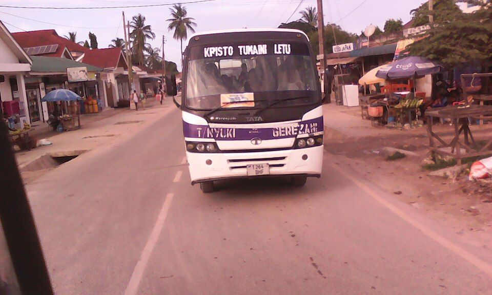
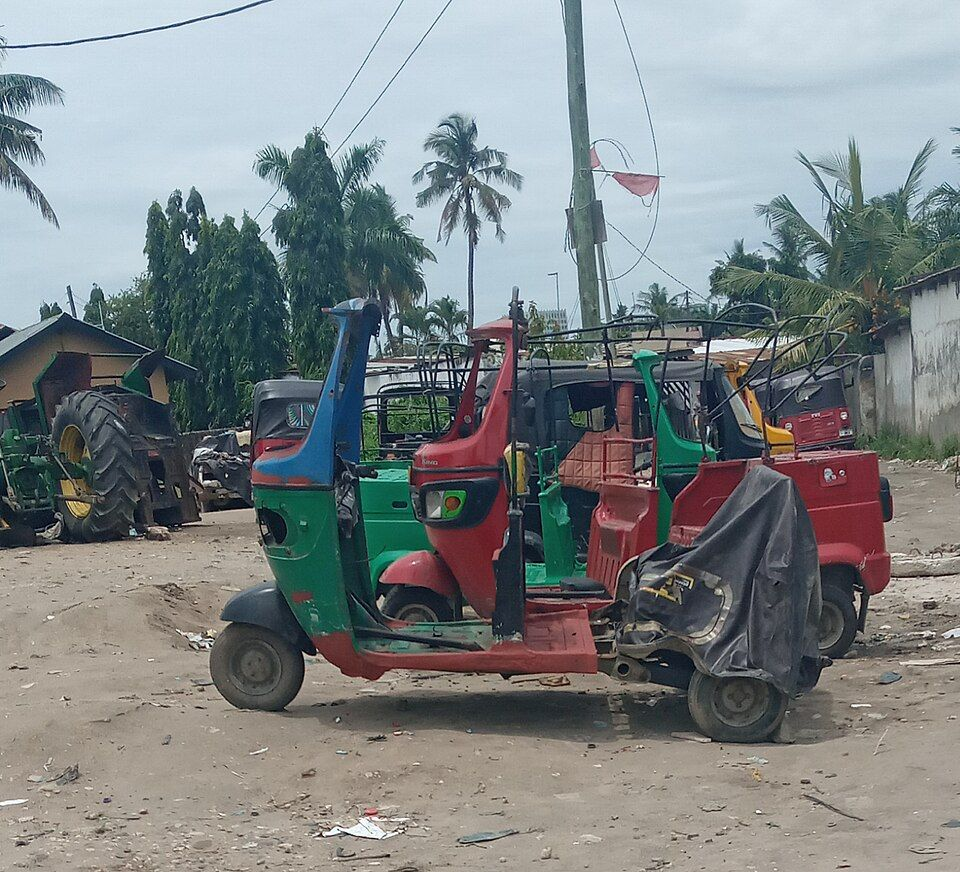
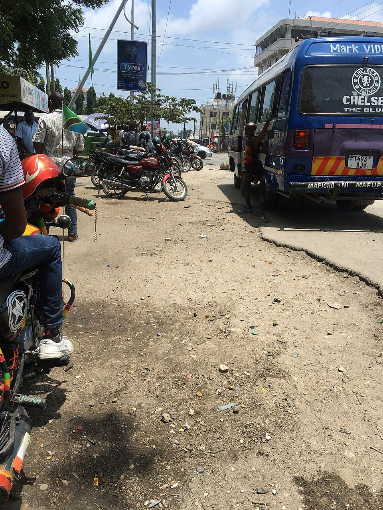
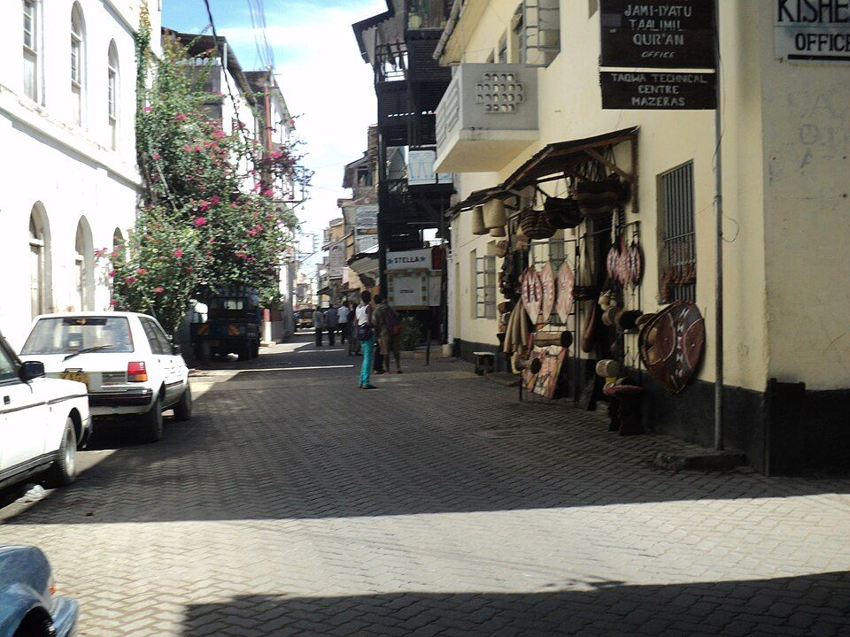

# 14. 移動・宿・町

## 乗り物

| スワヒリ語 | 読み | 意味 |
| --- | --- | --- |
| daladala | ダラダラ | 乗り合いのミニバス（タンザニア） |
| matatu | マタトゥ | 乗り合いのミニバス（ケニア） |
| bodaboda | ボダボダ | バイクタクシー |
| pikipiki | ピキピキ | バイク |
| bajaji | バジャジ | 三輪タクシー（タンザニア） |
| teksi | テクスィ | タクシー |
| basi | バスィ | 長距離バス |
| treni | トレニ | 列車 |
| ndege | ンデゲ | 飛行機（鳥も ndege） |
| kituo | キトゥオ | 停留所・駅（kituo cha basi バス停） |
| nauli | ナウリ | 運賃 |
| tiketi | ティケティ | 切符 |
| dereva | デレヴァ | 運転手 |
| kondakta | コンダクタ | 車掌（ダラダラ・マタトゥの） |

## 道をたずねる

| スワヒリ語 | 意味 |
| --- | --- |
| ... iko wapi? | 〜はどこですか |
| Nitafikaje sokoni? | 市場へはどうやって行けばいいですか |
| Ni mbali? | 遠いですか |
| moja kwa moja | まっすぐ |
| kulia / kushoto | 右 / 左 |
| Geuka kulia. | 右に曲がって |
| karibu na ... | 〜の近く |
| mbali | 遠い |
| hapa / pale | ここ / あそこ |
| mbele / nyuma | 前 / 後ろ |

- **karibu** には「ようこそ」と「近い」の2つの意味があります

## ダラダラ・タクシーで

| スワヒリ語 | 意味 |
| --- | --- |
| Gari hili linaenda Kariakoo? | この車はカリアコーへ行きますか |
| Nauli ni shilingi ngapi? | 運賃はいくらですか |
| Mpaka Arusha ni bei gani? | アルーシャまでいくらですか |
| Nishushe hapa. | ここで降ろしてください |
| Nishushe kituo kijacho. | 次の停留所で降ろしてください |
| Polepole, tafadhali! | ゆっくり（運転して）ください |
| Tutafika saa ngapi? | 何時に着きますか |

- ボダボダやタクシーは、乗る前に値段を決めます

## 宿で

| スワヒリ語 | 意味 |
| --- | --- |
| hoteli / gesti | ホテル / ゲストハウス |
| chumba | 部屋（vyumba） |
| Kuna chumba? | 部屋はありますか |
| Ni shilingi ngapi kwa usiku mmoja? | 1泊いくらですか |
| Kifungua kinywa kipo? | 朝ごはんは付いていますか（「口を開けるもの」＝朝ごはん） |
| ufunguo | 鍵 |
| maji ya moto | お湯 |
| choo / bafu | トイレ / シャワー室 |
| chandarua | 蚊帳 |
| umeme | 電気 |
| Umeme umekatika. | 停電した |

## 町で

| スワヒリ語 | 意味 | スワヒリ語 | 意味 |
| --- | --- | --- | --- |
| benki | 銀行 | duka | 店（maduka） |
| soko | 市場 | hospitali | 病院 |
| duka la dawa | 薬局 | ofisi | 事務所 |
| polisi | 警察 | kituo cha mafuta | ガソリンスタンド |
| msikiti | モスク | kanisa | 教会 |

## 困ったとき

| スワヒリ語 | 意味 |
| --- | --- |
| Nisaidie! | 助けて！ |
| Nimepotea. | 道に迷いました |
| Ninaumwa. | 具合が悪いです |
| Ninaumwa na kichwa. | 頭が痛いです |
| Nipeleke hospitali. | 病院へ連れて行ってください |
| Simu yangu imepotea. | 携帯電話をなくしました |
| Mwizi! | どろぼう！ |

## 練習

1. スワヒリ語で言ってください: (1) 銀行はどこですか (2) ここで降ろしてください (3) 右に曲がって (4) 部屋はありますか
2. 日本語にしてください: (1) Ni mbali? (2) Nimepotea. (3) Umeme umekatika.

## 練習の答え

1. (1) Benki iko wapi? (2) Nishushe hapa. (3) Geuka kulia. (4) Kuna chumba?
2. (1) 遠いですか (2) 道に迷いました (3) 停電した
