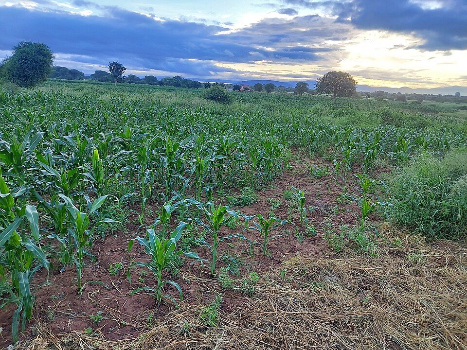
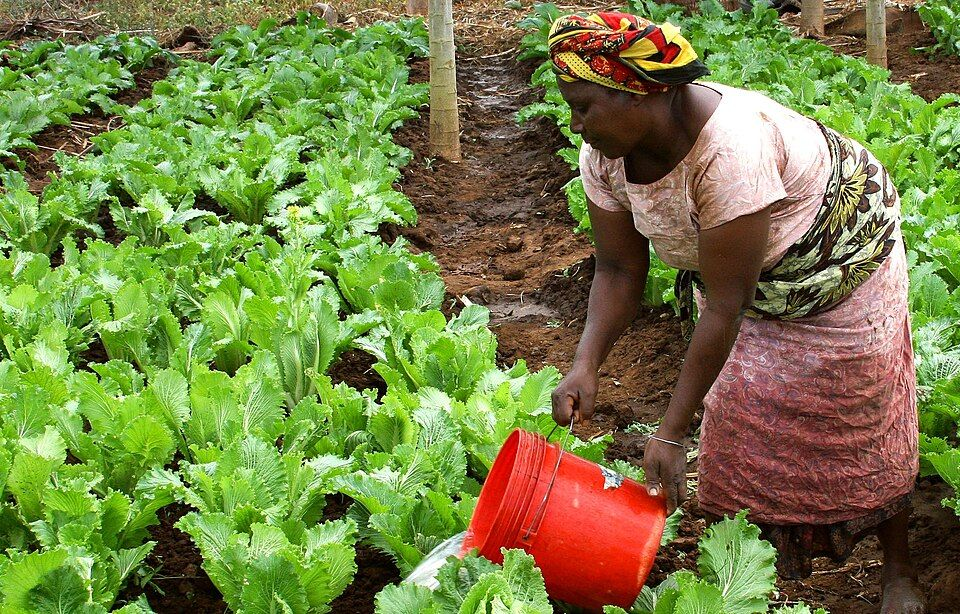
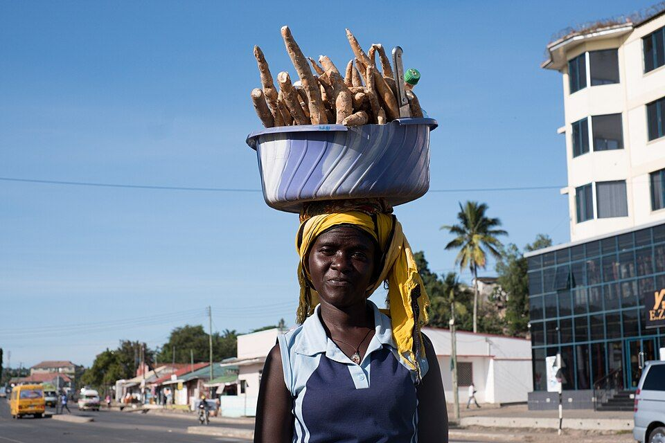
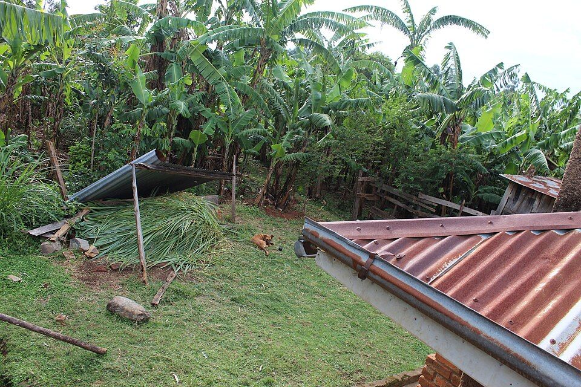
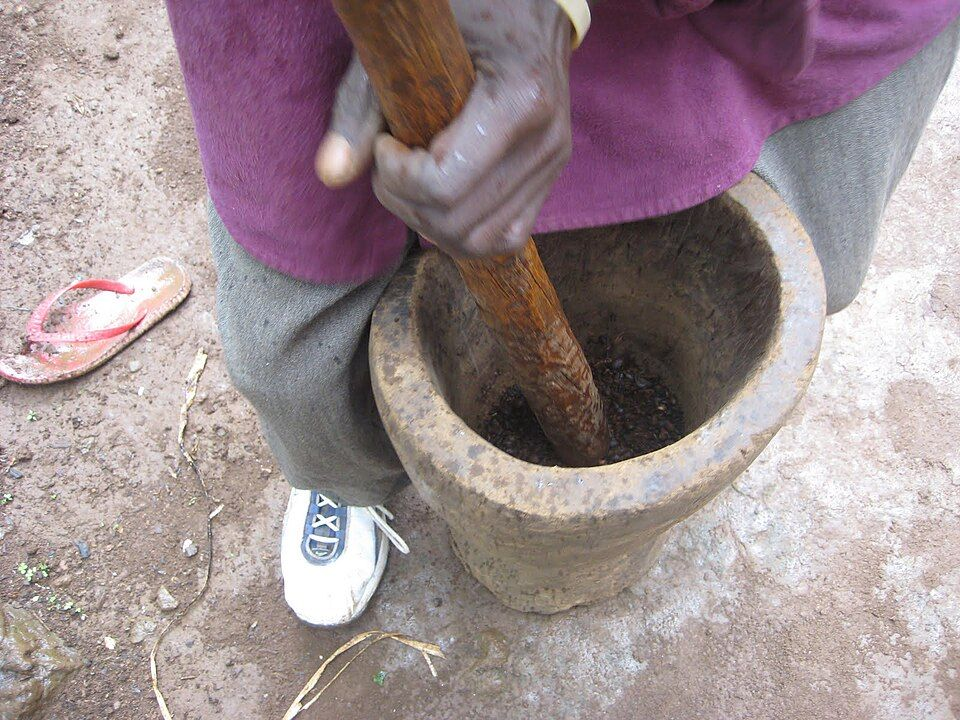
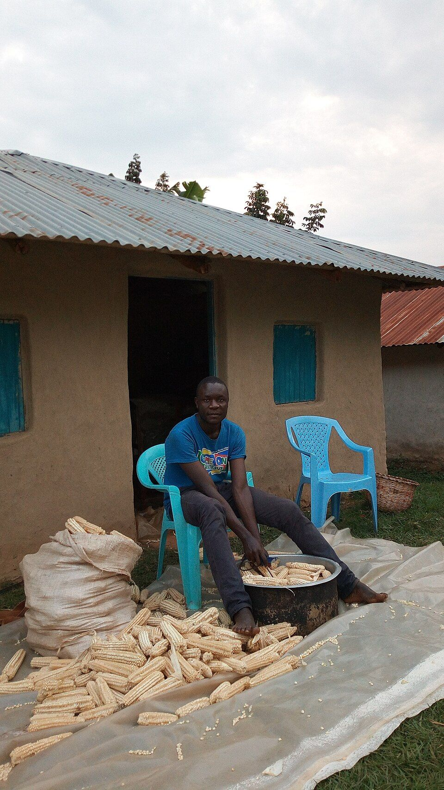
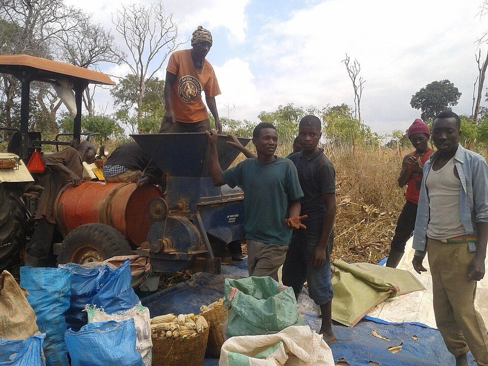

# 15. 畑と作物

タンザニアやケニアでは、働く人の多くが農業をしています。畑の言葉は、農家と話すときにすぐ役に立ちます。

## 畑と仕事

| スワヒリ語 | 読み | 意味 |
| --- | --- | --- |
| shamba | シャンバ | 畑・農場（mashamba） |
| kilimo | キリモ | 農業 |
| mkulima | ムクリマ | 農家（wakulima） |
| kulima | クリマ | 耕す・農業をする |
| kupanda | クパンダ | 植える・種をまく（「登る」の意味も） |
| kupalilia | クパリリア | 草取りをする |
| kumwagilia | クムワギリア | 水をやる |
| kuvuna | クヴナ | 収穫する |
| mavuno | マヴノ | 収穫・とれた物 |
| mazao | マザオ | 作物・農産物 |
| mbegu | ムベグ | 種 |
| mbolea | ムボレア | 肥料 |
| samadi | サマディ | 家畜のふん・たい肥 |
| udongo | ウドンゴ | 土 |
| jembe | ジェンベ | くわ |
| trekta | トレクタ | トラクター |
| wadudu | ワドゥドゥ | 虫・害虫 |
| magugu | マググ | 雑草 |
| dawa ya kuua wadudu | ダワ ヤ クウア ワドゥドゥ | 殺虫剤（虫を殺す薬） |
| umwagiliaji | ウムワギリアジ | かんがい |
| ghala | ガラ | 倉庫 |
| gunia | グニア | 袋（magunia）。作物は袋で数える |

## 作物

| スワヒリ語 | 意味 | スワヒリ語 | 意味 |
| --- | --- | --- | --- |
| mahindi | トウモロコシ | mpunga | 稲 |
| maharage | 豆 | mtama | ソルガム（モロコシ） |
| muhogo | キャッサバ | viazi | じゃがいも |
| ndizi | バナナ | alizeti | ひまわり |
| karanga | 落花生 | korosho | カシューナッツ |
| kahawa | コーヒー | chai | 茶 |
| pamba | 綿 | miwa | サトウキビ |
| mboga | 野菜 | matunda | 果物 |

## 季節と天気

| スワヒリ語 | 意味 |
| --- | --- |
| masika | 大雨季（3〜5月ごろ） |
| vuli | 小雨季（10〜12月ごろ） |
| kiangazi | 乾季 |
| mvua | 雨 |
| Mvua inanyesha. | 雨が降っている |
| jua | 太陽・日差し |
| ukame | 干ばつ |
| joto / baridi | 暑い / 寒い |
| upepo | 風 |

- 雨季が年2回なのは、ケニアやタンザニアの北部です。タンザニアの中部・南部は、11〜4月ごろに1回の雨季です

## 農家と話す

| スワヒリ語 | 意味 |
| --- | --- |
| Unalima nini? | 何を作っていますか |
| Shamba lako lina ukubwa gani? | 畑はどのくらいの広さですか |
| Ekari tano. | 5エーカーです（1エーカーは約0.4ヘクタール） |
| Ulivuna magunia mangapi? | 何袋とれましたか |
| Mwaka huu mvua ilikuwa nzuri? | 今年は雨はよかったですか |
| Mnauza mazao wapi? | 作物はどこで売りますか |
| Bei ya mahindi ni ngapi sasa? | 今、トウモロコシの値段はいくらですか |
| Mna tatizo gani shambani? | 畑で何に困っていますか |
| Wadudu wameharibu mahindi. | 虫がトウモロコシをだめにした |

- 広さはエーカー（**ekari**）で言うことが多いです
- トウモロコシの大きな害虫ツマジロクサヨトウ（fall armyworm）は **viwavijeshi vamizi** といいます

## 会話の例

| スワヒリ語 | 意味 |
| --- | --- |
| A: Shikamoo, Mzee. | こんにちは |
| B: Marahaba. Karibu shambani. | こんにちは。畑へようこそ |
| A: Asante. Unalima nini mwaka huu? | ありがとうございます。今年は何を作っていますか |
| B: Ninalima mahindi na maharage. | トウモロコシと豆を作っています |
| A: Mavuno yalikuwa mazuri? | 収穫はよかったですか |
| B: Hapana, mvua ilikuwa kidogo. Pia viwavijeshi vimeharibu mahindi. | いいえ、雨が少なかった。それに、ヨトウムシがトウモロコシをだめにした |
| A: Pole sana. | それは大変でしたね |

## 練習

1. スワヒリ語で言ってください: (1) 何を作っていますか (2) 雨が降っている (3) （私たちは）明日収穫します (4) 肥料
2. 日本語にしてください: (1) Ninalima mahindi. (2) Mwaka huu mvua ilikuwa nzuri.

## 練習の答え

1. (1) Unalima nini? (2) Mvua inanyesha. (3) Tutavuna kesho. (4) mbolea
2. (1) トウモロコシを作っています (2) 今年は雨がよかった
