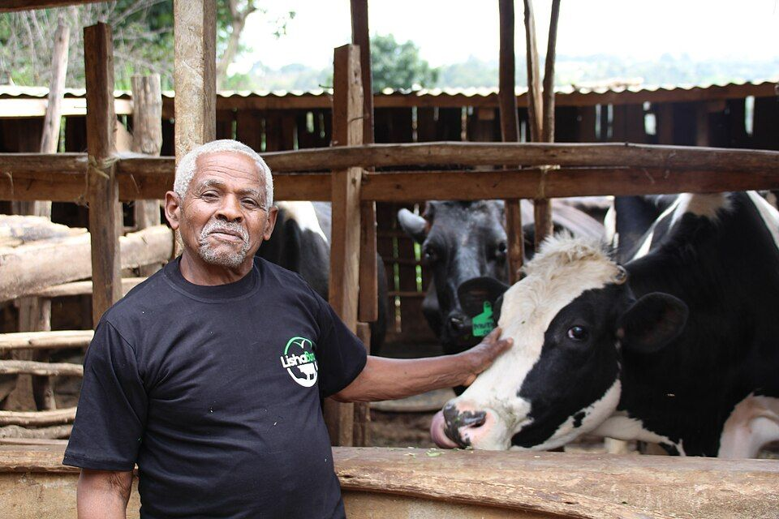
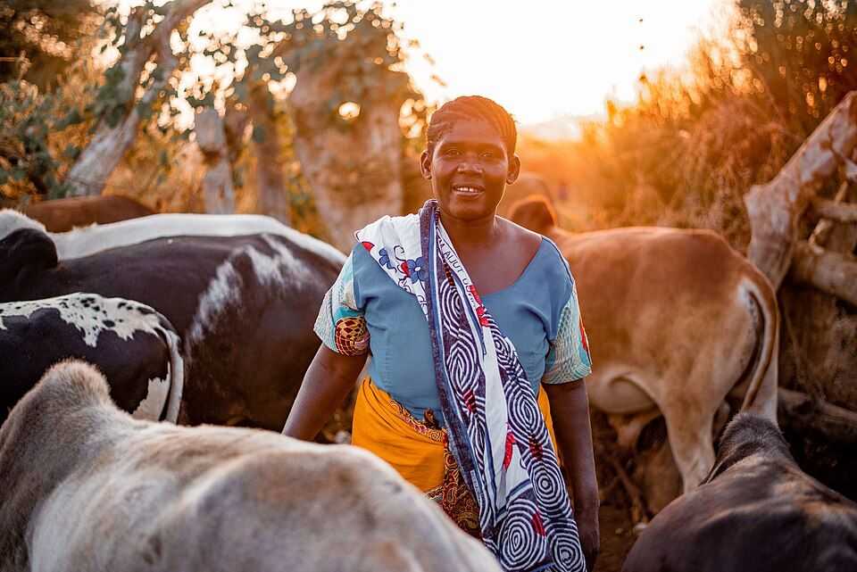
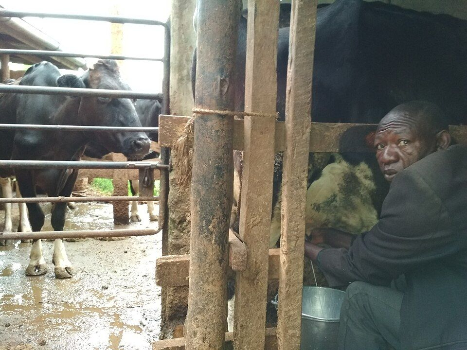
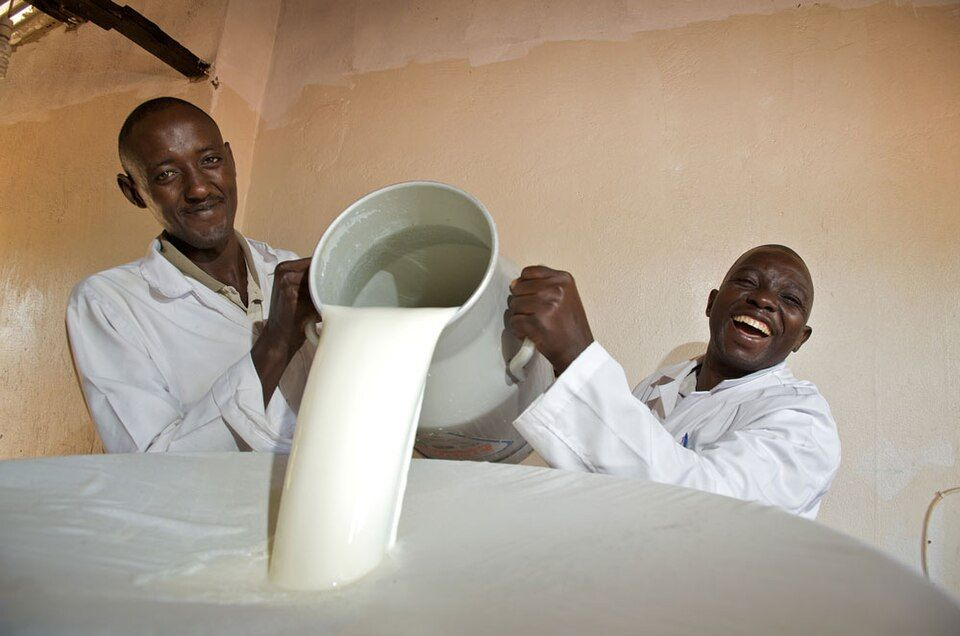

# 16. 牛と酪農

東アフリカでは、牛を数頭だけ飼う小さな酪農家が、牛乳の多くを作っています。牛と牛乳の言葉を覚えると、農家の話がよくわかるようになります。

## 牛の言葉

| スワヒリ語 | 読み | 意味 |
| --- | --- | --- |
| ng'ombe | ンゴンベ | 牛 |
| ng'ombe wa maziwa | | 乳牛 |
| ng'ombe wa nyama | | 肉牛 |
| ng'ombe wa kienyeji | | 在来の牛（ゼブー） |
| ng'ombe wa kisasa | | 改良された牛（ホルスタインなど） |
| chotara | チョタラ | 交雑種（在来の牛と外国の品種のかけ合わせ） |
| fahali | ファハリ | 雄牛（種牛） |
| ndama | ンダマ | 子牛 |
| mtamba | ムタンバ | 若い雌牛（まだ子を産んでいない） |
| maksai | マクサイ | 去勢した雄牛（すきを引く） |
| mifugo | ミフゴ | 家畜 |
| kufuga | クフガ | 飼う |
| mfugaji | ムフガジ | 家畜を飼う人（wafugaji） |
| zizi | ズィズィ | 家畜の囲い |
| banda | バンダ | 牛舎・小屋 |
| kiwele | キウェレ | 乳房 |
| chuchu | チュチュ | 乳頭 |
| pembe | ペンベ | 角 |
| mkia | ムキア | しっぽ |

- ほかの家畜: **mbuzi**（ヤギ）、**kondoo**（羊）、**kuku**（鶏）、**nguruwe**（豚）、**punda**（ロバ）

## 牛乳の言葉

| スワヒリ語 | 意味 |
| --- | --- |
| maziwa | 牛乳・乳 |
| kukamua | 乳をしぼる |
| lita | リットル |
| ndoo | バケツ |
| kituo cha kukusanya maziwa | 集乳所 |
| ushirika / chama cha ushirika | 協同組合 |
| maziwa mabichi | 生乳（加熱していない牛乳） |
| kuchemsha | 沸かす |
| kupoza | 冷やす |
| mtindi / maziwa lala | 発酵乳 |
| siagi | バター |
| jibini | チーズ |
| samli | ギー（バターオイル） |
| kiwanda cha maziwa | 乳業工場 |
| ubora | 品質 |

## エサと水

| スワヒリ語 | 意味 |
| --- | --- |
| chakula cha mifugo | 家畜のエサ |
| majani | 草・葉 |
| malisho | 放牧地・牧草 |
| majani ya tembo | ネピアグラス（「象の草」） |
| nyasi kavu / hei | 干し草 |
| pumba | ぬか（pumba za mahindi トウモロコシのぬか） |
| kulisha | エサをやる |
| kunywesha | 水を飲ませる |

- 牛を牛舎で飼い、草を刈って運ぶ飼い方は、ケニアでは英語のまま **zero grazing** とよびます

## 病気と健康

| スワヒリ語 | 意味 |
| --- | --- |
| ugonjwa | 病気（magonjwa） |
| -gonjwa | 病気の（ng'ombe mgonjwa 病気の牛） |
| daktari wa mifugo | 獣医 |
| afisa ugani | 農業普及員（役所から農家に技術を教えに来る人） |
| dawa | 薬 |
| chanjo | ワクチン |
| kuchanja | ワクチンを打つ |
| sindano | 注射 |
| kupe | ダニ |
| josho | 薬浴場（牛を薬の水にくぐらせてダニを落とす所） |
| ugonjwa wa kiwele | 乳房炎（英語の mastitis もよく使う） |
| ndigana kali | 東海岸熱（ダニがうつす病気。タンザニアでの言い方） |
| homa | 熱 |
| kuhara | 下痢をする |
| kuzaa | 子を産む |
| mimba | 妊娠（ana mimba 妊娠している） |
| joto | 発情（「暑さ」から。yuko kwenye joto 発情している） |
| uhimilishaji | 人工授精（ケニアでは AI とよく言う） |
| kupandisha | 交配させる |

## 酪農家と話す

| スワヒリ語 | 意味 |
| --- | --- |
| Una ng'ombe wangapi? | 牛を何頭飼っていますか |
| Ng'ombe huyu anatoa lita ngapi kwa siku? | この牛は1日に何リットル出しますか |
| Mnakamua mara ngapi kwa siku? | 1日に何回しぼりますか |
| Mnakamua kwa mkono au kwa mashine? | 手でしぼりますか、機械ですか |
| Mnauza maziwa wapi? | 牛乳はどこで売りますか |
| Lita moja ni shilingi ngapi? | 1リットルいくらですか |
| Mnawalisha nini? | 何を食べさせていますか |
| Amepata chanjo? | ワクチンは打ってありますか |
| Alizaa lini? | いつ子牛を産みましたか |
| Maziwa yamepungua. | 乳が減った |
| Kiwele kimevimba. | 乳房が腫れている |

## 会話の例

| スワヒリ語 | 意味 |
| --- | --- |
| A: Hodi! | ごめんください |
| B: Karibu! | どうぞ |
| A: Asante. Habari za kazi? | ありがとうございます。お仕事はどうですか |
| B: Nzuri. Karibu uone ng'ombe wetu. | 順調です。うちの牛を見てください |
| A: Mna ng'ombe wangapi? | 何頭飼っていますか |
| B: Tuna ng'ombe sita wa maziwa na ndama watatu. | 乳牛が6頭と、子牛が3頭です |
| A: Mnapata maziwa lita ngapi kwa siku? | 1日に何リットルとれますか |
| B: Kama lita sitini. Tunakamua mara mbili, asubuhi na jioni. | 60リットルくらいです。朝と夕方の2回しぼります |
| A: Mnauza wapi? | どこで売っていますか |
| B: Kwenye kituo cha kukusanya maziwa cha ushirika. | 協同組合の集乳所です |
| A: Ng'ombe huyu anaonekana mgonjwa. | この牛は具合が悪そうですね |
| B: Ndiyo, kiwele chake kimevimba, na maziwa yamepungua. | ええ、乳房が腫れて、乳も減りました |
| A: Inaweza kuwa ugonjwa wa kiwele. Tumpigie simu daktari wa mifugo. | 乳房炎かもしれません。獣医に電話しましょう |

## 練習

1. スワヒリ語で言ってください: (1) 牛を何頭飼っていますか (2) 1日に何回しぼりますか (3) 獣医 (4) 乳房が腫れている
2. 日本語にしてください: (1) Ng'ombe huyu anatoa lita kumi kwa siku. (2) Ndama alizaliwa jana. (3) Tunawalisha majani ya tembo.

## 練習の答え

1. (1) Una ng'ombe wangapi? (2) Mnakamua mara ngapi kwa siku? (3) daktari wa mifugo (4) Kiwele kimevimba.
2. (1) この牛は1日に10リットル出します (2) 子牛は昨日生まれました (3) ネピアグラスを食べさせています
