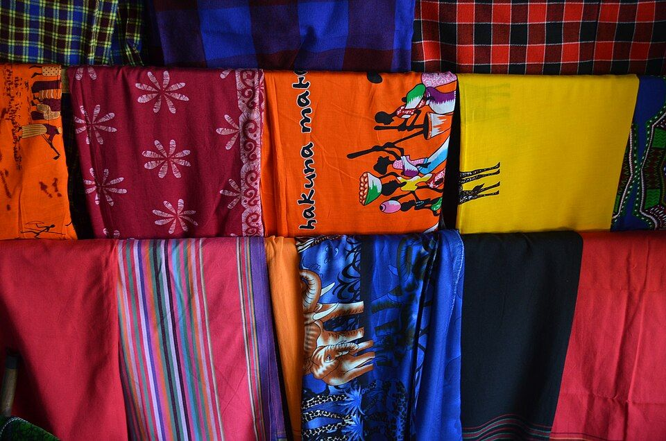
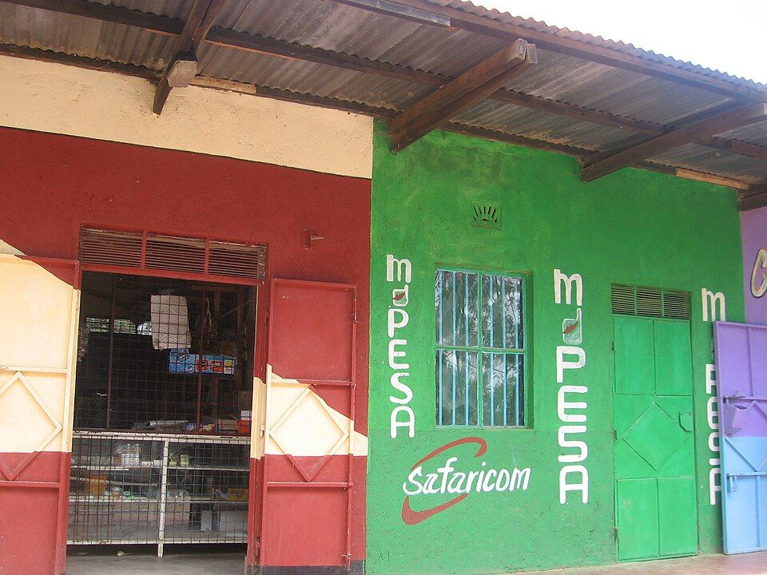

# 17. 仕事と商売

仕事の場では英語も使いますが、スワヒリ語であいさつしたり、少し話したりすると、相手との距離がぐっと近くなります。

## 仕事の言葉

| スワヒリ語 | 意味 | スワヒリ語 | 意味 |
| --- | --- | --- | --- |
| kazi | 仕事 | biashara | 商売・ビジネス |
| kampuni | 会社 | ofisi | 事務所 |
| mkutano | 会議（mikutano） | mteja | 客（wateja） |
| mwenzangu | 同僚・仲間 | mkurugenzi | 社長・理事 |
| bidhaa | 商品 | bei | 値段 |
| punguzo | 値引き | malipo | 支払い |
| ankara | 請求書 | risiti | 領収書 |
| mkataba | 契約・契約書 | faida | 利益 |
| hasara | 損 | mtaji | 元手・資本 |
| mkopo | 借金・ローン | soko | 市場（マーケット） |
| usafirishaji | 輸送 | sampuli | 見本・サンプル |
| bei ya jumla | 卸値 | bei ya rejareja | 小売りの値段 |
| kibali | 許可 | kodi | 税・家賃 |

## 会う約束と会議

| スワヒリ語 | 意味 |
| --- | --- |
| Tunaweza kukutana lini? | いつお会いできますか |
| Kesho saa nne asubuhi inafaa? | 明日の朝10時（スワヒリの4時）はどうですか |
| Inafaa. / Haifai. | 大丈夫です / 都合が悪いです |
| Saa nne za Kiswahili au za Kizungu? | スワヒリの4時ですか、ヨーロッパの4時ですか |
| Samahani, nimechelewa. | 遅れてすみません |
| Tuanze mkutano. | 会議を始めましょう |
| Nina swali. | 質問があります |
| Ninakubali. / Sikubaliani na hilo. | 賛成です / それには賛成できません |
| Nitakutumia barua pepe. | メールを送ります |
| Nitumie ujumbe wa WhatsApp. | WhatsApp でメッセージを送ってください |
| Tutawasiliana. | また連絡を取り合いましょう |

## 値段の交渉

| スワヒリ語 | 意味 |
| --- | --- |
| Bei yenu ni ngapi kwa lita? | 1リットルいくらですか（御社の値段は） |
| Tukinunua kwa wingi, mtapunguza? | たくさん買えば、安くしてもらえますか |
| Bei hiyo ni kubwa kwetu. | その値段は、私たちには高いです |
| Nitafikiria. | 考えておきます |
| Tumekubaliana. | 合意しました |
| Malipo ni lini? | 支払いはいつですか |
| Tutalipa kwa benki. | 銀行で払います |

## 携帯電話のお金（M-Pesa）

携帯電話でお金を送ったり、払ったりする仕組みが、とても広く使われています。ケニアの Safaricom が2007年に始めた **M-Pesa** が有名で、タンザニアでも使えます。

| スワヒリ語 | 意味 |
| --- | --- |
| kutuma pesa | お金を送る |
| kutoa pesa | お金を引き出す |
| wakala | 代理店（現金を出し入れできる店） |
| salio | 残高 |
| Nitumie pesa. | お金を送ってください |
| Nimekutumia. | 送りました |
| Salio halitoshi. | 残高が足りません |

## 電話

| スワヒリ語 | 意味 |
| --- | --- |
| Halo? | もしもし |
| Nani anaongea? | どなたですか |
| Naongea na Bwana Juma? | ジュマさんですか |
| Ni mimi. | 私です |
| Subiri kidogo. | 少々お待ちください |
| Sikusikii vizuri. | よく聞こえません |
| Mtandao ni mbaya. | 電波が悪いです |
| Nitakupigia baadaye. | あとでかけ直します |

## ていねいなよび方

- **Bwana**（男性に）: **Bwana Juma**（ジュマさん）
- **Bi**（女性に）: **Bi Amina**（アミナさん）
- 仕事の名前も、名前の前に付けます: **Daktari**（医者）、**Mwalimu**（先生）、**Mhandisi**（技術者）
- 年上の人には **Mzee**・**Mama**・**Baba**（3章）

## メールの書き出しと結び

| スワヒリ語 | 意味 |
| --- | --- |
| Ndugu Juma, | ジュマさま |
| Natumaini u mzima. | お元気のことと思います |
| Ninaandika kuhusu... | 〜についてご連絡します |
| Naomba unijulishe. | お知らせください |
| Asante kwa ushirikiano wako. | ご協力ありがとうございます |
| Wako, | 敬具（あなたの〜より） |

## 仕事で気をつけること

- まず、あいさつをします。いきなり本題に入りません（3章）
- 時刻はスワヒリの時刻か、ヨーロッパの時刻かを確かめます（5章）。前の日に WhatsApp で確かめるとよいです
- お金と約束のことは、英語でも書いて残します。契約書は英語が多いです
- ケニアの会社では英語が中心です。タンザニアでは、地方へ行くほどスワヒリ語だけになります

## 練習

1. スワヒリ語で言ってください: (1) いつお会いできますか (2) メールを送ります (3) よく聞こえません (4) 遅れてすみません
2. 日本語にしてください: (1) Tumekubaliana. (2) Malipo ni lini? (3) Tukinunua kwa wingi, mtapunguza?

## 練習の答え

1. (1) Tunaweza kukutana lini? (2) Nitakutumia barua pepe. (3) Sikusikii vizuri. (4) Samahani, nimechelewa.
2. (1) 合意しました (2) 支払いはいつですか (3) たくさん買えば、安くしてもらえますか
