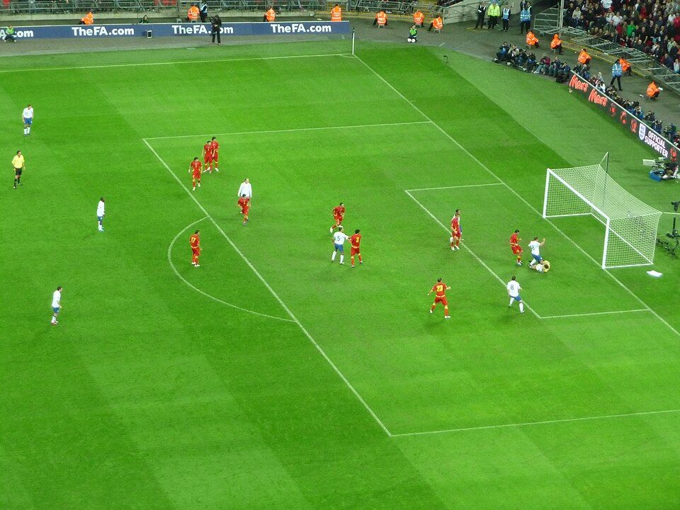
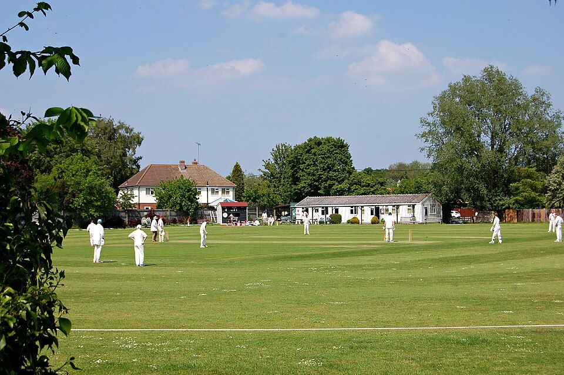
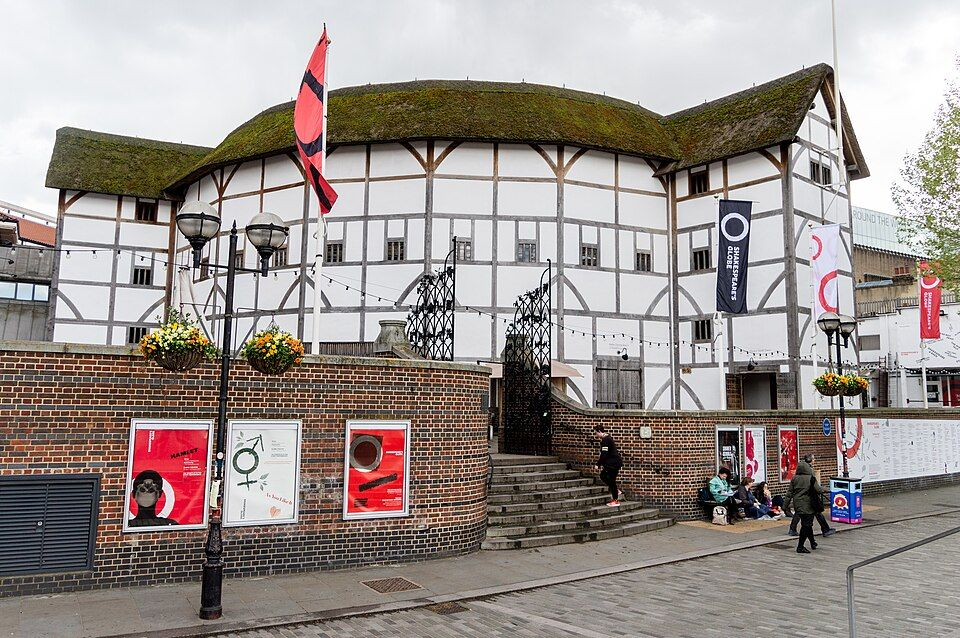
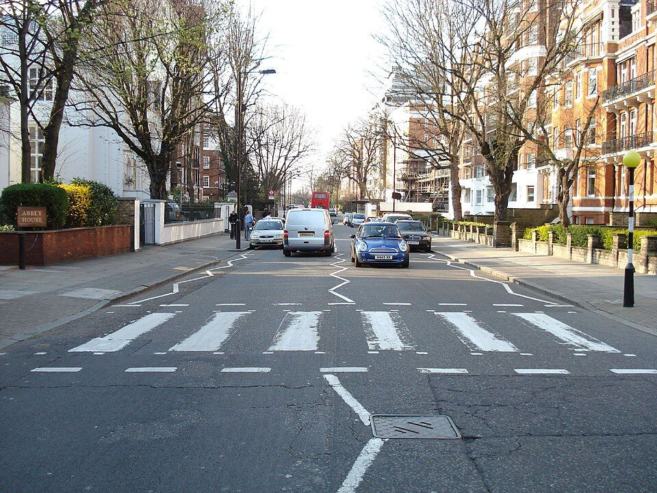
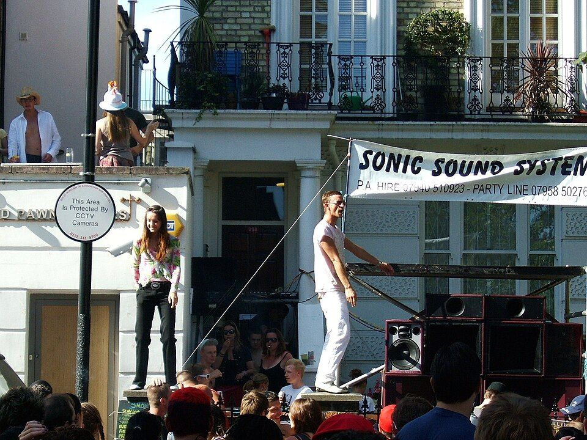
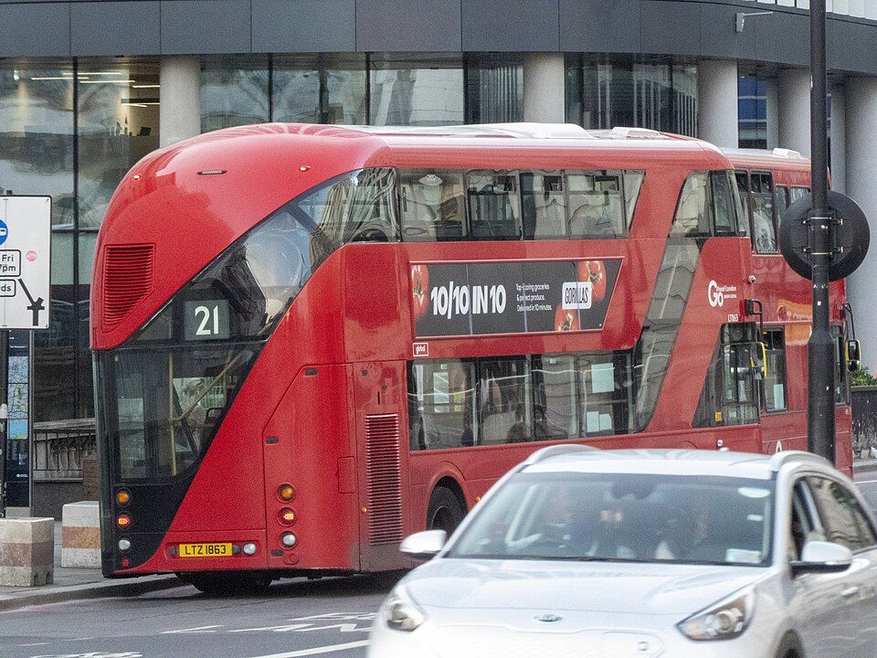
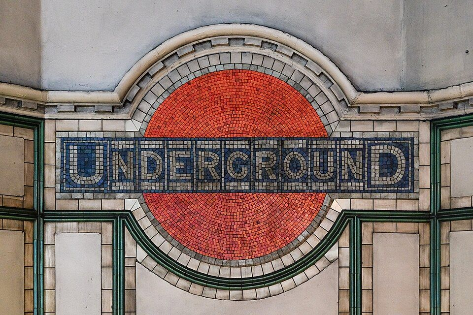
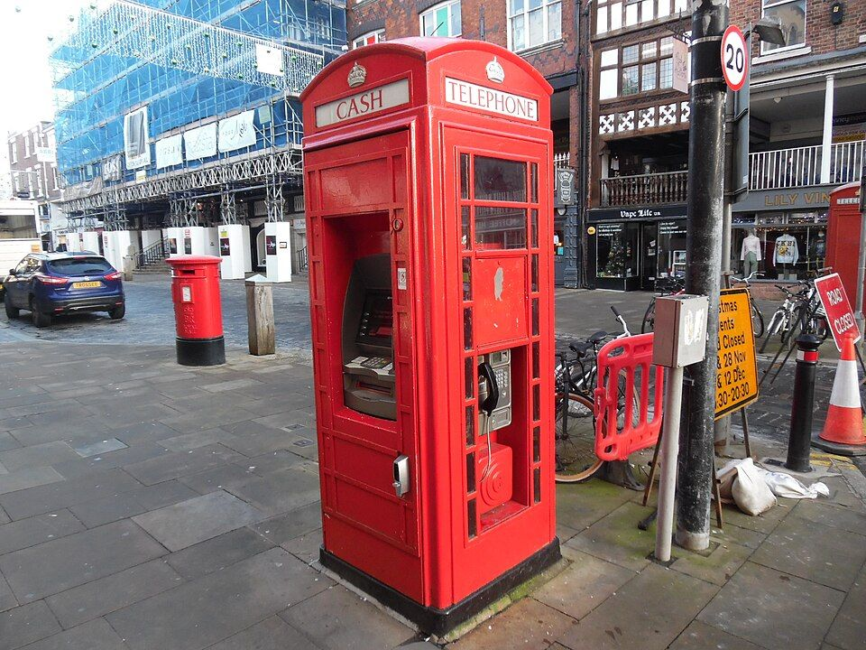

# 4. 文化と暮らし

## この章でわかること

- スポーツ（サッカー・ラグビー・クリケット）
- 音楽・文学・演劇
- 暮らしの習慣とマナー
- イギリスの英語
- 町の風景（バス・地下鉄・電話ボックス）

## スポーツ

サッカー・ラグビー・クリケット・テニス・ゴルフなど、いま世界でしているスポーツの多くは、19世紀のイギリスでルールが決まりました。

- **サッカー**（イギリスでは **football**）: いちばん人気。イングランドの**プレミアリーグ**は世界でいちばんお金が動くリーグで、日本の選手もたくさんいます。地元のチームを家族で代々応援します
- **ラグビー**: ウェールズでは国のスポーツ。イングランドの学校（ラグビー校）で生まれました。毎年春に6か国対抗（シックス・ネーションズ）があります
- **クリケット**: 夏のスポーツ。1試合が5日かかる試合（テスト・マッチ）もあります。村の芝生のグラウンドで、週末に地元のチームが試合をする風景は、イングランドの夏の象徴です
- ほかに、ウィンブルドン（テニス）、ゴルフの発祥の地セント・アンドルーズ（スコットランド）、競馬（王室も大好き）

## 音楽・文学・演劇

- **音楽**: ビートルズ（リバプール）、ローリング・ストーンズ、クイーン、オアシス、エド・シーラン、アデルなど。イギリスはアメリカと並ぶ、ポップ音楽の大国です
- **文学**: シェイクスピア（16〜17世紀）、ジェーン・オースティン、ディケンズ、シャーロック・ホームズ（コナン・ドイル）、ハリー・ポッター（J・K・ローリング、エディンバラで書いた）、ノーベル賞のカズオ・イシグロ（長崎生まれ）
- **演劇**: ロンドンのウエスト・エンドは、ニューヨークのブロードウェイと並ぶミュージカルと演劇の中心です
- 大英博物館やナショナル・ギャラリーなど、国の美術館・博物館の多くは**入場無料**です

## お祭り

- **ノッティング・ヒル・カーニバル**（8月末、ロンドン）: カリブ海から来た人たちのお祭り。ヨーロッパで最大級の街頭のお祭りです
- **ガイ・フォークス・ナイト**（11月5日）: 1605年に国会議事堂を爆破しようとした事件を思い出す日。花火とたき火
- **クリスマス**: 1年でいちばん大きな行事。家族で七面鳥を食べ、国王のスピーチを見ます。翌日の12月26日は「ボクシング・デー」で休み
- 夏には、各地で**農業ショー**（品評会）が開かれます。牛や羊の品評会、トラクターや機械の展示、地元の食べ物の店。町の人も家族で楽しみに来ます（9章）

## 暮らしの習慣とマナー

- **列に並ぶ**（queue）: とても大事にします。割り込みは強く嫌われます
- **「Sorry」と「Please」「Thank you」**: ぶつかられた方も「sorry」と言うほど、よく使います。バスを降りるとき運転手に「Cheers!」（ありがとう）
- **天気の話**: 知らない人とも、まず天気の話から。会話を始めるきっかけです
- **遠回しの言い方**: はっきり言わずに、やわらかく言います。「That's interesting（それは興味深い）」は、本当は「賛成できない」の意味のことがあります。「Not bad」はかなりほめています
- **ユーモア**: 皮肉や、自分をけなす冗談が好きです。仕事の場でも、冗談を言える人は好かれます
- **階級**: 労働者・中流・上流の「階級」の意識がいまも少し残り、話し方・学校・食べ物・スポーツの好みに出ます
- **左側通行**で、車は右ハンドル。日本と同じです
- **電気**: 230 V、3つの四角いピンのプラグ（BF 型）。日本の電気製品にはアダプターと、電圧に合うかの確認が要ります

## イギリスの英語

- アメリカ英語と、言葉や綴りがちがいます

| イギリス | アメリカ | 意味 |
| --- | --- | --- |
| flat | apartment | アパート |
| lift | elevator | エレベーター |
| lorry | truck | トラック |
| petrol | gas | ガソリン |
| queue | line | 列 |
| mobile | cell phone | 携帯電話 |
| colour, centre, organise | color, center, organize | 綴り |
| first floor | second floor | 2階（イギリスの1階は ground floor） |

- 地方によって発音がかなりちがいます。ロンドンの下町（コックニー）、リバプール（スカウス）、ニューカッスル（ジョーディー）、スコットランド、北アイルランドなど。農家の人と話すときは、地方の言葉に慣れが要ります
- 「Cheers」（ありがとう・乾杯）、「Mate」（友だち・きみ）、「Brilliant」（すばらしい）、「Lovely」（いいね）、「Fancy a cuppa?」（お茶はどう？）はよく聞きます
- 付録A に、農業と酪農の英語の言葉をまとめました

## 町の風景

- **ロンドン地下鉄**（1863年開業）は、世界でいちばん古い地下鉄です。「Tube」と呼びます。カードやスマホをかざして乗ります
- 赤い2階建てバスと、黒いタクシー（ブラック・キャブ）は、ロンドンの象徴です
- 家は、レンガ造りの古い家がふつうです。100年以上前の家に住み、直しながら使います。古い家ほど人気があります
- 庭（ガーデン）が好きで、ガーデニングは国民的な趣味です
