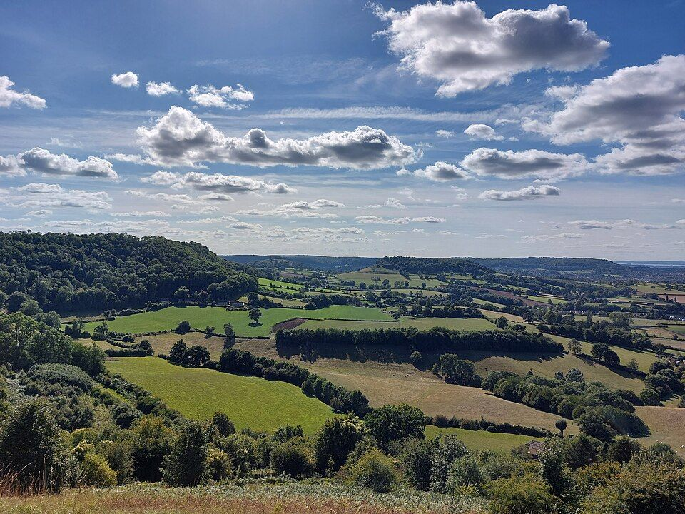
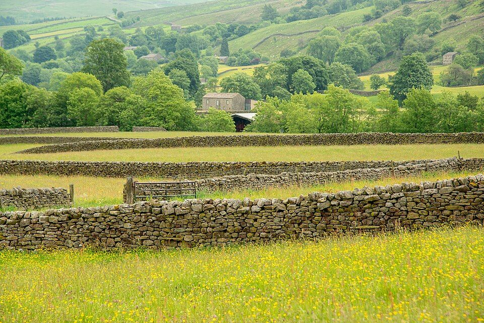
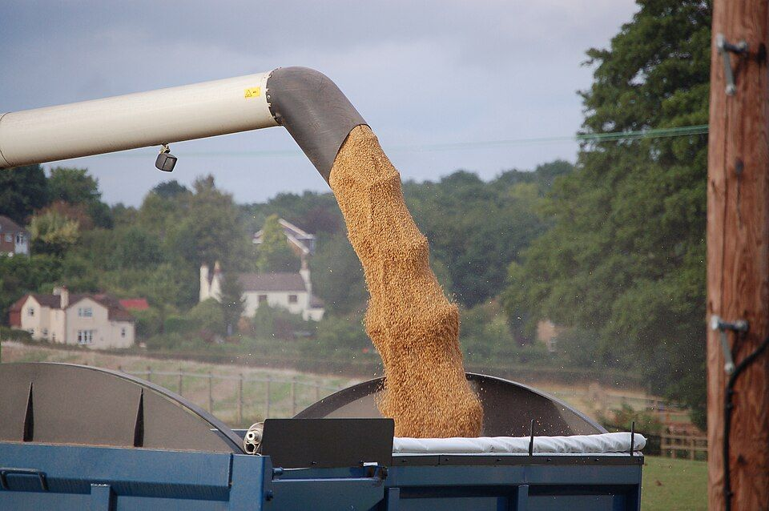
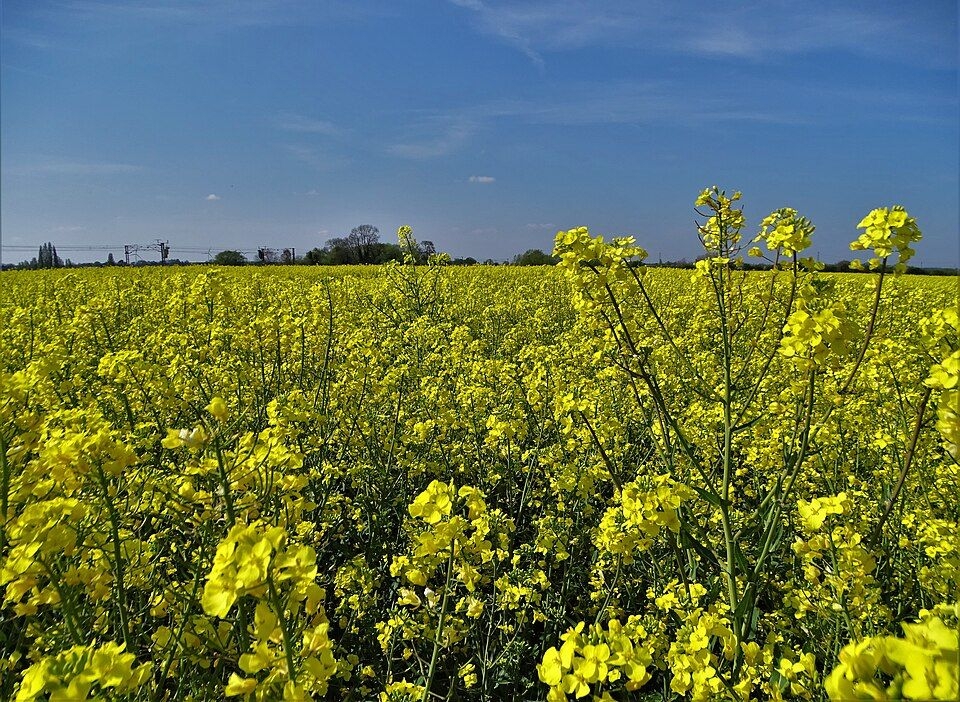
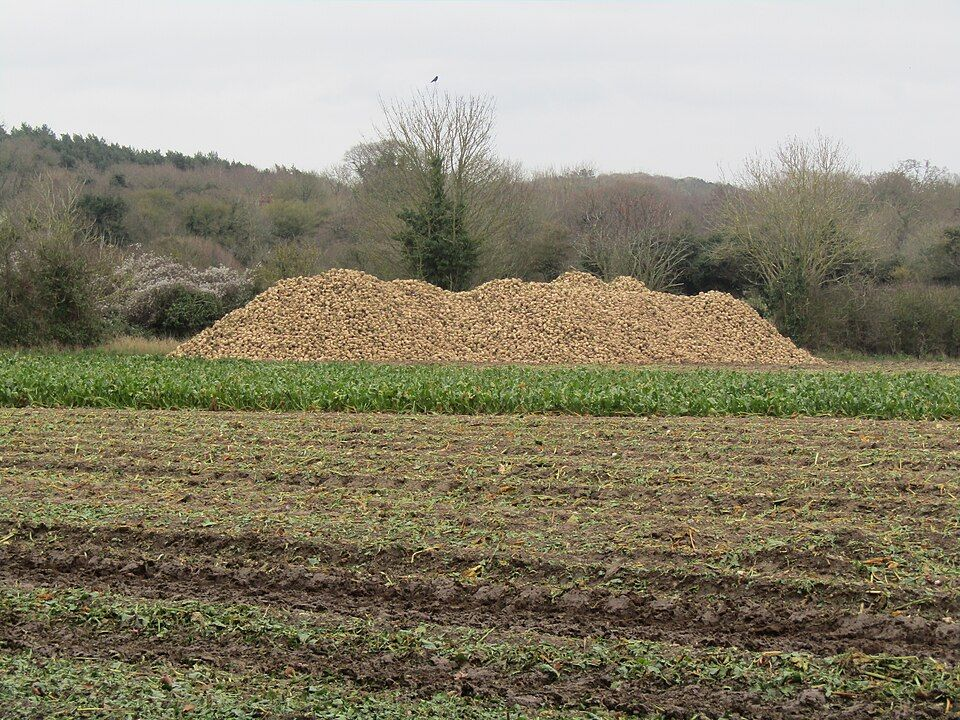
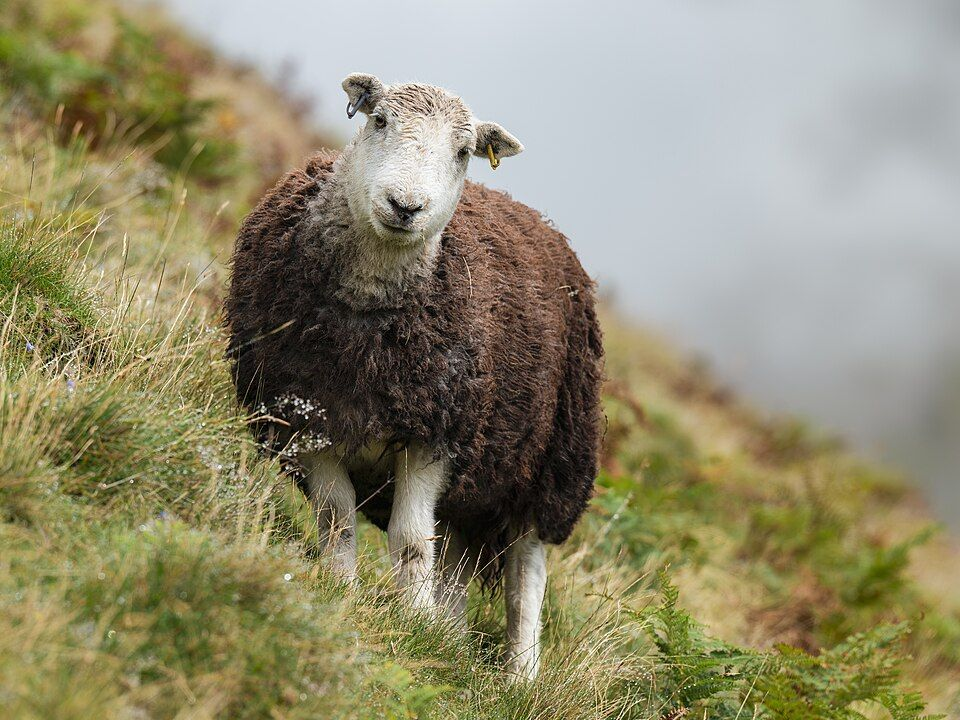
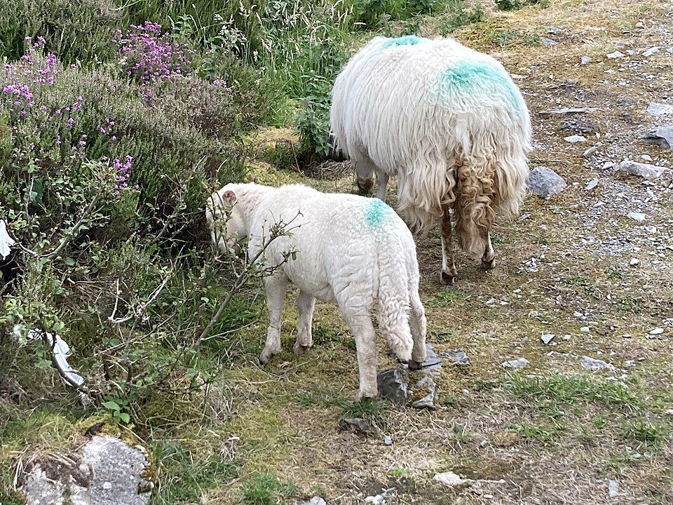
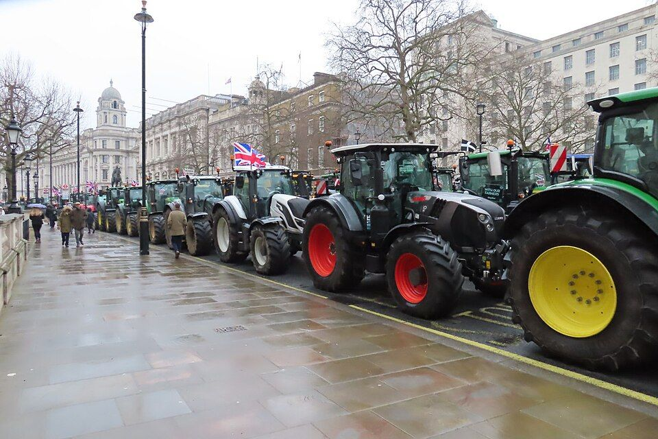

# 6. イギリスの農業

## この章でわかること

- 数字で見るイギリスの農業（日本とくらべて）
- 東の畑作と、西と北の畜産
- おもな作物（小麦・大麦・菜種・てんさい・じゃがいも）と羊
- EU の補助金のあと（SFI）と、相続税の騒ぎ
- いまの悩み（干ばつ、人手、お金）

## 数字で見る

| 項目 | イギリス | 日本 |
| --- | --- | --- |
| 農地 | 約1,700万 ha（国土の約7割） | 約430万 ha（国土の約1割） |
| 1つの農場の広さ | 平均 約80 ha | 平均 約3 ha（北海道は約30 ha） |
| 農業の所得（全体、2025年） | 約84億ポンド（約1.8兆円） | ― |
| 食べ物の自給率（金額、2025年） | 60%（イギリスで作れる種類だけなら72%） | 64%（生産額ベース） |

- 農地の約3分の2は**草地**（牧草地と、山の放牧地）で、畑は約3分の1です。雨が多くて草がよく育つので、牛と羊を飼うのに向いています
- 2025年の農業の所得は、前の年より21%増えました。牛肉と牛乳の値段が良かったためで、畑作（小麦など）は干ばつと安い値段で苦しみました。「**家畜は上、穀物は下**（up horn, down corn）」と言われました
- 自給率は2024年の65%から60%に下がりました。干ばつで収穫が減ったことと、輸入した食べ物の値段が上がったためです。野菜と果物は半分以上を輸入しています（にんじんは94%を自給）

## 東は畑、西と北は家畜

| 地域 | おもな農業 |
| --- | --- |
| イングランド東部（イースト・アングリア、リンカンシャー、ヨークシャー東部） | 小麦・大麦・菜種・てんさい・じゃがいも・野菜。平らで、雨が少ない。「イギリスのパンかご」 |
| イングランド南西部（デボン、サマセット、コーンウォール）、チェシャー | 酪農。雨が多く、草がよく育つ |
| ウェールズ、湖水地方、ペナイン山脈、スコットランド高地 | 羊と肉牛の放牧。山がちで畑には向かない |
| 北アイルランド | 草地の酪農と肉牛 |
| ケント、ヘレフォードシャー | 果物（りんご・いちご・ホップ） |

- 畑の境目には、**垣根**（ヘッジロウ、低木を植えて作った生きた塀）や、北と西では**石垣**（ドライストーン・ウォール、モルタルを使わず石を積んだ塀）があります。18世紀の囲い込み（2章）のころにできたものが多く、いまは鳥や虫のすみかとして、補助金で守っています

## おもな作物

### 小麦

- イギリスでいちばん大きな作物（2025年の作物の売り上げの中で最大、約21億ポンド）
- ほとんどが**秋まき小麦**（9〜10月にまき、冬をこして、翌年8月に刈る）
- 1 ha から**8トン**ほどとれます。日本の小麦（4〜5トン）の1.5〜2倍で、世界でもいちばん多くとれる国のひとつです。夏が涼しく、ゆっくり実るからです
- パン用の小麦と、家畜のエサ・ウイスキーやエタノール用の小麦があります
- 2025年は干ばつで、小麦の自給率（量）は83%でした（ふつうの年は国内の分をまかない、少し輸出します）

### 大麦

- ビールとウイスキーの麦芽（モルト）用と、家畜のエサ用
- スコットランドの大麦は、スコッチ・ウイスキーの大事な原料です（3章）

### 菜種（なたね）

- 英語で **oilseed rape**（オイルシード・レイプ）。油（キャノーラ油）と、しぼりかすは家畜のエサ
- 小麦の輪作に入れる作物として大事
- ネオニコチノイド系の殺虫剤が EU 時代に禁止され、ノミハムシの害がふえて、作る面積が大きく減りました

### てんさい・じゃがいも・野菜

- **てんさい**: イングランド東部だけで作り、ブリティッシュ・シュガーという1つの会社の工場で砂糖にします。秋から冬に収穫
- **じゃがいも**: フライドポテト・ポテトチップス用が多い。スコットランドは、病気の少ない**種いも**の産地
- **野菜**: にんじん・キャベツ・ネギ・芽キャベツなど。リンカンシャーやノーフォーク

## 羊

- イギリスには約3,000万頭の羊がいて、人口の半分ほどです。ヨーロッパで最も多い国のひとつ
- 山や丘の草地（日本ならば何もない山）を、食べ物（羊肉と羊毛）に変えるのが羊の役目です
- **品種が60以上**あり、地方ごとにちがいます。山で強い品種（ハードウィック、スウェールデール、ウェルシュ・マウンテン）を育て、低地で肉の多い品種とかけ合わせる、山から平地への流れがあります
- 羊肉の約3分の1は輸出（とくにフランスなど EU）。EU 離脱で、検査の手間が増えた代表的な産業です
- 羊毛は、いまは安くて、毛を刈る費用のほうが高いことが多い

## EU の補助金のあと

- EU にいたころは、**CAP** で、農地の面積に応じて補助金をもらっていました（基本支払い、BPS）。広い農地を持つ大きな農家ほど多くもらえるしくみでした
- EU を離れたあと、農業の政策は4つの国それぞれが決めます
- **イングランド**: 面積の補助金（BPS）を2021年から少しずつ減らし、2027年でなくします。代わりに「**環境土地管理**」（ELM）を始めました
  - **SFI**（持続可能な農業のインセンティブ）: 土を守る、垣根を守る、農薬を減らす、草地に花を混ぜる、などの「行動」を選んで約束すると、その分のお金がもらえる
  - カントリーサイド・スチュワードシップ（自然を守る、もっと大きな約束）
  - ランドスケープ・リカバリー（広い地域で、森や湿地を取り戻す）
- SFI は申し込みが予算をこえて2025年3月に突然止まり、農家の不満が高まりました。2026年に新しい **SFI26** として再開しています（行動の数を102から71に減らし、1つの農場は年10万ポンドまで。申し込みは6月と9月の2回）
- **ウェールズ**は2026年から「持続可能な農業スキーム」、**スコットランド**は面積の支払いを残しながら条件を付ける、と、国ごとにやり方がちがいます

## 相続税の騒ぎ

- これまで、農地を相続するときは、相続税が**100%免除**でした（農業財産控除、APR）
- 2024年10月、政府は「免除は100万ポンドまで、それをこえる分は20%の税」に変えると発表しました。お金持ちが税をのがれるために農地を買うのを防ぐ、という理由です
- イギリスの農地は1 ha 2万ポンドほどするので、100 ha ほどの家族の農場でも上限をこえます。「農場を売らないと税を払えない」と、農家がトラクターでロンドンに集まり、何度も抗議しました（**No Farmers, No Food**）
- 2025年12月に政府が見直し、**2026年4月から上限は1人250万ポンド**（夫婦で500万ポンド）になりました。これで、対象になる農家は大きく減りました

## いまの悩み

- **天気**: 2024年は雨が多すぎて種をまけず、2025年は干ばつ。天気の変化で、収穫が年ごとに大きくぶれます
- **お金**: 肥料・燃料・機械・人の費用が上がり、作物の値段は世界の市場で決まるので、もうけが出にくい
- **人手**: 果物や野菜の収穫は、以前は東ヨーロッパから来る人にたよっていました。EU 離脱のあとは「**季節労働者ビザ**」で、中央アジアなどからも来てもらっています。人手が足りないことが、ロボットへの関心の理由です（8章）
- **年をとる農家**: 農場主の平均年齢は60歳ほど。継ぐ人がいない農場もあります
- **環境**: 川の水の汚れ（家畜のふん尿や肥料）、生きものの減少、温室効果ガス。環境への要求は年々厳しくなっています

## 農家の団体と研究

- **NFU**（全国農業者組合）: イングランドとウェールズの農家の大きな団体。政府への要望や、ニュースの発信
- **AHDB**: 農家から集めたお金で、市場の情報や研究をする団体。牛乳の値段や牛の頭数の統計はここが出します
- **ロザムステッド研究所**（8章）、ハーパー・アダムズ大学、SRUC（スコットランド）など、農業の研究と教育の場所がたくさんあります
