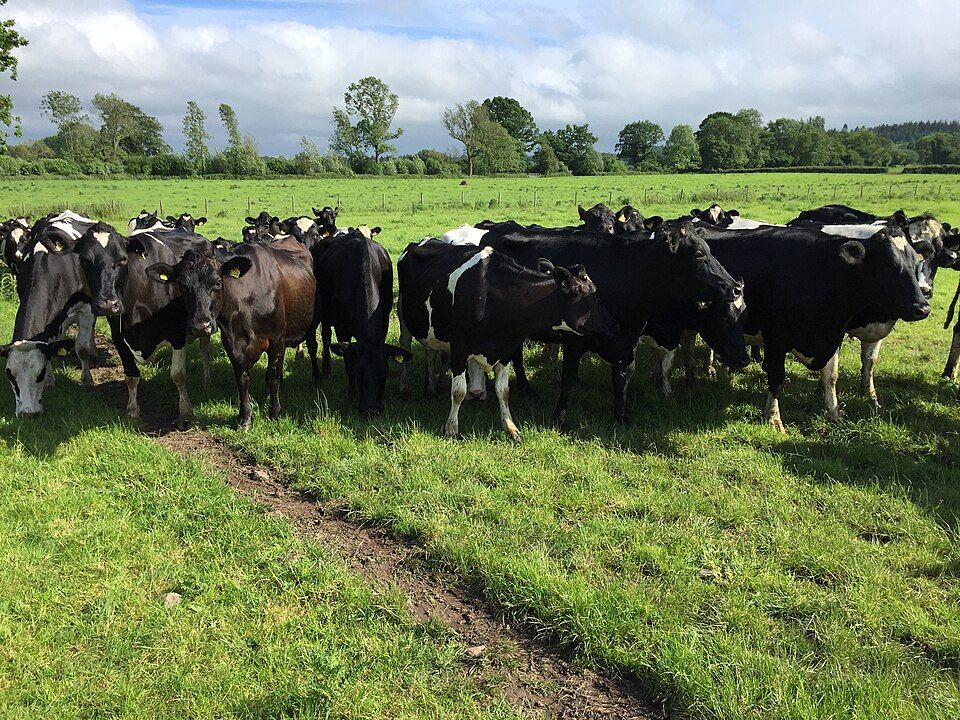
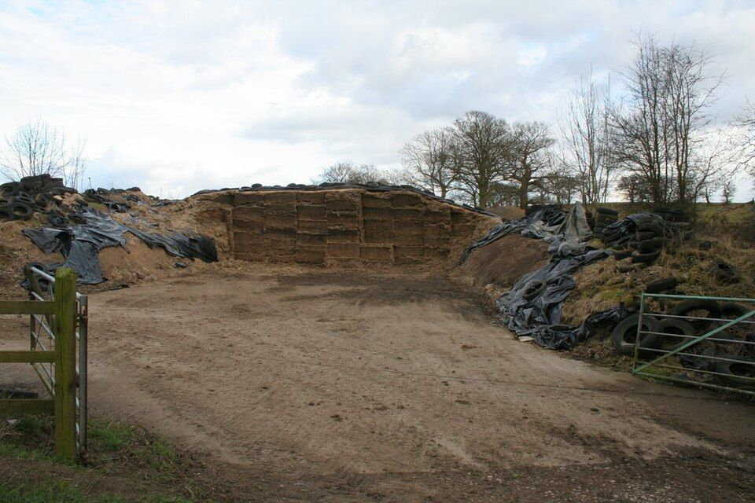
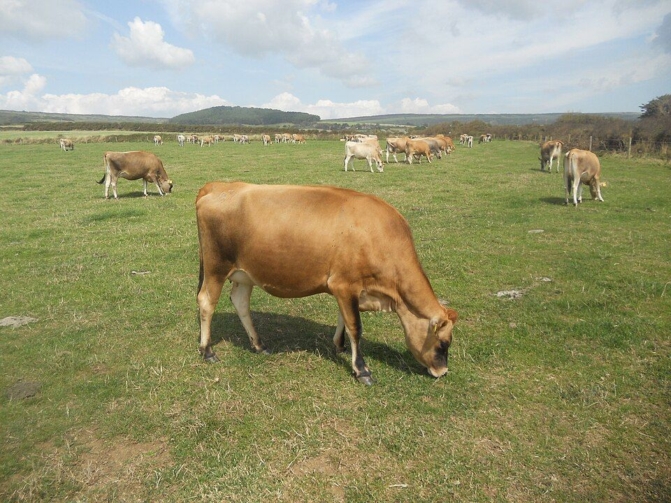
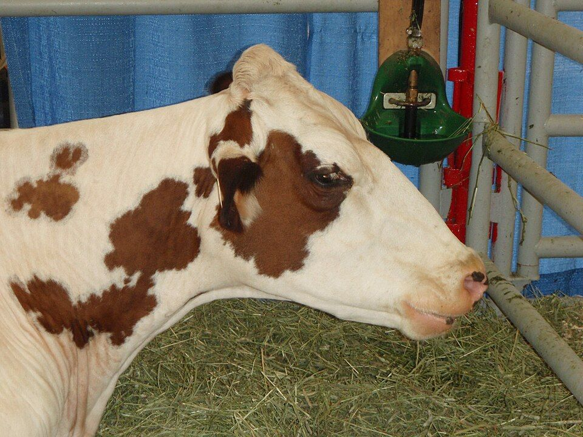
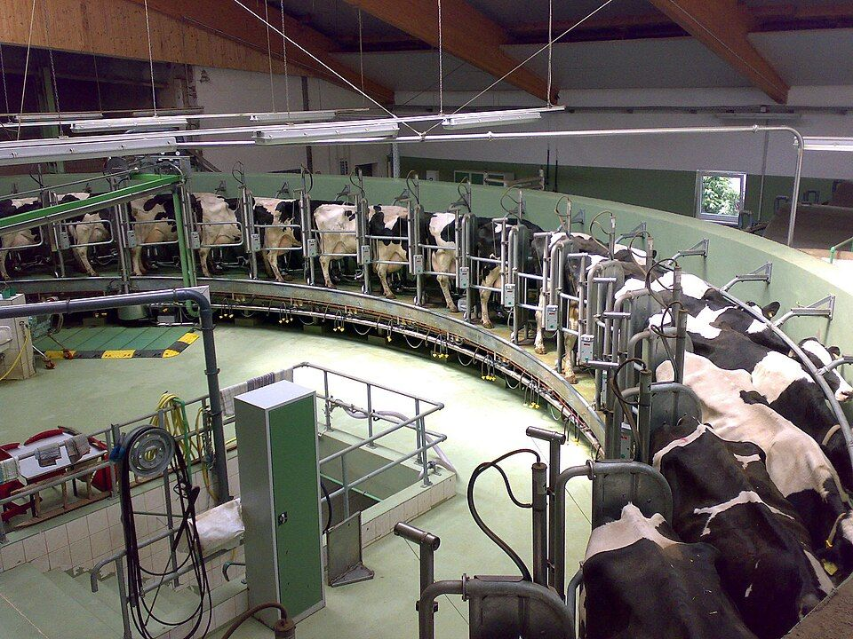
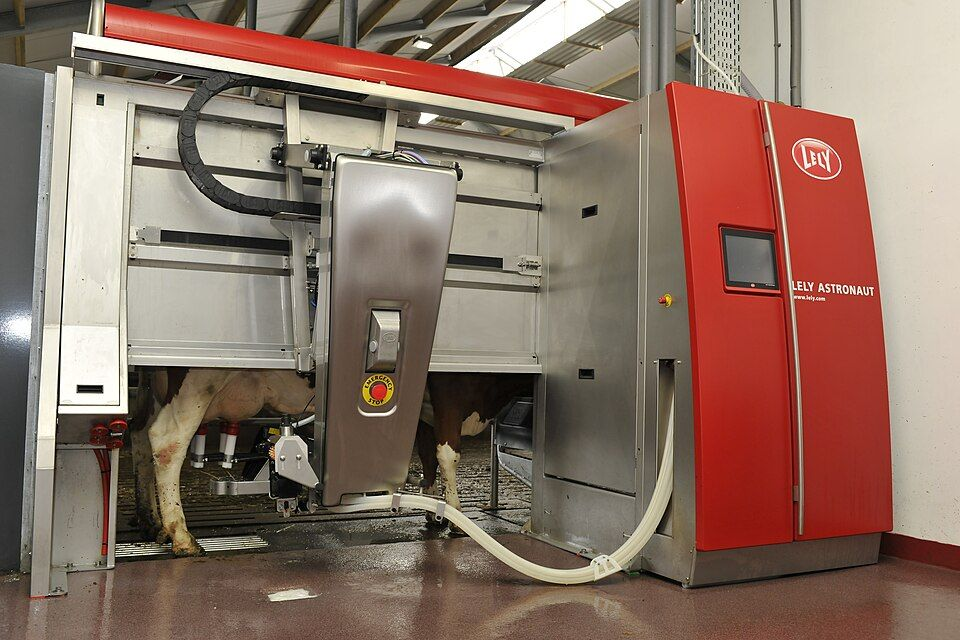
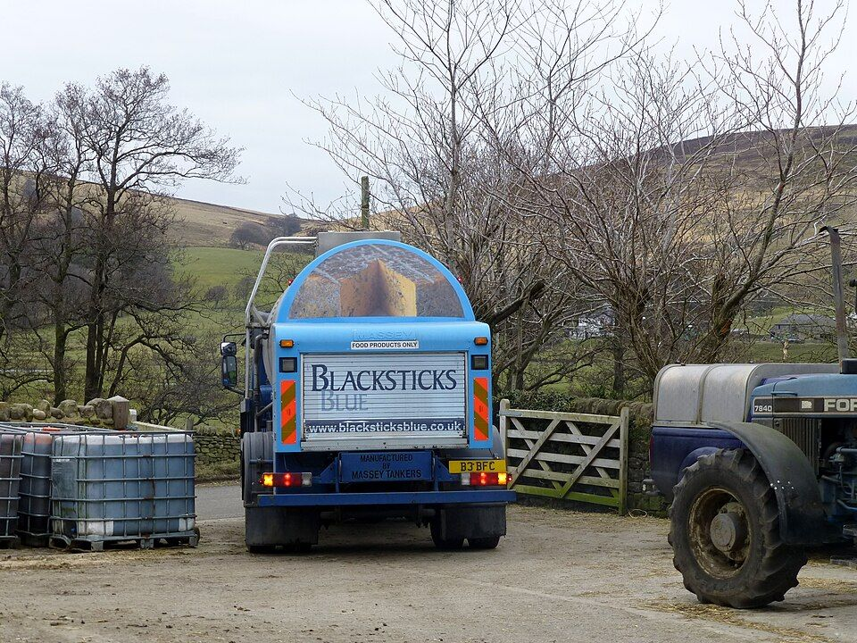
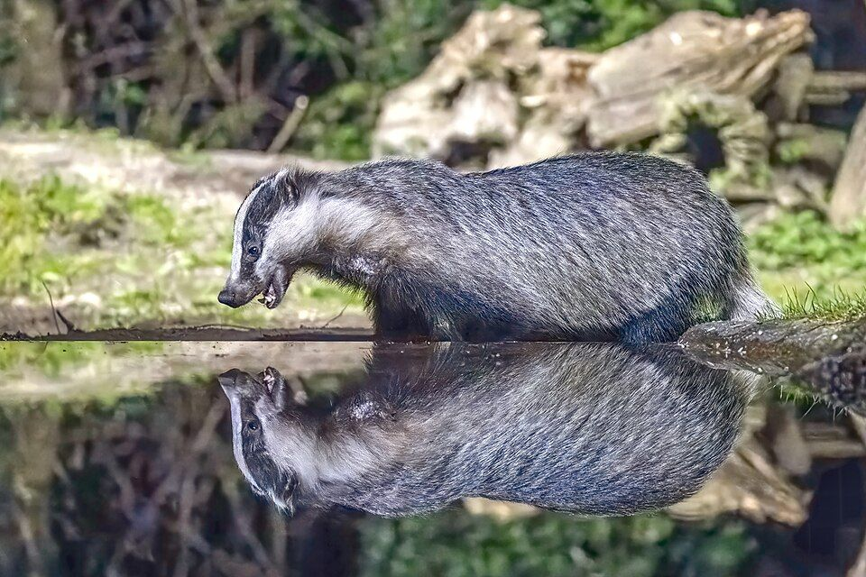

# 7. イギリスの酪農

## この章でわかること

- 数字で見るイギリスの酪農（日本とくらべて）
- 放牧と舎飼い、牛の品種
- 乳の値段と、乳を買う会社（乳業メーカー）
- 搾乳ロボットとセンサー
- いまの悩み（牛の結核、値段、人手、環境）

牛のからだ・繁殖・エサ・乳房炎のことは「牛の教科書」を見てください。この章は、イギリスでどう酪農をしているか、の話です。

## 数字で見る

| 項目 | イギリス（GB） | 日本 |
| --- | --- | --- |
| 酪農家の数 | 6,850戸（2026年4月） | 約1万2千戸（2024年） |
| 搾っている牛 | 約159万頭（2026年4月）。過去最少 | 全体で約133万頭（子牛・育成牛を含む） |
| 1戸あたり | 搾っている牛だけで約230頭 | ― |
| 乳の量 | 約129億 L（2026年7月までの1年） | 約730万トン（約71億 L） |
| 乳の値段（農家が受け取る） | 1 L 約37ペンス（2026年8月、約77円） | 1 kg 120円前後 |

- GB は、イングランド・スコットランド・ウェールズ。北アイルランドの酪農（約3,000戸）は別に数えます
- 酪農家は**5年で約15%減りました**。それでも乳の量は増えています（1頭あたりの乳が増え、群れが大きくなっているため）。日本と同じく「やめる農家が多く、残った農家が大きくなる」流れです
- 1頭あたりの乳は年 8,000 L ほどで、日本（約9,000 kg）より少なめです。放牧が多く、たくさん出すより、安く作ることを大事にする農家が多いためです

## 放牧と舎飼い

イギリスの酪農は、やり方の幅がとても広いのが特徴です。

| やり方 | 中身 | 1頭の乳（年） |
| --- | --- | --- |
| **放牧中心**（春にまとめて分娩） | 春に全頭がいっせいに子を産み、草が伸びる季節にたくさん搾る。ニュージーランド式。エサ代と機械が少ない | 5,000〜6,000 L |
| **夏は放牧、冬は牛舎** | いちばん多いやり方。春〜秋は放牧、冬（11〜3月ごろ）は牛舎でサイレージ | 7,000〜9,000 L |
| **1年中 牛舎**（舎飼い） | 混合飼料（TMR）を与え、1日3回搾ることも。1年中 子を産ませ、乳の量を平らにする | 10,000〜12,000 L 以上 |

- 南西部（デボン・コーンウォール・サマセット）、ウェールズ、北アイルランドは、雨が多く草が良いので、放牧が多い
- 牛舎は、1頭ずつ寝床が区切られた**フリーストール**（cubicle housing）がふつう
- エサの中心は**牧草サイレージ**。南のほうでは、とうもろこしのサイレージも使います

## 牛の品種

| 品種 | 生まれ | 特徴 |
| --- | --- | --- |
| ホルスタイン・フリージアン | オランダ・北ドイツ（イギリスで改良） | 乳がいちばん多い。イギリスの乳牛の大部分 |
| ジャージー | ジャージー島（英仏海峡） | 体が小さく、乳脂肪とたんぱく質が多い。チーズやクリームに向く |
| ガーンジー | ガーンジー島（英仏海峡） | 乳が金色っぽい（カロテンが多い） |
| エアシャー | スコットランド | 丈夫で長生き。放牧向き |
| 交雑種（クロス） | ― | ホルスタインに、モンベリアード・ノルウェーレッド・ジャージーなどをかけ合わせる。丈夫さと繁殖の良さをねらう |

- 放牧中心の農家では、ニュージーランドの小型のフリージアンや、ジャージーとの交雑（キウイクロス）が人気です
- 酪農の牛の雄の子牛や、肉牛の精液をかけた子牛は、肉牛として育てます。イギリスの牛肉の約半分は、酪農の牛から来ています

## 乳を搾る

- **ヘリンボーン・パーラー**（牛が斜めに並ぶ）がいちばんふつう。大きな群れでは**ロータリー**
- **搾乳ロボット**: 牛が好きなときに自分でロボットに入り、ロボットが乳頭を見つけて搾ります。イギリスの酪農家の約1割が使い、**新しく入れる搾乳の機械の約35%がロボット**です。人手が足りないこと、人の費用が高いことが理由です
  - おもなメーカーは、レリー（オランダ、アストロノート）と、デラバル（スウェーデン、VMS）、GEA（ドイツ）
  - 1台で60頭ほど。ロボットは1頭ごとの乳量・乳の成分・体重・歩数などのデータを集めます
  - 牛舎と放牧の両方で使う農家もいて、ロボットに来る時間に合わせて放牧地の区画を変える工夫をしています

## 乳の値段と乳業メーカー

- 日本は指定団体（ホクレンなど）が乳をまとめて売りますが、イギリスは1994年に国のミルク・マーケティング・ボードをやめてから、**農家が乳業メーカーと直接 契約**します
- おもな乳業メーカー

| 会社 | ひとこと |
| --- | --- |
| アーラ・フーズ（Arla） | デンマーク・スウェーデンの協同組合。イギリスの農家も組合員 |
| ミュラー（Müller） | ドイツの会社。牛乳・ヨーグルト |
| ファースト・ミルク（First Milk） | イギリスの農家の協同組合。チーズ |
| サプート・デイリー UK | カナダの会社。チーズ（カテドラル・シティ） |

- **乳の値段は会社ごと・契約ごとにちがい**、毎月のように上がったり下がったりします。世界のバターや脱脂粉乳の値段に引っぱられるためです
  - 2026年は、4月に 1 L 約34ペンスまで下がり、8月に約37ペンスまで戻りました
- スーパー（テスコ、セインズベリーズなど）と組んだ「**アラインド契約**」は、生産費をもとに値段を決めるので、安定して高めです。そのかわり、動物福祉や環境の条件が厳しい
- 多くの農家は、**レッドトラクター**（イギリスの食べ物の安全と品質の認証）を取っています

## いまの悩み

### 牛の結核とアナグマ

- **ウシ結核**（bTB）は、イングランド南西部とウェールズの酪農のいちばん大きな悩みです。検査で陽性の牛が見つかると、その牛は処分し、農場は牛の出荷を止められます
- 野生の**アナグマ**がうつすとされ、イングランドでは2013年からアナグマの駆除をしてきました。動物の保護団体の反対も強く、国を二分する議論でした
- 2026年7月までに駆除の許可はすべて終わり、これからは牛の検査を厳しくすることとアナグマへのワクチンで減らします。結核のある群れの割合は、2026年3月にイングランドで3.3%と、2007年からでいちばん低くなりました。**2038年に結核のないイングランド**が目標です

### 値段・人手・後継ぎ

- エサ・肥料・電気の値段が上がり、乳の値段が下がると、すぐに赤字になります
- 牛の世話と搾乳の人手が足りません。外国の人が多く働いています
- 群れに入る若い雌牛（育成牛）が減っていて、これから乳が減る心配があります

### 環境

- ふん尿（スラリー）をためるタンクの大きさや、まく時期に厳しい決まりがあります。川を汚さないため
- 牛のゲップの**メタン**を減らすことが求められています。2024年に、メタンを減らすエサの添加物（ボベア）を試したアーラの牛乳に、ネットで「買わない」という声が広がりました。環境への取り組みと、消費者の気持ちの間の難しさを示した出来事です

## センサーと AI

- 首輪・足輪・耳標のセンサーで、発情と病気（反すうの減り）を見つけるのは、大きな農家ではふつうになっています

| 製品 | 会社 | 付ける所 |
| --- | --- | --- |
| SenseHub（センスハブ） | MSD アニマルヘルス（もとはイスラエルのSCR） | 首・耳 |
| CowManager | オランダ | 耳 |
| CowScout | GEA（ドイツ） | 首・足 |
| CowAlert | アイスロボティクス（エディンバラ） | 後ろ足 |
| Moocall | アイルランド | しっぽ（分娩の知らせ） |

- **カメラと AI**: 牛舎の通路の上のカメラで、歩き方（**跛行**、足の悪さ）や太り具合（BCS）を毎日 自動で点数にします。ベルファストの **CattleEye**（2024年からドイツの GEA の会社。2026年3月に GEA がベルファストにソフトウェアの研究所を開いた）などがあります。2026年の調査では、農家が「いちばん注目している技術」は、搾乳ロボットより**カメラの AI** でした
- イギリスの乳業メーカーやスーパーは、**跛行の点数（モビリティ・スコア）**を定期的に記録することを求めることが多く、自動で点を付けたい、という需要があります
